<!-- Generated by docs/status/flow_src/build_workflow_md.py from pipeline_flow.en.workflow.json; do not edit by hand -->
# Workflow

How one freight adjustment dispute moves through the system, from the carrier's free text to a reviewer's decision. The system never decides whether a charge should be paid: it produces a structured reading, checks it, and raises flags for a person.

```mermaid
flowchart LR
  subgraph carrier["Carrier"]
    submit["Submit dispute<br/>invoice + free text"]
    pushback["Receives return<br/>via OTM"]
  end
  subgraph code["Processing (code)"]
    read["0-1 Read<br/>keep · redact · inject"]
    nums["2 Number parse<br/>find · number · cover"]
    llminput["Model input<br/>no Delta"]
    tool["4-5 Checks<br/>math · padding · basis"]
    history["5.5 Duplicates<br/>row · invoice · shipment"]
  end
  subgraph llm["Understanding (LLM)"]
    understand["3 Blind parse<br/>agent loop · no Delta"]
  end
  subgraph rules["Flags & recommendation (code)"]
    flags["6a Flags<br/>rules · evidence · → first"]
    draft["6c Return draft<br/>reviewer only, never sent"]
    decide["6b Recommendation<br/>passed · human · return suggested"]
  end
  subgraph assets["Knowledge assets & data"]
    skill["SKILL.md<br/>procedure · examples"]
    taxonomy["Code table<br/>codes · aliases · labels"]
    taxrules["Tools · tax<br/>calc · tax · cases"]
    store["7 Parse store<br/>facts ≠ judgments"]
    rulesyaml["rules.yaml<br/>dups · flags · plain text"]
    catalog["Diagnostics<br/>fixed wording"]
  end
  subgraph reviewer["Reviewer"]
    review["Review UI (end)<br/>decide · reason"]
  end
  submit -->|"OTM Excel export"| read
  read -->|"redacted text"| nums
  nums -->|"numbers + diagnostics"| llminput
  llminput -->|"no Delta"| understand
  skill -->|"procedure"| understand
  taxonomy -->|"codes + aliases"| understand
  understand -->|"readings · claim · math"| tool
  tool -.->|"mismatch: keep or revise"| understand
  taxrules -->|"tax rates"| tool
  tool -->|"attempts + status"| history
  store -.->|"earlier parses"| history
  history -->|"all diagnostics"| flags
  flags -->|"flags"| decide
  rulesyaml -->|"rules"| decide
  catalog -->|"fixed wording"| draft
  decide -->|"if return"| draft
  decide -->|"all three colours"| review
  decide -->|"facts + judgments"| store
  review -->|"reviewer returns"| pushback
  review -.->|"decision · reason"| store
  classDef green fill:#e3f4e6,stroke:#2e7d32,color:#1b3d1f
  classDef yellow fill:#fff6d1,stroke:#b8860b,color:#4d3800
  classDef red fill:#fbe1e0,stroke:#c62828,color:#4a1010
  classDef plain fill:#ffffff,stroke:#8a94a6,color:#1f2937
  class read,nums,llminput,understand,draft,store,catalog,review green
  class tool,history,flags,decide,skill,taxonomy,taxrules,rulesyaml yellow
  class submit,pushback plain
```

Boxes are grouped by who does the work. Solid arrows are the forward flow; dashed arrows go back to an earlier step or to the store. Box colour is the status of the matching card in [`STATUS.md`](STATUS.md):

- Light green: built, run on the dev split, has a deliverable; in-sample evidence only
- Yellow: partly done
- White: a person or outside system, no status card

## Main path, in order

| Step | Who does it | What happens | Card |
|---|---|---|---|
| Submit dispute | Carrier | The carrier submits an invoice adjustment with a free-text explanation in the transportation system; we receive it as an Excel export. | none |
| 0-1 Read | Processing (code) | Code reads each row, keeps it unchanged, redacts names, emails and phone numbers, and marks text that looks like an instruction to the model. | B01 |
| 2 Number parse | Processing (code) | Code finds every number and date in the text, gives each an ID, and checks that every digit is covered. | B02 |
| Model input | Processing (code) | Code builds the model input from the redacted text and the number table; Delta, carrier and Reason Code are left out. | B04 |
| 3 Blind parse | Understanding (LLM) | The model reads the text without seeing Delta and says what each numbered amount is (charge type, claimed or not, supporting words); it can only answer through `submit_line_items`. | B04 |
| 4-5 Checks | Processing (code) | Code checks each submission: every number is accounted for, stated arithmetic holds, quoted words are in the text, and the claimed total is compared with Delta; on a mismatch the model is told once and may keep or revise its reading. | B07 |
| 5.5 Duplicates | Processing (code) | Code looks for the same dispute or the same charge appearing again, by row and by invoice (the shipment and cross-batch levels are optional and not built). | B09 · B08 |
| 6a Flags | Flags & recommendation (code) | Code turns all diagnostics into flags with one of three severities set in `config/rules.yaml`. | B09 |
| 6b Recommendation | Flags & recommendation (code) | Code derives one of three recommendations from the flags (passed checks, human review, return suggested); every record goes to a reviewer whatever the recommendation. | B09 |
| Review UI (end) | Reviewer | The reviewer opens each dispute in a local screen, sees the parse, flags and recommendation, and records a decision with a reason; the screen changes nothing outside our own store. | U2 |

## Side steps

| Step | Who does it | What happens | Card |
|---|---|---|---|
| Receives return | Carrier | If the reviewer decides to return a dispute, they do it themselves in the transportation system; our tool does not contact the carrier. | none |
| 6c Return draft | Flags & recommendation (code) | When a return is suggested, code fills a draft message from fixed wording for the reviewer to edit; nothing is ever sent. | C1 |

## Knowledge assets the steps read

| Asset | Lane | What it is | Card |
|---|---|---|---|
| SKILL.md | Knowledge assets & data | The procedure and worked examples the model follows (`skill/freight-dispute-line-items/SKILL.md`; the examples in the repository are synthetic). | B05 |
| Code table | Knowledge assets & data | The table of charge codes with their names and known phrasings (`config/taxonomy.yaml`). | C3 |
| Tools · tax | Knowledge assets & data | The tools the model may call and the tax-rate table used by the checks (`config/tax_rules.yaml`). | B06 |
| 7 Parse store | Knowledge assets & data | Each run is saved to SQLite and JSON with the parse (facts) kept apart from flags and recommendations (judgments); the downstream export contains only readings that passed the checks. | B10 |
| rules.yaml | Knowledge assets & data | The settings that decide flag severity, duplicate rules and the recommendation order (`config/rules.yaml`). | C2 |
| Diagnostics | Knowledge assets & data | Fixed explanatory wording for every diagnostic code, shown to the reviewer and used in return drafts. | C1 |

## Source

The diagram is generated from [`docs/status/flow_src/pipeline_flow.en.workflow.json`](docs/status/flow_src/pipeline_flow.en.workflow.json) by [`build_workflow_md.py`](docs/status/flow_src/build_workflow_md.py) in the same folder; how to change it is in [`docs/status/flow_src/README.md`](docs/status/flow_src/README.md). An interactive version exists in Chinese only: `docs/status/pipeline_flow.zh.html` (download it and open it in a browser). Longer notes per step (why each step is designed this way) are in [`docs/architecture.md`](docs/architecture.md).
