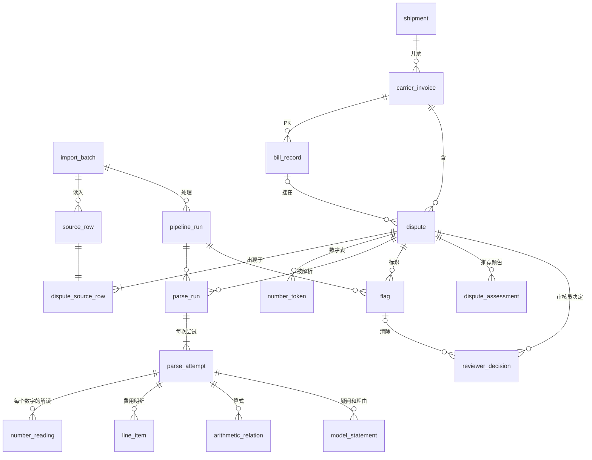

# 06 业务调研、数据关系、schema 基线和留痕设计

日期：2026-11-04。任务书：`docs/tasks/cc_task_06_research_schema.md`。以 `docs/decisions/2026-11-04_framework_decisions.zh.md`（下称"决定记录"，引用写作"决定 3.2"）为准。

## 先看这一屏

**结论**

1. 数据里的编号关系比原来设想的简单：**开发集上一张承运商发票恰好对应一票货**（813 对 813），一票货只有一个承运商、一个运费金额；PK 和 `Invoice/Bill ID` 一一对应，一张承运商发票下有 1、2 或 8 个 PK（B1）。
2. "一笔争议挂在多个 PK 下"有 22 组 62 行（3 组各 8 行，19 组各 2 行），全部集中在 10 票货，形态都是"行数 = 争议数 × PK 数"。之前合并掉的 45 行用的五个字段已经把这 22 组全部合并，908 这个数和 01b 的统计**没有因此被高估**（B2）。
3. **PK 编号日期晚于 Event Date 是常态**，不是那一例特有：631 行有 PK 的行里 519 行晚于 Event Date（中位数晚 9 天），120 行晚 30 天以上。但在"只有 PK 不同"的组里，晚 30 天以上的比例高得多（50/62 对其他行 70/569）（B2）。
4. `US/CAN` 这一栏 953 行全是 `US`，按起讫省州推国家后 87.2% 不一致（B4）。
5. 算 CO 金额占比要的 Delta 和运费在数值上都完整（无空值，`Invoice Amount = Shipment Amount + Delta` 全部成立），但口径有三处没定：运费含不含燃油、跨版本的 Delta 能不能相加、副本要不要先去掉（B5）。
6. schema v0 **18 张表**，分五层：原样（Excel 行）、事实（我们的解析结果）、判断（标识、推荐）、人（审核员决定）、过程（批次、运行、每次尝试）。和任务书草稿的主要区别：**副本不合并**，每份是一笔独立争议，用标识指向第一份（决定 5.3）；之后批次重新导出的同一行不算副本，只加一条关联；模型的每次尝试、每个数字的解读、算式、模型自己写的话各有一张表。
7. 任务 05 的报告在 `docs/analysis/` 下不存在，**任务 05 结果未纳入**；B3 里依赖它的结论标为"待核实"。

**schema v0 的表关系**



**调研的主要结论（A 部分）**：没有成熟的开源运费审计 schema；EDI 210 的 L1 行和 OTM 的发票行可以直接借用"数量 × 费率 = 金额、每个金额带币种、代码 + 描述"的结构，但它们的文字字段只有 25 到 120 个字符，没有"原文层与解读层分开""原文片段位置""模型尝试留痕"这些东西，需要自建（A4.4）。X12 不同版本的附加费代码不同，外部代码要连同代码体系和版本一起存（A4.1）。

**依赖调研结论的地方**：审核界面每类费用的"通常需要核实什么"提示（A1、A2）；为了以后能算承运商指标而保留的字段（A3，决定了 `shipment.shipment_amount`、`carrier_invoice`、`reviewer_decision` 必须有）；表的划分参考了 EDI 210 和 OTM 的发票—明细—附加费结构（A4）。

**依赖 Jake 回答的地方**：schema YAML 里标了 11 处 `[待 Jake]`（8 个字段、3 处查重规则），涉及 J1、J2、J3、J4、J6、J7、J9、J10；另有 J5、J8、J11 到 J14 影响规则或界面但不改表结构。C5 一共列了 14 条，覆盖 J1 到 J14。最关键的是 **J1**（PK、Invoice/Bill ID、承运商发票号各是什么，多 PK 是导出复制还是真实的多次 change order）：它不改变表的划分，但决定行层面查重的标识是"提示"还是"标红"更合适。

---

## 第 A 部分：行业资料调研（公开来源）

> 调研日期：2026-11-04。只用公开网页；检索词只用通用行业术语，没有使用任何客户数据（承运商名、地址、金额、原文、内部 ID、客户公司名）。
> 可信度分四档：**行业标准文件**（X12、OASIS UBL、NMFTA、政府税务/能源机构）/ **厂商文档**（软件厂商、承运商公开文件）/ **行业文章**（审计服务商、物流公司博客）/ **论坛**（社区问答、个人开源仓库）。
> 标"（摘要）"的来源只通过搜索引擎摘要读过，没有抓取全文，引用时降一档使用。凡是 X12/OTM 代码，只列在抓取页面上实际看到的；没看到的标"未核实"。
> 本部分只讨论**某一类费用通常靠什么证据核实**，不涉及任何单笔费用是否应付。

---

### A1 审核员确认每一类费用时看什么

**读法**：每类一行。"行业通常要求的证据"来自所引来源；"可能出现在承运商自由文本中的要素"是我们的推断（没有来源专门研究过承运商解释文本里写什么），用来指导抽取字段的设计。代码列只放已核实的 X12 004010 元素 150（L1-08）代码 [7]，以及 project44 代码 [22]。

#### A1.1 司机/车辆等待（driver detention）

| 项目 | 内容 |
|---|---|
| 行业通常要求的证据 | 预约时间；到达/签到时间；免费等待时间（free time）到期时刻；装卸开始与结束时间；放行/离开时间；BOL 或 POD 上签字的进出时间；运价确认单里约定的免费时长、每小时费率、计费增量、上限，以及"免费时间到期前须通知"之类条款；可选 ELD/GPS/地理围栏记录 [32][34] |
| 补充 | ELD/轨迹数据能证明到达和离开，但单独不能证明预约时间、延误原因或可计费区间 [32]。免费时间常见 2 小时，但没有联邦规定，以合同为准 [34]（摘要） |
| 文本中可能出现的要素 | 到达/离开时刻、等待总时长、免费时长、可计费小时数、每小时费率、计费增量（如 15/30/60 分钟）、地点（起运地/目的地）、预约号或签到号、"已通知"时间 |
| 可核对的算术关系 | (离开 − 到达 − 免费时长) × 费率 ≈ 金额；按增量取整 |
| 已核实代码 | X12：DET "Detention of Trailers"、DTL "Detention Loading"、DTU "Detention Unloading"、TDT "Truck Detention"、SDC "Special Detention Charge"、WTG "Waiting Time" [7]；EDI2XML 另列 DPU（30 分钟计）、DWP（60 分钟计）、DETO/DETD（起运地/目的地）[9]，在 Stedi 4010 页面上未逐一核对；project44：DET "Detention"（Charge Code）[22] |
| 时间戳的标准来源 | EDI 214 AT7 状态码：X3 到达提货点、X1 到达交货点、CP 提货点装完、D1 交货点卸完、AF 带货离开提货点、CD 离开交货点 [6]；G62 日期限定符如 77/78 提/送货预约日、86 实际提货日、35 送达日 [5] |

#### A1.2 装卸工费（lumper / unloading labor）

| 项目 | 内容 |
|---|---|
| 行业通常要求的证据 | **装卸收据**是核心，没有收据通常不报销；收据应显示场站名称、日期、拖车号、服务方、金额，并随 POD 一起提交；也有要求 BOL 上注明 [35]（摘要） |
| 文本中可能出现的要素 | 收据号/票据号、装卸服务方名称（需脱敏）、金额、日期、托盘数或件数、"代垫/pass-through"字样 |
| 可核对的算术关系 | 收据金额 = 账单金额（代垫类通常不加价，是否加管理费看合同） |
| 已核实代码 | X12 4010：LOA "Loading (Labor Charges)"、UNL "Unloading (Labor Charges)" [7]；没有核实到名称含 "lumper" 的 X12 代码（EDI2XML 把 LOA 写成 "...or Lumper Free"，与 Stedi 不一致 [9]）；project44：LUMPER "Lumper Service" [22] |

#### A1.3 车辆已派未用（TONU / dry run / truck ordered not used）

| 项目 | 内容 |
|---|---|
| 行业通常要求的证据 | 书面取消通知及其时间；合同里的取消时限（样例条款有提货前 2/4/6 小时）；派车时间；到场证明（GPS 时间戳、照片）；运价确认单中的 TONU 条款（金额、触发条件、所需证明）[33]（全文）；行业摘要还提到司机书面说明、拒收通知 |
| 文本中可能出现的要素 | 取消时刻、原定提货时刻、两者间隔、取消方、原因（货未备好、场站关闭、设备不符）、空驶里程、是否已到场 |
| 可核对的算术关系 | 原定提货时间 − 取消时间 < 合同时限；若按里程补偿，里程 × 单价 |
| 已核实代码 | X12：VOR "Vehicle Ordered but Not Used"、CAA "Cancellation Charge" [7]；EDI2XML 另列 WFT "Wasted/Futile Trip"、ATP "Attempted Pickup" [9]；"dry run" 没有对应代码 |

#### A1.4 过夜滞留（layover）

| 项目 | 内容 |
|---|---|
| 行业通常要求的证据 | 原预约与改期确认、拒收或延误记录、到场尝试记录、沟通记录；运价确认单中的日费率和触发条件（样例：超出预约 24 小时后按日计）[36]（摘要） |
| 和 detention 的区别 | detention 按**小时**，layover 按**天**；同一票货可以两者都有 [36]（摘要）。审核时要防止同一段时间被两类重复计费 |
| 文本中可能出现的要素 | 原定日期、实际装/卸日期、天数、日费率、改期原因 |
| 已核实代码 | X12：LAY "Layover Charges"、LYC "Layover Service Charge" [7] |

#### A1.5 改址/改收货人（reconsignment / diversion / redirect）

| 项目 | 内容 |
|---|---|
| 行业通常要求的证据 | 托运方或收货方发出的改址指令（时间、发起人）；新旧目的地；BOL 变更记录。行业文章称改址费通常分两部分：改单的管理费 + 若不在原站点交货而产生的额外运输费，可能另有标记/贴签费 [37]（摘要） |
| 文本中可能出现的要素 | 新旧收货地（城市/省）、指令日期、额外里程、管理费与运费两段金额 |
| 可核对的算术关系 | 总额 = 管理费 + 追加运费；追加运费 = 里程 × 费率 |
| 已核实代码 | X12：RCC "Reconsignment Charge"、DIV "Diversion and Reconsignment" [7]；EDI2XML 另列 DIC、RCD、RDC [9]；project44：RECON "Reconsignment Fee" [22] |

#### A1.6 燃油附加费（fuel surcharge, FSC）

| 项目 | 内容 |
|---|---|
| 行业通常要求的证据 | 合同指定的燃油指数来源（美国 EIA 周度柴油价，全国或 PADD 分区）；**取哪一周**的规则（如"提货日当天或之前的周一"）；基准价（peg，附加费为 0 的价格）；整车按里程公式时的 MPG；LTL 用的分档表及其版本和生效日；里程（以运价确认单为准）；LTL 的计费基数（折后干线运费，是否含杂费）；取整规则 [30] |
| 常见差错（类别层面） | 用了发票日而不是提货日对应的周；全国价和分区价混用；用了承运商新表而不是合同版本；里程多于运价确认单；百分比套在毛运费或合同排除的杂费上；在单独通知里重复收取 [30] |
| 指数事实 | EIA 每周发布美国公路柴油价（含税），有全国和 PADD1–5 等分区 [29]。加拿大合同多参考加拿大自然资源部（NRCan）周度零售柴油均价 [49]（摘要）；NRCan 官方页面未抓到，发布日、城市数**未核实** |
| 文本中可能出现的要素 | 指数周/日期、指数价格（$/gal 或 ¢/L）、基准价、附加费率（%或每英里/公里）、计费基数金额、里程/公里数、表版本 |
| 可核对的算术关系 | 整车：(指数 − 基准价) ÷ MPG × 里程；LTL：基数 × 分档百分比 |
| 已核实代码 | X12 4010 与 8010：405 "Fuel Surcharge"、FUE "Fuel Charge" [7][8]。**FSC 在 Stedi 的 4010 和 8010 元素 150 列表中都不存在** [7][8]，EDI2XML 列有 FSC "Fuel Surcharge" [9]，可能是某些伙伴的扩展用法，应视为非标准。project44：FSC "Fuel Surcharge"（Charge Code）[22] |

#### A1.7 尾板（liftgate）及同类交付条件费（住宅、受限地点、室内交付、预约）

| 项目 | 内容 |
|---|---|
| 行业通常要求的证据 | BOL 或交货回单上要能体现该条件；尾板费在交货回单显示收货方无月台时才成立；住宅费在 BOL 收货地址为商业地址时不成立 [31] |
| 文本中可能出现的要素 | 交付条件描述（无月台、住宅、学校/工地等受限地点、室内/楼层）、提货端还是交货端、次数、预约号 |
| 已核实代码 | X12：LFT "Lift Gate (Truck) or Forklift Service at Pick-up/Delivery"、IDL "Inside Delivery"、RES "Residential Delivery"、APT "Appointment (Notification)" [7]；受限地点在 X12 列表中**未找到**对应 [9]；project44：LGPU/LGDEL、INDEL、RESPU/RESDEL、LTDPU/LTDDEL、APPTPU/APPT/APPTDEL、NOTIFY [22] |

#### A1.8 再次派送（redelivery）

| 项目 | 内容 |
|---|---|
| 行业通常要求的证据 | 首次派送尝试的记录（时间、未能交货原因）、收货方通知记录、再次派送的请求。某 LTL 承运商规则费率表规定：派送被拒后再收到请求的，按再派送条款计费 [39]（摘要）。公开来源**没有**明确列出"派送尝试"要保留哪些证明，这一点未核实 |
| 文本中可能出现的要素 | 首次尝试日期/时间、失败原因（关门、拒收、无预约、缺设备）、再派送日期、按重量计费的费率（如每百磅）与最低收费 |
| 已核实代码 | X12：RCL "Redelivery" [7]；EDI2XML 另列 ATD "Attempted Delivery" [9]（Stedi 4010 页面上未见）；EDI 214 AT7：AH "Attempted Delivery"、A7 "Refused by Consignee" [6]；project44：CREDEL "Redeliver to Consignee" [22] |
| 注意 | NMFTA 的 PFC 事件码里也出现 "RCL"[23]，页面未定义其含义；同一字母组合在不同标准中可能含义不同，代码必须带"代码体系"字段 |

#### A1.9 仓储/堆存（terminal storage）与集装箱/设备滞留（per diem）

| 项目 | 内容 |
|---|---|
| 行业通常要求的证据（LTL 场站仓储） | 到货通知时间（或首次派送尝试时间）；免费期（承运商费率表例：通知后次一工作日起计；或首 24 小时免费）；计费天数；按天/按托盘/按重量的费率 [39]（摘要） |
| 行业通常要求的证据（海运集装箱滞留，若遇到） | 美国 FMC 规则 46 CFR 541.6 要求账单列出免费天数及起止日、可提箱日或最早还箱日、具体计费日期、提单号和箱号等 [摘要，未抓取法规原文，**未核实**] |
| 文本中可能出现的要素 | 到货/通知日期、免费天数、计费天数、日费率、托盘数、箱号/拖车号 |
| 可核对的算术关系 | (结束日 − 开始日 − 免费天数) × 日费率 × 单位数 |
| 已核实代码 | X12：SRG "Storage"、STR "Storage in Transit"、CHE "Chassis Equipment Lease Charge" [7]；EDI2XML 另列 ISO/IST 联运堆存 [9]；X12 和 project44 都没有找到 per diem 的专门代码；project44：STORAGE "Storage"（Charge Code）[22] |

#### A1.10 运价/重量更正（rate correction：基础费率、重量、燃油档、区域系数、合同）

| 项目 | 内容 |
|---|---|
| 重量更正的证据 | 承运商出具的**重量/检验证书**（W&I），列实测重量/尺寸、更正后等级、所引 NMFC 条目，常附照片 [40]（摘要）；对比 BOL 申报重量；托运方反证通常是经认证的地磅票 [31] |
| 等级更正的证据 | BOL 原申报等级、商品描述、密度计算；合同常要求承运商提供带照片和密度测量的书面检验证书 [31] |
| 费率更正的证据 | 合同/运价协议（MRA）或运价确认单中的费率、生效日、最低收费条款 [31]；OTM 里对应"关税/合同引用"字段（Tariff Reference Number、Tariff Effective Date 等）[10] |
| 文本中可能出现的要素 | 原重量与新重量、原等级与新等级、原费率与新费率、证书号、NMFC 条目号、合同号/报价号、生效日 |
| 可核对的算术关系 | 差额 = (新费率 × 新计费量) − (原费率 × 原计费量)；燃油随基数变化联动 |
| 已核实代码 | X12：WTV "Weight Verification Charge"、SCL "Scale Charge"、MIC "Minimum Charge"、DSC "Discount" [7]；没有找到名为 "reweigh" 的 X12 代码 [9]；project44：WINSPC "Weight Inspection" [22]；NMFTA PFC 事件码 RWE（页面未定义，推测为 reweigh，**未核实**）[23] |

#### A1.11 加拿大运输税（GST/HST/PST/QST）

| 项目 | 内容 |
|---|---|
| 规则要点 | 国内货运服务的供应地按**目的地**定："a supply of a freight transportation service is made in a province if the destination of the service is in the province" [42]；目的地在 HST 参与省（新不伦瑞克、纽芬兰与拉布拉多、新斯科舍、安大略、爱德华王子岛）按该省 HST，其余省份/地区 5% GST [41]；连续入境/出境货运和联运承运商之间的服务通常零税率，需托运方声明等书面证据 [41] |
| QST | Revenu Québec：目的地在魁北克的货运服务一般视为在魁北克供应；从加拿大其他省运入魁北克的视为在魁北克以外供应，不收 QST（由魁北克居民自行计税）[43]（摘要，官方页面抓取返回 403） |
| 证据 | 起运地、目的地（省）、是否连续国际货运的一部分、承运商税号；CRA 页面**没有**说明发票必须列哪些字段，未核实 [41] |
| 文本中可能出现的要素 | 税种名、税率、计税基数、税额、省份缩写 |
| 可核对的算术关系 | 税额 ≈ 税基 × 税率；税率与目的地省份一致；税基是否包含燃油和杂费 |
| 已核实代码 | X12 4010：GST "Goods and Services Tax Charge"、TAX "Tax Charge"；HST、PTX 在 4010 中**不存在** [7]；X12 8010：HST "Harmonized Sales Tax"、PTX "Provincial Sales Tax"、QST "Quebec Sales Tax" [8]。OTM 行项目有 VAT 区，说明可用于加拿大省级税 [10] |

#### A1.12 其余类别（证据资料较少）

| 类别 | 已知证据要点 | 已核实代码 | 状态 |
|---|---|---|---|
| 干线基础费、最低收费 | 合同费率、最低收费条款、BOL [31] | MIC、DSC [7] | 部分核实 |
| 危险品 | 危险品申报（BOL 上的危险品信息）；EDI 210 有 H1/H2 危险品段 [1] | HAZ [7]；project44 HAZM [22] | 证据要求未核实 |
| 防冻 | 无公开证据要求 | PSC "Protective Service - Cold"、DFD [7]；project44 PFZ [22] | 未核实 |
| 分拣/分隔 | 无公开证据要求 | SEG "Segregating (Sorting)" [7]；project44 SORTPU/SORTDEL [22] | 未核实 |
| 保税（in-bond） | 无公开证据要求 | 4010：BND "Bond Charges"、CUS "Customs Charge" [7]；project44 BOND [22] | 未核实 |
| 特殊派送 | — | 685 "Special Delivery" [7] | 未核实 |
| 封路 | 未找到任何代码或证据资料 | — | 未核实 |
| 港口费、预提箱（pre-pull） | EDI2XML 列有港口/码头类代码；pre-pull 没有找到代码 [9] | — | 未核实 |
| "purchased transportation surcharge"（PENDING） | 按检索约束，没有用这个短语检索（它出自我们的数据），含义仍然**未知** | — | 不在本轮范围 |

---

### A2 容易被滥用或出错的费用类别（审核界面提示用）

只描述类别层面的风险，写成提示语，不对任何单笔费用下结论。

| 类别 | 资料中提到的风险 | 审核界面提示（"这类费用通常需要核实什么"） | 来源 |
|---|---|---|---|
| 杂费整体 | 首次自查的托运方常发现 5–15% 的杂费计错或用了与合同不符的费率；同一承运商对有月台的地点反复收尾板费，属于计费模式而非偶发错误 | 这类费用通常需要核实：合同是否约定该杂费、BOL/回单是否体现触发条件 | [38]（摘要） |
| 杂费：已收费但从未下单 | 开源审计工具专门有"杂费已收但从未下单"规则 | 通常需要核实：下单/BOL 时是否请求了该服务 | [27]（摘要） |
| 杂费：同一服务计两次 | 开源审计工具第一版漏掉的正是"一次服务计两次"；修正后按代码数单位数并比对合同单价 | 通常需要核实：同一代码在同一运单上的次数是否与服务次数一致 | [26]（摘要） |
| 等待费 | 没有时间戳或免费期条款时，经纪商常拒付 | 通常需要核实：到达/离开时间、免费时长、费率与计费增量、通知时间 | [32][34] |
| 过夜滞留 vs 等待费 | 两类可在同一票共存 | 通常需要核实：两类的计费时段是否重叠 | [36]（摘要） |
| 装卸工费 | 无收据通常不报销 | 通常需要核实：收据号、金额、日期与场站 | [35]（摘要） |
| 已派未用 | 口头取消事后难以证明 | 通常需要核实：取消时间与合同时限、取消方、到场证明 | [33] |
| 燃油附加费 | 指数周、分区、表版本、里程、计费基数出错；在单独通知中重复收取 | 通常需要核实：指数周和价格、基准价、表版本、里程或计费基数 | [30] |
| 尾板/住宅/室内/受限地点 | 回单或 BOL 若显示有月台或商业地址，则条件不成立 | 通常需要核实：BOL 收货地址类型、回单上的条件记录 | [31] |
| 重量/等级更正 | 证书缺照片或尺寸；托运方磅单冲突 | 通常需要核实：检验证书号、实测与申报重量、NMFC 条目 | [31][40] |
| 改址 | 管理费与追加运费两段，后者可能高达原运费 | 通常需要核实：改址指令来源与时间、新旧目的地、是否两段分列 | [37]（摘要） |
| 仓储 | 起算日依赖到货通知时间 | 通常需要核实：通知时间、免费期、计费天数 | [39]（摘要） |
| 加拿大税 | 税率取决于目的地省；连续国际货运可零税率 | 通常需要核实：目的地省份与税种/税率是否一致、税基 | [41][42] |
| 整张发票重复 | 承运商以新发票号重开同一账单，所以只按发票号查重不够 | 通常需要核实：同一承运商 + 运单号/BOL + 金额 + 日期是否已出现过 | [45] |

---

### A3 评价承运商的常用指标（只存字段，不打分）

| 指标 | 公式（来源原文或直译） | 计算所需字段 | 来源 |
|---|---|---|---|
| 发票准确率（invoice accuracy rate） | 无异常发票数 ÷ 发票总数 | invoice_id、carrier_id、是否有异常（flag 计数 > 0）、审核期间 | [45]；[44] 只有文字定义 |
| 行级计费准确率 | 与费率卡一致的行数 ÷ 总行数（目标带：≥98% 绿 / 95–98% 黄 / <95% 红） | line_id、invoice_id、charge_code、billed_amount、contract_amount（我们没有合同，只能存"与原文/Delta 一致"的替代口径） | [46]（摘要） |
| 异常率（exception rate） | 需人工调查的发票 ÷ 处理发票总数 × 100 | invoice_id、是否进入人工复核、处理时间 | [44] |
| 首次匹配率（first-pass match rate） | 无需人工干预即匹配成功的发票占比（来源无公式） | invoice_id、首次自动匹配结果、是否有人工改动（审计轨迹） | [44] |
| 免触达处理率（touchless rate） | 全自动处理发票 ÷ 发票总数 × 100 | invoice_id、是否有人工操作记录 | [44] |
| 重复开票/重复付款率 | 重复提交或重复付款的频率（来源无公式）；可操作化为：被判重复的记录 ÷ 记录总数 | carrier_id、invoice_number、pro_number、bol_number、shipment_id、amount、currency、shipment_date、重复组 ID 与重复层级 | [44][45] |
| 杂费占比 | 杂费占运费比例（[44] 无公式）；"Accessorial Charges as % of Base Rate" [47]；"accessorial ratio" 以总运费为分母 [48]。**分母有两种口径，存数时必须标明** | line category（LINEHAUL/FUEL/ACCESSORIAL/…）、line amount、currency、carrier_id、shipment_id | [44][47][48]（后两者摘要） |
| 超收率（overcharge rate） | 识别出的超收 ÷ 总运费 × 100 | 涉及应付判断，**不在本项目范围**，只列出不存 | [44] |
| 追回率/追回成功率 | 追回金额 ÷ 总运费；追回 ÷ 争议金额 | 同上，不在范围 | [45] |
| 争议频率、争议金额、平均处理时长 | 来源只列名称，未定义"争议率"公式 | dispute_id、carrier_id、创建时间、关闭时间、涉及金额、币种 | [44] |
| 按线路的承运商准确率 | 每条线路上无异常发票的比例 | carrier_id、起运地/目的地（省或城市级）、invoice_id、是否有异常 | [45] |
| 发票处理周期 | 收到到批准/付款的时间（来源无公式） | received_at、各状态时间戳 | [44] |

**字段层面的结论**：要支撑上述指标，每条记录至少要有 carrier_id、shipment_id、invoice_number、pro/BOL 号、日期、金额、**币种**、费用类别、异常标记、重复组、人工操作时间戳。"是否应付"类指标（超收率、追回率）不存。

---

### A4 现有标准和开源方案

#### A4.1 X12 EDI 210（Motor Carrier Freight Details and Invoice，004010）

**段结构（与我们相关的部分）**[1]

| 区域 | 段 | 作用 | 对我们的意义 |
|---|---|---|---|
| 表头 | B3 | 发票号（B3-02）、运单号（B3-03）、付款方式、开票日（B3-06）、**净应付额**（B3-07）、**更正标志**（B3-08）、送达日（B3-09）、SCAC（B3-11）[3] | B3-08 可区分原票和更正票，用于重复/版本判断 |
| 表头 | C3 | 币种 [1] | 发票级币种 |
| 表头 | N9（≤300） | 参考号（BOL、PO 等）[1] | 多种参考号，跨记录关联 |
| 表头 | G62（≤6） | 日期/时间：G62-01 日期限定符、G62-03 时间限定符、G62-04 时间 [4] | 预约、提货、送达时间 |
| 表头 | K1（≤10） | 备注 [1] | 唯一的自由文本位置之一 |
| 表头 | N1 循环（N1/N2/N3/N4/N9） | 当事方名称与地址 [1] | 起运地/目的地省份（用于税） |
| 明细 | S5 循环（S5、N9、G62、H3） | 经停点及其日期时间 [1] | 每个经停点的时间，用于等待费 |
| 明细 | LX 循环（≤9999）：LX、N9、POD、L5、H1/H2、**L0**、**L1**、L4、L7、K1 | 每个计费行 [1] | 一行费用对应一个 LX（有的伙伴要求一个 L1 一个 LX，摘要） |
| 汇总 | L3 | 总重量与总金额 [1] | 行合计校验 |

**L1（Rate and Charges）关键元素** [2]

| 元素 | 含义 |
|---|---|
| L1-02 / L1-03 | 费率 / 费率限定符（成对出现） |
| L1-04 | 金额（该行运费或杂费） |
| L1-08（元素 150） | **Special Charge or Allowance Code**，3 位，4010 共 1073 个代码 |
| L1-12（元素 276） | Special Charge Description，**仅 2–25 个字符**，在 150 中找不到合适代码时使用 |
| L1-17 / L1-18 | 计费数量 / 计费数量限定符（里程、重量、体积等） |
| L1-19 | 百分比（用于算出 L1-04，例如燃油百分比） |
| L1-20 | 币种（作用于本 L1 所有金额） |

**代码版本差异（已核实）**：4010 有 405 "Fuel Surcharge"、GST，没有 HST、PTX [7]；8010 增加了 HST、PTX、QST [8]；两个版本都没有 FSC [7][8]，但第三方列表收录了 FSC [9]。所以代码必须记录**代码体系和版本**。

**EDI 214/990/997**：214 的 AT7 状态码（X1、X3、AF、CD、CP、D1、AH、A7）提供到达、装卸完成、离开、尝试派送、拒收的时间戳，是等待费、再派送证据的标准来源 [6]。990（承运商对派车单的接受/拒绝）可能与 TONU 有关，但本轮**未核实**其字段。997 只是功能确认回执，与证据无关（常识，**未抓取核实**）。

#### A4.2 Oracle Transportation Management（OTM）公开文档

| 主题 | 公开文档内容 | 来源 |
|---|---|---|
| 发票行字段 | 行序号、Freight Charge（= Billed As Quantity × Freight Rate Value）、Cost Type、Description（≤120 字符）、Accessorial Code ID、Accessorial Description、Adjustment Reason、Freight Rate Qualifier、Billed As Quantity/Qualifier、Weight、Remarks、Reference Number + Qualifier、Tariff 引用（含生效日）、VAT（含加拿大省级税）、General Ledger Code | [10] |
| Cost Type 代码 | B 基础费、D 折扣、A 杂费、S 经停、C 绕行、**L 差额（Delta）**、O 其他 | [10] |
| 行匹配状态 | UNMATCHED、MATCHED、MATCHED_IN_TOLERANCE、MATCHED_OUT_OF_TOLERANCE、UNMATCHED_IN_TOLERANCE、UNMATCHED_OUT_OF_TOLERANCE | [10] |
| 超容差明细 | 超出金额、偏差、原因代码（Above/Below Allowable Amount/Percentage） | [10] |
| 行与运单成本关联 | Invoice Line Item Cost References：可关联订单行、运单经停、运单单元、成本序号等 | [10] |
| 容差规则 | 按 Cost Type × Accessorial Code × 总账代码 × 付款方式组合设定上下浮动百分比/金额，取更严者；例：燃油附加费行可比运单成本高 5% | [11] |
| 发票级审批规则 | 将发票与已匹配运单的成本和重量比较；默认规则 + 明细规则；百分比基于运单或发票可配置 | [12] |
| 重复判定 | 非贷项通知的发票若匹配到已有发票的运单，MATCH 状态变为 MATCH_NON_ORIGINAL_INVOICE；贷项通知则进入 PROCESS_HOLD，不算重复 | [13] |
| 发票状态类型 | APPROVAL、INVOICE MODIFIED、MATCH（含 Non_original_invoice、Multiple_shipment_match 等）、PROCESS（Hold）、VAT_CALCULATION；没有专门的"争议"状态 | [14] |
| 金额与币种 | REST 接口中金额是 currencyType 对象（ISO 4217 币种 + 数值），每个金额单独带币种；还有 exchangeRateDate、exchangeRateGid；INVOICE_LINEITEM 表本身带币种字段 | [15][19] |
| 数据表名 | 社区论坛列出发票相关表：INVOICE、INVOICE_LINEITEM、INVOICE_INVOLVED_PARTY、INVOICE_REMARK、INVOICE_SHIPMENT、INVOICE_STOP、INVOICE_STATUS、INVOICE_REFNUM、VOUCHER | [16]（论坛，摘要） |
| ACCESSORIAL_CODE 表 | 6.3 数据管理指南列有 ACCESSORIAL_CODE_GID、ACCESSORIAL_CODE_XID、ACCESSORIAL_DESC、APPLY_GLOBALLY、DOMAIN_NAME、IS_FLOW_THRU、IS_VAT_EXEMPT | [17]（摘要，PDF 未能解析） |
| INVOICE_SHIPMENT | REST 子资源含 lineitemSeqNo、shipmentGid、trackingNumber 等，说明发票行可直接关联运单 | [18]（摘要） |
| 完整列定义 | INVOICE_LINEITEM、INVOICE_REFNUM 的完整列表需要 OTM Data Dictionary，公开网页上**没有找到** | — |

**注意范围**：OTM 的审批、凭证、超收部分属于付款决策，本项目只能借鉴它的**数据结构**（行、代码、匹配状态、差额类型），不能借鉴审批语义。

#### A4.3 其他标准与开源方案

| 方案 | 有什么 | 成熟度 | 来源 |
|---|---|---|---|
| OASIS UBL 2.1 `cac:AllowanceCharge` | ChargeIndicator（收费/折让）、AllowanceChargeReasonCode（0..1）、AllowanceChargeReason（文本，0..*）、MultiplierFactorNumeric、Amount、BaseAmount、PerUnitAmount、TaxCategory、SequenceNumeric | 国际标准，欧洲 Peppol 强制使用；不是货运专用 | [20] |
| Peppol BIS Billing 3.0 | 收费原因码用 UNCL7161，折让用 UNCL5189；代码与文本须表示同一原因 | 成熟。**UNCL7161 中货运相关的具体代码本轮没有抓到，未核实** | [21]（摘要） |
| project44 参考代码 | LTL 提货/送货/通用杂费代码（LGDEL、RESDEL、LTDDEL、HAZM、PFZ、SORTDEL、RECON、LUMPER、BOND、ELS_*）和 Charge Codes（DET、STORAGE、FSC、TAX） | 厂商私有代码，覆盖北美 LTL 常见杂费；页面没有说明是用于下单还是开票 | [22] |
| NMFTA 数字 LTL 委员会 | eBOL API v2.1；Preliminary Freight Charges（PFC）API 追踪改重、改等级、增删杂费、仓储、等待、再派送等计费事件，事件码有 RWE、RCL、LFTP、APTD 等（页面未给全表） | 行业协会标准，较新；委员会自己承认杂费列表永远不全，各承运商有自己的代码 | [23][24]（[24] 摘要） |
| Open Logistics Foundation | 已发布 eCMR 开源标准，在做电子交货单；**没有找到货运发票数据模型** | 欧洲为主，与本项目无直接可用项 | [25]（摘要） |
| GitHub 个人项目 | 若干 Python/Django 审计 demo：按合同重算、燃油/杂费/重复检查、"杂费从未下单"规则、按代码计单位数 | 都用合成数据、单人维护，**没有成熟、多人维护的开源项目**；可借鉴规则思路，不可当标准 | [26][27][28]（摘要） |

#### A4.4 对照表：我们的需求 vs 现有方案

图例：**直接复用** = 字段语义可直接照搬；**需改造** = 有相近结构但要扩展；**无对应** = 标准里没有，需要自建。

| 我们的需求 | X12 210 | OTM | UBL/Peppol | project44 / NMFTA / 开源 | 结论 |
|---|---|---|---|---|---|
| 原始文本行原样保留 | 只有 K1 备注和 L1-12（2–25 字符）[1][2] | Remarks、Accessorial Description、Description（≤120 字符）[10] | AllowanceChargeReason 文本 [20] | 无 | **需改造**：标准的文本字段太短，也不区分不可变的原文层 |
| 我们对一次争议的解读与原始行分开 | 无（210 本身就是发票） | 发票行与运单计划成本分两层，可借鉴"两层对照"思路 [10][13] | 无 | 无 | **无对应**，需自建解读层 |
| 行项目：原文片段位置 + 代码 + 映射状态 | L1-08 代码 + L1-12 描述 [2] | Accessorial Code + Cost Type + 行匹配状态 [10] | ReasonCode + Reason [20] | project44 代码 [22] | 代码与描述**直接复用**；映射状态可**改造** OTM 的 MATCHED/UNMATCHED；原文片段位置**无对应** |
| 代码体系 | 4010 与 8010 代码不同 [7][8] | 每个域自定义 ACCESSORIAL_CODE [17] | UNCL7161/5189 [21] | 各自私有 [22][24] | **需改造**：每个代码须带"体系 + 版本"，内部分类表与外部代码做映射 |
| 每个数字的解读（费率、数量、单位、百分比、金额） | L1-02/03 费率与限定符、L1-17/18 计费数量与限定符、L1-19 百分比、L1-04 金额 [2] | Freight Rate Value/Qualifier、Billed As Quantity/Qualifier [10] | MultiplierFactorNumeric、BaseAmount、PerUnitAmount、Amount [20] | 无 | **直接复用**字段语义（数量 × 费率 = 金额，百分比 × 基数 = 金额）；但标准只覆盖"计费数字"，不覆盖文本里的时间、时长、指数价格等**证据数字** → 后者**需改造** |
| 算术关系 | L3 合计 = 各 L1 之和；B3-07 净应付 [1][3] | Freight Charge = 数量 × 费率；Cost Type L = 差额 [10] | BaseAmount × 系数 = Amount [20] | 开源 demo 重算 [26] | **需改造**：标准只有"行求和"和"数量 × 费率"，没有"差额 = 新 − 旧"、"税 = 税基 × 税率"、"(离开 − 到达 − 免费期) × 费率"这类关系 |
| 模型尝试与审计轨迹 | 无 | 只有 INVOICE MODIFIED 状态 [14] | 无 | 无 | **无对应** |
| 标记（flags） | 无 | 超容差原因码、行匹配状态 [10] | 无 | PFC 事件码 [23] | **需改造**：可借鉴"原因码 + 偏差量"结构，内容改为一致性检查，不含付款判断 |
| 审核员决定 | 无 | 审批状态、调整原因 [10][14]——属于付款审批 | 无 | 无 | **不可复用**（越出范围）；我们的审核员决定只针对"解读是否正确" |
| 每条记录带币种 | C3 发票级、L1-20 行级 [1][2] | 每个金额是（币种, 数值）对 [15] | 有（currencyID 属性为常识，本轮**未核实**） | — | **直接复用**：ISO 4217，按金额或按行存 |
| 多层级查重 | B3-08 更正标志可区分原票/更正票 [3] | 运单层：已有发票的运单再匹配 → MATCH_NON_ORIGINAL_INVOICE [13] | 无 | 发票层：承运商 + 运单号 + 金额；模糊：BOL + 金额 + 日期 ±2 天 [45]；行层：按代码计次数 [26] | **需改造**：组合成"发票号 / 运单 / 行 / 文本"四层，各层独立记录 |

**小结**：可直接照搬的是**计费行的数字结构**（费率、数量、限定符、百分比、金额、币种）和**代码 + 描述的二元结构**。需要自建的是**原文层与解读层的分离**、**原文片段位置**、**证据数字**（时间、时长、指数）、**模型尝试的审计轨迹**。现有标准都是"开票方写给付款方"的格式，没有一个是为"解读别人写的自由文本"设计的。

---

## 第 B 部分：数据关系（只用开发集）

数据：`data/processed/dev.csv`，953 行，813 票货。脚本：`scratch/analysis/a12_id_relations.py`（从仓库根目录 `uv run python scratch/analysis/a12_id_relations.py`），只打印汇总数。没有打开测试集和原始 Excel；B3 没有看 `Invoice Dups Removed`。下文不引用任何编号、承运商名和原文。

### B1 编号之间的关系【事实】

| 关系 | 结果 | 类型 |
|---|---|---|
| 票货 → 承运商发票号（`Carrier Invoice`） | 813 票货每票恰好 1 个发票号；813 个发票号每个恰好属于 1 票货 | **一对一**（开发集上） |
| 票货 → 承运商 | 每票 1 个承运商 | 多对一 |
| 承运商发票号 → 承运商 | 每个发票号 1 个承运商 | 多对一 |
| `PK` ↔ `Invoice/Bill ID` | 539 对 539，`PK` 恒等于固定前缀加 `Invoice/Bill ID` | **一对一**（同一个东西的两种写法） |
| 承运商发票号 → PK | 有 PK 的 523 票里：513 票 1 个 PK，9 票 2 个，1 票 8 个；每个 PK 只属于 1 票 | 一对多 |
| PK 为空 | 322 行（33.8%），290 票货的全部行都没有 PK | |
| PK → 原始行 | 每个 PK 1 行 460 个，2 行 66 个，3 行 13 个 | 一对多 |
| 票货 → 原始行 | 1 行 720 票，2 行 79，3 行 3，4 行 9，6 行 1，24 行 1 | 一对多 |
| 票货 → `SAP BOL` | 有值的 811 票一一对应 | 一对一 |
| 票货 → `Shipment Number` | 每票 1 个，但 1 个 `Shipment Number` 对应 1 到 32 票（263 个值） | 多对一，含义不明 |
| 票货 → `Shipment Amount` | 每票只有 1 个值 | 票货属性 |
| 票货 → `Invoice Amount` | 1 个值 740 票，2 个 72 票，3 个 1 票 | 随每次争议变 |
| `Invoice Amount = Shipment Amount + Delta` | 953 行全部成立 | |

要点：

- 承运商发票号在开发集上和票货一一对应，所以决定 5.2 的"发票内"和"票货内跨发票"两层在开发集上是同一个范围，**"票货内跨发票"这一层在开发集上一次都不会触发**，只能在 mock 上验证。schema 不假设一一对应（真实数据可能一票多张发票）。
- PK 有三分之一为空，不能当争议的主键；`Shipment Number` 一对多到 32 票，含义不明，schema 里只原样保存，不进任何推算（没有读者）。这两点放进 J1。
- `Invoice Amount` 在一票货里会变（73 票有 2 到 3 个值），和 01b §2.1 的结论一致：每次争议对应一个独立的发票版本，`Invoice Amount` 是"运费 + 本行 Delta"，不是发票合计。

### B2 "一笔争议挂在多个 PK 下"【事实】

按（票货、规范化文字、Delta、Event Date）分组：

| 指标 | 数 |
|---|---:|
| 分组数 | 908 |
| 多于 1 行的组 | 27 组，多出 45 行 |
| 其中每行 PK 都不同（只有 PK 不同） | **22 组 62 行**：8 行一组的 3 组，2 行一组的 19 组 |
| 其中有行 PK 相同或为空 | 5 组，每组 2 行（4 组两行 PK 都为空，1 组两行 PK 相同） |
| 组内除 PK 外还有变化的列 | 只有 `Invoice Dups Removed`（12 组）；B3 不使用这一列 |
| 有多个 PK 的票货 | 10 票，**10 票全部满足"行数 = 争议数 × PK 数"** |

**PK 编号日期与 Event Date。**PK 去掉前缀后的前 8 位在 631 行上都能读成日期。用它减去 Event Date 的日期：

| 差（天） | 行数 |
|---|---:|
| 早于 Event Date 30 天以上 | 11 |
| 早 1 到 30 天 | 101 |
| 同一天 | 0 |
| 晚 1 到 7 天 | 115 |
| 晚 8 到 30 天 | 284 |
| 晚 31 到 60 天 | 33 |
| 晚 60 天以上 | 87 |

- 晚于 Event Date 的 519/631 行（82%），中位数晚 9 天。**"PK 日期晚于争议时间"本身是常态**，不能单独当作异常的证据。
- 在"只有 PK 不同"的 22 组 62 行里，晚 30 天以上的 50 行（81%）；其他有 PK 的行里是 70/569（12%）。
- 逐组看：3 个 8 行组各有 7 个 PK 晚 30 天以上（与决定 4.6 用户看到的一例同形，开发集里这 3 组在同一票货下）；2 行组中 11 组两个 PK 都晚 30 天以上，7 组一个晚，1 组都不晚。
- 【推测】PK 可能是 OTM 在争议之后生成的账单记录，日期是生成时间。多 PK 组里晚得多的那些，更像是后来对同一张发票又生成的账单记录，而争议行被连接到每一条上。这是导出复制还是真实的多次 change order，数据本身分不出来（J1）。

**之前合并掉的 45 行。**01 P1 用的五个字段是（票货、Event Date、规范化文字、`Invoice Amount`、Delta）。结果：

- 按五个字段去重和按上面四个字段去重，都是 908 组、多出 45 行；**22 组"只有 PK 不同"全部被五个字段合并**（同一组内 `Invoice Amount` 相同）。
- 所以 908 这个数、以及 01b 以 908 条争议为单位的版本对比，**没有因为这些副本被高估**。影响只在另一面：按决定 5.3，副本以后不合并，每份是独立争议。如果按新口径重排 01b 的版本对，这 45 行会作为"同一分钟、内容相同"的并列出现，不会形成新的有序对（并列互相不排序），01b 的 85 对有序版本不变；"同一分钟的并列"会从 10 组变多。这里只说明影响，不重算 01b。

### B3 重复的成因和特征

任务 05 结果未纳入；下表中标"待核实"的，原本应由任务 05 给出证据。来源列的 01b 指 `01b_version_pairs.md`。

| 层面（决定 5.2） | 可能的成因 | 识别特征 | 开发集里的量 | 来源 |
|---|---|---|---|---|
| 行层面 | 导出时争议行与 PK 交叉连接 | 同一票货下多行，除 PK 外全部相同；该票货"行数 = 争议数 × PK 数"；多数 PK 日期比 Event Date 晚 30 天以上 | 22 组 62 行，10 票 | B2 |
| 行层面 | 同一行被导出两次（没有 PK 或 PK 相同） | 除行号外全部相同 | 5 组 10 行 | B2 |
| 行层面（跨批次） | 两次导出的时间窗重叠，旧行再次出现 | 包括 PK 在内的稳定字段全部相同，出现在不同批次 | 开发集只有一个批次，无法观察 | 推测，待核实 |
| 发票内 | 几分钟内完全相同地提交两次（操作重复） | 同一发票、文字和 Delta 相同、Event Date 不同（间隔分钟到天） | 4 组（3 组间隔不到 3 小时） | 01b §2.2；本脚本 |
| 发票内 | 后一版替换前一版，金额约多 5% | Delta 比约 1.03 到 1.07，后一版改用"余额"类写法 | 20 对 | 01b §2.2 |
| 发票内 | 后一版保留前一版金额，再加一个约 1.05 倍的余额 | 后一版文字里重复前一版的金额，Delta ≈ 前一版的 2.05 倍 | 18 对 | 01b §2.2 |
| 发票内 | 同一笔金额换费用名称再提 | 金额和 Invoice Amount 不变，费用族不相交 | 4 对 | 01b §2.3 |
| 发票内 | 同一段文字里同一个金额写两次 | 一段文字里同一 `$` 金额出现两次以上 | 10 笔争议 | 本脚本；是否属于重复计费待核实 |
| 发票内 | Delta 把文字自述的合计又加了一遍 | Delta = 各项 + 合计 | 10 行 | 01 P6；决定 3.4 不再作为门槛 |
| 票货内跨发票 | 同一费用在同一票货的另一张发票上再开一次 | 不同承运商发票号，同费用代码同金额 | 0（开发集一票一张发票） | B1；只能在 mock 上造 |
| 跨层 | 按天或按次的费用每次单独提一次 vs 一次提合计 | 同一费用代码多次出现，金额是单价的整数倍 | 未统计 | 待核实，J7 |

给造 mock 的提示：每种成因按"特征"一栏造正例，同时造只差一个特征的反例（例如同文字同 Delta 但不同费用代码），用来检验规则不会误标。

### B4 国家与币种【事实】

- `US/CAN` 953 行全是 `US`。
- 按省州推国家：加拿大到加拿大 790 行，美国到美国 122 行，美国到加拿大 41 行，没有加拿大到美国。
- 以"起点或终点在加拿大"为准，与 `US/CAN` 不一致的 831 行（87.2%）；其中 790 行是纯加拿大境内却写着 `US`。
- 推国家时要注意：州代码里有 `CA`（加利福尼亚，不是加拿大）和 `PR`（波多黎各），加拿大省份表要用两位省份代码，不能用 `CA` 判断。
- 币种：数据里没有币种列。schema 按国家推算，存在争议一级并标"推算"（决定 4.3）；美国到加拿大的 41 行推不出确定的币种（J4）。

### B5 计算 CO 金额占比需要的字段【事实 + 判断】

CO 金额占比（争议金额 ÷ 运费）需要 Delta 和运费，以及去重口径。

| 字段 | 完整性 | 可靠性的问题 |
|---|---|---|
| Delta | 无空值；0 有 13 行，负数 1 行 | 数值可靠（等式全部成立）。口径问题：同一票货后一版的 Delta 可能重复了前一版的金额（01b 的 18 对"保留并叠加"），跨版本直接相加会重复计数（J6）；副本要先清理（决定 5.4） |
| `Shipment Amount` | 无空值、无 0、无负数；每票只有 1 个值 | 是不是运费全额、含不含燃油附加费，不知道（J2）。Delta ÷ 运费的中位数 0.23，有 33 行 Delta 大于运费 |
| `Invoice Amount` | 无空值 | 等于运费加本行 Delta，不是发票合计，不能拿来当"发票金额"（决定 4.6，J2） |
| 币种 | 没有这一列 | 只能推算（B4，J4）；不同币种不能直接相加 |
| 最终批准金额 | 导出里没有 | 要看 J8；没有的话只能算"主张金额占比"，算不了"实际多付占比" |

结论：数值上够用，口径上不够。schema 把这些字段都存下来（`shipment.shipment_amount`、`dispute.delta`、`dispute.currency`），汇总只在审核员清理之后算（视图 `post_review_aggregates`），口径等 J2、J6、J8 回答后再定。

---

## 第 C 部分：schema v0

完整字段表在 `docs/analysis/06_schema_v0.yaml`（机器可读，每个字段有含义、类型、读者、来源、能否为空）；本报告末尾附录由同一文件生成。下面讲为什么这样分表。

### C1 表的划分

| 层 | 表 | 存什么 | 为什么需要 | 主键 | 和其他表的关系 |
|---|---|---|---|---|---|
| 过程 | `import_batch` | 每次读入的 Excel：文件名、哈希、时间、行数 | 跨批次比较、"第一份"指向之前批次、复现 | `batch_id` | 一批有多行原始行、多次运行 |
| 过程 | `pipeline_run` | 一次运行的全部版本：代码、代码表、规则、诊断目录、SKILL.md、模型、重试次数、实验分组 | 结果可复现；对照实验分组 | `run_id` | 属于一个批次 |
| 原样 | `source_row` | Excel 每一行，全部列原样（字符串），带批次和行号 | 决定 1.3：读 Excel 的代码在一处；所有推算都能回到原行 | `source_row_id` | 通过 `dispute_source_row` 关联争议 |
| 事实 | `shipment` | 票货：承运商、提单号、起讫地、推出的国家、运费、距离 | 发票总览的基本信息（决定 6.2）；CO 占比分母 | `shipment_gid` | 有多张承运商发票 |
| 事实 | `carrier_invoice` | 承运商发票号 | 审核界面的列表单位（决定 6.1）；发票内查重的范围 | `carrier_invoice_id` | 属于票货；下有 PK 和争议 |
| 事实 | `bill_record` | PK、`Invoice/Bill ID`、编号日期 | 一笔争议可能挂在多个 PK 下；审核员拿 PK 回 OTM | `pk` | 属于承运商发票 |
| 事实 | `dispute` | 我们理解的一笔争议：所属票货、发票、PK、时间、脱敏文字、三个金额、币种、查重键 | 审核员逐笔处理的单位 | `dispute_id` | 关联到所有出现过的原始行 |
| 原样 | `dispute_source_row` | 争议与原始行的关联，标"第一次出现"或"之后批次重新导出" | 一笔争议可以出现在多次导出里 | (`dispute_id`, `source_row_id`) | |
| 事实 | `number_token` | 代码切出的数字表 | 模型只引用编号；界面高亮 | (`dispute_id`, `token_id`) | 属于争议 |
| 过程 | `parse_run` | 一笔争议在一次运行里的解析：状态、与 Delta 的一致情况、第一次和最终尝试 | 决定 3.9：用状态区分通过和没通过，下游只读通过的 | `parse_run_id` | 有多次尝试 |
| 过程 | `parse_attempt` | 每次尝试：输入原样、反馈、提交原样、整笔主张金额、代码算的和、是否和 Delta 一致、没通过的检查、用量 | 决定 3.2：每一次尝试都保留 | `attempt_id` | 下挂解读、明细、算式、陈述 |
| 过程 | `model_statement` | 模型自己写的疑问、修改理由、坚持理由 | 决定 3.2：修改要说明；决定 2.3：疑问是规则输入 | `statement_id` | 属于尝试 |
| 事实 | `number_reading` | 每个数字的解读：是什么、状态、依据片段、排除依据 | 决定 3.5：前后两次逐个比较；人工核对"读得对不对" | (`attempt_id`, `token_id`) | 属于尝试 |
| 事实 | `line_item` | 费用明细：金额、费用代码、原文费用名称、依据片段、对应状态、承运商声称的理由和依据 | 下游读的核心数据 | `line_item_id` | 属于尝试 |
| 事实 | `arithmetic_relation` | 算式：类型、操作数和角色、结果、代码算的值、是否成立 | 决定 3.3：代码每次都验算 | `relation_id` | 属于尝试 |
| 判断 | `flag` | 标识：代码、层面、挂在什么对象上、严重程度、来源、指向第一份、证据、解释 | 决定 5.3 的指向和计数；审核界面的三角图标 | `flag_id` | 属于运行和争议 |
| 判断 | `dispute_assessment` | 推荐颜色、决定颜色的标识、历史状态、退回草稿 | 决定 2.3 的三种推荐 | (`run_id`, `dispute_id`) | |
| 人 | `reviewer_decision` | 审核员按了什么、理由、批量操作号、改过的草稿、对标识的评价、更正 | 决定 6.4、6.5：记录决定，以后作为筛选后的标准答案 | `decision_id` | 指向争议，可指向标识 |

**和任务书草稿的差别，以及理由：**

1. **"争议"不合并副本。**草稿说"争议关联到它出现过的所有原始行"。按决定 5.3"每份复制品都是独立记录、各自审核、各自清除"，"除 PK 外全部相同"的几行各自是一笔争议，用 `flag` 指向第一份；"关联到所有原始行"留给另一种情况：同一行在之后批次的导出里又出现（`row_fingerprint` 相同，含 PK）。这样 J1 无论怎么回答都不用改表：如果多 PK 是导出复制，审核员批量清除；如果是真实的多次 change order，它们本来就该各自审核。
2. **"模型的每次尝试"拆成四张子表**（解读、明细、算式、陈述）挂在 `parse_attempt` 下。草稿只有一张"尝试"表。拆开是因为决定 3.5 要逐个数字比较前后两次，决定 3.3 要逐个算式验算，放进一个 JSON 字段里代码比不了。
3. **加了 `parse_run`。**一次运行里一笔争议的多次尝试需要一个"最终状态"挂靠的地方，否则"下游只读通过的"（决定 3.9）没有落点。副本可以直接沿用第一份的解析（`reused_from_parse_run_id`，建议，待确认），省一次模型调用，也保证副本的读法完全一致。
4. **加了 `import_batch`、`pipeline_run`。**跨批次查重（决定 4.1）和复现都需要知道每条数据来自哪一批、用哪套版本跑出来的。
5. **"标识"之外加了 `dispute_assessment`。**推荐颜色是从标识算出来的（决定 2.3），但它是每笔争议一个值，和标识的粒度不同；退回草稿和"历史未提供"状态也放这里。
6. **没有单独的"退回草稿"表和"前后两次差异"表。**草稿归到 `dispute_assessment.return_draft`，审核员改过的版本归到 `reviewer_decision`；前后差异由代码从 `number_reading` 算（视图 `attempt_diff`），有差异时另出一条标识，不重复存。
7. **币种放在 `dispute` 上**（决定 4.3 "记录一级"），不放在每条明细上：一笔争议的所有金额共用一个币种，导出 JSON 时再带到每条明细。

### C2 字段

每个字段的含义、类型、读者、来源、能否为空见 YAML 和附录。几条原则：

- **读者**四类：审核员（`reviewer`）、下游系统（`downstream`）、我们自己的审计和评估（`audit`）、模型输入（`model`，只标在输入字段上）。YAML 的检查脚本确认了每个字段至少有一个读者。
- **来源**四类：Excel 原样、代码推算、模型判断、审核员决定。**模型从不写数字**：金额、整笔主张金额都由模型以编号引用、代码取值；唯一的例外是认不出的数字区域，模型逐位写出、代码逐位比对（决定 3.8）。
- **删掉的字段**：`Shipment Number`、`Shipment Indicator`、`US/CAN`、`Dispute Status`、地址只留在 `source_row` 的原样列里，不进任何事实表，因为现在没有读者（`US/CAN` 不可信；`Dispute Status` 是票货层面的最新状态，01b §2.4；`Shipment Number` 含义不明）。J13 回答后如果 `Dispute Status` 有用，再提到 `dispute` 上。
- **`Invoice Dups Removed`** 只在原样列里，任何推算都不读它（决定 4.6）。
- **`counted_in_claim`** 由状态推出（`CLAIMED`、`UNPAID` 计入），模型不单独写，避免"状态"和"计不计入"两个字段互相矛盾。
- **没有付款结论字段。**`reviewer_decision.action` 存的是审核员本人按了哪个按钮（决定 6.4），系统从不写这张表，也不给出这里任何值的建议。

### C3 多层面查重落在哪里

先处理下层，再往上比（决定 5.2）。每层读的字段、标识存哪、怎么指向第一份：

| 层 | 读哪些字段 | 规则 | 标识存在哪、怎么指 | 跨批次怎么找之前那份 |
|---|---|---|---|---|
| 0 重新导出（建议，待确认） | `source_row.row_fingerprint`（稳定业务列含 PK，不含 `Dispute Status` 和 `Invoice Dups Removed`） | 之前批次已有同指纹的原始行 → 不新建争议 | 不出标识；`dispute_source_row.link_type = RE_EXPORTED`，界面"之前批次的上下文"里显示 | 按指纹查库 |
| 1 行层面 | `dispute.content_key`（票货、承运商发票、规范化文字、Delta、`event_time`，不含 PK） | 同一键的多笔争议 | 第一份：`flag` 一条提示，`n_later_copies = N`；后面每份：`flag` 标红，`points_to_dispute_id` = 第一份 | 之前批次有同键争议 → 它是第一份，本批全部标红 |
| 2 发票内 | `accepted_line_items` 的费用代码和金额、`dispute.carrier_invoice_id`、`event_time`；先排除第 1 层标红的副本 | 同一发票里同一种费用出现两次；包括 01b 的同文重提、约 5% 替换、保留并叠加、同额换名 | `flag`，`points_to_line_item_id` = 先出现的那条明细 | 同一发票在之前批次里的已通过明细 |
| 3 票货内跨发票 | 同上，按 `shipment_gid` 分组、发票号不同 | 不同发票里同费用代码同金额 | `flag`，`points_to_line_item_id` | 同一票货在之前批次里的已通过明细 |

- 第 2、3 层只用**通过检查**的明细比较；没通过的争议在这两层上不比，`dispute_assessment.history_status` 和标识说明原因，不当作"没有重复"。
- "之前批次"指我们库里存的**自己的解析结果**（决定 4.1）。库里最早一批之前的数据我们没有，这时 `history_status = HISTORY_NOT_AVAILABLE`，和"确实没有更早记录"（`NO_EARLIER_RECORDS`）分开。
- 批次内的"第一份"按 PK 还是 Excel 行号，是决定 5.3 的 `[待讨论]`，schema 只留 `dispute.copy_rank`，排序规则放 `rules.yaml`。
- 规则和阈值（例如"约 5%"的区间）放 `rules.yaml`，不写进代码（决定 1.5）。
- 第 3 层对应 A2 和 A4.2 的行业做法：承运商可能以新发票号重开同一账单，只按发票号查重不够；OTM 在运单层用 `MATCH_NON_ORIGINAL_INVOICE` 识别这种情况 [13][45]。

### C4 留痕

| 要存的判断 | 存在哪 | 给谁看 | 服务于什么 |
|---|---|---|---|
| 每个数字的解读 | `number_reading`（每次尝试一套） | 审核员；人工核对 | 界面逐个数字显示读法；"读得对不对"的评估单位（决定 1.4 例外） |
| 整笔主张金额 | `parse_attempt.claimed_total`，代码算的和 `counted_sum` | 审核员；审计 | 与 Delta 比对；界面上"模型读数合计 vs Delta 合计"（决定 6.2） |
| 算式关系 | `arithmetic_relation` | 审核员；审计 | 代码每次验算（决定 3.3）；有 `@`、`X`、`PER`、`DAYS` 迹象但没有算式时出提示 |
| 费用代码和依据片段 | `line_item.charge_code`、`code_evidence_span`、`raw_charge_label`、`mapping_status` | 审核员；下游；审计 | 别名核对、"不常见的对应"提示（决定 3.6）；扩充代码表（决定 3.7） |
| 排除金额的理由 | `number_reading.exclusion_reason_span` | 审核员；审计 | 防凑数（决定 3.5） |
| 每次尝试的内容、与 Delta 是否一致 | `parse_attempt`（输入、反馈、提交原样、`delta_check`、`failed_checks`） | 审核员看摘要；审计看全文 | 决定 3.2：每次都保留，第一次的读法在界面可见 |
| 修改时的理由 | `model_statement`（`REVISION_REASON`，修改时必填；坚持时 `INSIST_REASON`） | 审核员 | 判断是模型错还是 Delta 错 |
| 前后两次尝试的差异 | 视图 `attempt_diff`，有差异时一条 `flag` | 审核员 | 决定 3.5：把改了状态的数字列给审核员 |
| 模型主动报告的疑问 | `model_statement`（`UNCERTAINTY`），经规则转成 `flag`（`origin = MODEL_REPORTED`） | 审核员；规则 | 决定 2.3：疑问是规则的输入 |
| 用量 | `parse_attempt.usage`（五项分开，不合计） | 审计 | 成本对比、对照实验 |

**不存的**：模型自评的把握程度（决定 2.3 不用它定颜色，没有读者）；模型的思考过程原文（没有读者；需要时由 `raw_submission` 和 `model_statement` 覆盖）。

**谁能看到原文**：审核员在本地界面上看 `source_row` 里的原文；模型只看到 `dispute.description_redacted`；导出给下游的 JSON 不带原文，只带原文哈希和片段位置。

### C5 依赖客户回答的部分

| 位置 | 依赖什么 | 问题 |
|---|---|---|
| `carrier_invoice.carrier_invoice_no`、`bill_record.pk_date`、`source_row.row_fingerprint`、行层面查重 | 三种编号各是什么；多 PK 是导出复制还是真实的多次 change order；PK 日期代表什么 | `[待 Jake J1]` |
| `dispute.invoice_amount`、`shipment.shipment_amount`、B5 | `Invoice Amount` 是否"运费 + 本行 Delta"；真实发票合计在哪；运费是否含燃油 | `[待 Jake J2]` |
| `dispute.event_time`、`row_fingerprint` | Event Date 的来源和时区；有没有提交时间或版本号 | `[待 Jake J3]` |
| `dispute.currency` | 币种的真实来源 | `[待 Jake J4]` |
| 税的检查（不改表） | 适用省份规则；公开资料显示按目的地省（A1.11），仍要 Jake 确认 PPG 的实际做法；确认前税的问题一律送人工（决定 4.4） | `[待 Jake J5]` |
| 发票内查重、`post_review_aggregates` | 后一次是替换还是追加 | `[待 Jake J6]` |
| 发票内查重（按天按次的费用） | 一次提合计还是每次一提 | `[待 Jake J7]` |
| B5、`post_review_aggregates` | 导出里有没有最终批准的金额；有的话在 `source_row` 原样保存，读者是评估 | `[待 Jake J8]` |
| `shipment.planned_distance` | OTM 有没有计划里程 | `[待 Jake J9]` |
| `reviewer_decision.action` | OTM 里审核员有哪几种操作 | `[待 Jake J10]` |
| 审核界面每类费用的提示（不改表） | 审核员实际看哪些单据 | `[待 Jake J11]` |
| `line_item.charge_code` 与代码表 | OTM 有没有 accessorial 代码表；有的话代码表加一列 OTM 代码 | `[待 Jake J12]` |
| `Dispute Status` 是否提到 `dispute` 上 | 四种状态各代表什么 | `[待 Jake J13]` |
| `PENDING_MEANING` 对应 | purchased transportation surcharge 指什么 | `[待 Jake J14]` |

### C6 存储方式和 JSON 导出

**建议，待确认**：SQLite 单文件，放 `data/` 下（git-ignored），本地读写。理由：表之间要按键关联和查询（跨批次查重），一个文件好备份和交付；不需要服务器，和"不设计 API"（决定 1.3）一致。表结构写成 SQL DDL 时以 YAML 为准生成。

导出 JSON 按审核界面的单位（一张承运商发票）组织，**事实层和判断层分开**。下面是一个示例（全部为虚构值）：

```json
{
  "schema_version": "v0",
  "run": {"run_id": "run-0001", "rules_version": "rules-v0.2", "taxonomy_version": "taxonomy-v0.2", "model_id": "<model>"},
  "carrier_invoice": {
    "carrier_invoice_id": "CARRIER_X:INV0001",
    "shipment": {"shipment_gid": "SHIP0001", "carrier_id": "CARRIER_X",
                 "origin": {"state": "ON", "country": "CA"}, "destination": {"state": "QC", "country": "CA"},
                 "shipment_amount": "1000.00", "straight_line_km": null},
    "disputes": [
      {
        "dispute_id": "D0001", "pk": "PFX.20220101-0001", "event_time": "2022-01-05T10:00:00",
        "delta": "157.50", "currency": "CAD", "currency_basis": "DERIVED_FROM_COUNTRY",
        "facts": {
          "parse_status": "PASSED_CHECKS",
          "delta_consistency": "MATCH_FIRST",
          "line_items": [
            {"line_item_id": "A1-1", "amount": "150.00", "charge_code": "DETENTION_STORAGE.DRIVER_DETENTION",
             "raw_charge_label": "DETENTION", "mapping_status": "ALIAS_MATCH",
             "arithmetic": {"relation_type": "PRODUCT", "quantity": "2", "unit_rate": "75.00", "holds": true},
             "carrier_stated_basis_type": "NONE"},
            {"line_item_id": "A1-2", "amount": "7.50", "charge_code": "TAX.GST",
             "raw_charge_label": "GST", "mapping_status": "ALIAS_MATCH"}
          ],
          "source": {"description_sha256": "<hash>", "spans_refer_to": "redacted_text"}
        },
        "judgments": {
          "recommendation": "FLAGGED",
          "history_status": "COMPARED",
          "flags": [
            {"code": "DUP.ROW.COPY", "severity": "ATTENTION", "points_to_dispute_id": "D0000"}
          ]
        }
      }
    ]
  }
}
```

下游只读 `facts.parse_status = PASSED_CHECKS` 的 `line_items`；`judgments` 是给审核员和评估看的，不是事实。

### C7 机器可读版本

`docs/analysis/06_schema_v0.yaml`：18 张表、161 个字段、4 个视图、4 层查重。每个字段有 `type`、`meaning`、`readers`、`source`、`nullable`，依赖客户或讨论的带 `pending`。

---

## 第 D 部分：和现有原型的差距（只列，不改）

| 位置 | 现在 | schema v0 / 决定记录要求 | 依据 |
|---|---|---|---|
| `schemas.py` `LLMInput` | 含 `delta`、`delta_sign` | 去掉；模型输入不含 Delta | 决定 3.1 |
| `skill/SKILL.md` §2、§6、§7 | 输入表有 `delta`；工具表有 `reconcile`；不一致时调用 `report_uncertainty`（`delta_does_not_match_text`）结束 | 去掉 `delta` 一行和试算工具；改为代码比对后回给模型"不一致，不一定是你错了"，模型可坚持或修改，修改要写理由 | 决定 3.1、3.2 |
| `tools.py` | 有 `reconcile`，提交上限"第一次 + 2 次重试" | 去掉 `reconcile`；可另给计算器；重试次数 `[待讨论]` | 决定 3.2、3.3 |
| `pipeline.py`、`gate.py`、`rules.yaml` 的 `auto_reject` | 模型前有打回分支，命中不调用模型 | 删除；所有记录进模型；"空文本""只有数字"改为普通诊断 | 决定 2.1 |
| `schemas.py` `RunInfo.status` | 含 `not_run_auto_reject` | 去掉；改为 `parse_run.status` 四种状态 | 决定 2.1、3.9 |
| `schemas.py` `Disposition.outcome` | `AUTO_REJECT / HUMAN_REVIEW / SPLIT_TRUSTED`，按分数 | `NORMAL / FLAGGED / RETURN_SUGGESTED`，按顺序：先要人看，再可退回，都没有才正常 | 决定 2.3 |
| `schemas.py` `RejectDraft.automatic`、`Event.type` 的 `auto_reject_sent` | 有自动发送 | 删除；草稿只给审核员 | 决定 2.2 |
| `schemas.py` `SourceInfo` | `record_id` 是"文件 + 行号"；`invoice_pks` 是合并后的 PK 列表；没有币种 | 每份副本是独立争议；原样行进 `source_row`；币种放争议一级，标推算 | 决定 4.3、5.3 |
| `checks.py` / 诊断目录 `REC.INPUT.EXPORT_DUPLICATE` | 合并五字段相同的行 | 不合并；改成行层面查重标识，第一份提示、后面标红并指向第一份 | 决定 5.3 |
| `history.py`、`run_dev.py` | 批次运行器在内存里按票货累积历史 | 历史从库里我们存的解析结果读；区分"没有更早记录"和"更早的数据没有" | 决定 4.1、第 7 节第 2 条 |
| `schemas.py` `NumberJudgment.charge_codes`、`other_phrase` | 代码挂在数字上；`other_phrase` 只在数字上 | 费用代码挂在明细上，带 `code_evidence_span`、`raw_charge_label`、`mapping_status`；有名无金额的"其他"也能存 | 决定 3.6、3.7 |
| `schemas.py` `evidence_phrase` | 字符串，只查是否出现在全文 | 片段位置，代码核对是费用名称、在不在别名表里 | 决定 3.6 |
| `schemas.py` `LineItem.quantity_ref`、`unit_rate_ref` | 可选，漏填不报 | 独立的 `arithmetic_relation`，代码每次验算；有算式迹象但没写时出提示 | 决定 3.3 |
| `schemas.py` `UnrecognizedRead.contains_number` | 可以说"这里没有数字" | 去掉；模型逐位写出 | 决定 3.8 |
| `checks.py` `DELTA_COUNTS_TOTAL_TWICE` | 是门槛（强推荐规则） | 不作门槛，只作可选解释 | 决定 3.4 |
| `checks.py` `DOLLAR_EXCLUDED` | 只覆盖部分状态 | 任何带 `$` 未计入的都要原文依据；前后两次自动比较 | 决定 3.5 |
| 失败提交 | 最后一次失败的提交仍写进 `content`、`claim` | 用 `parse_run.status` 区分；下游只读通过的 | 决定 3.9 |
| 重试留痕 | 退回类诊断不进最终记录；完整回执只在临时 trace | 每次尝试进 `parse_attempt`，修改理由进 `model_statement` | 决定 3.2 |
| `tax_rules.yaml` / 税检查 | 按目的地省判错税 | 规则确认前税的问题一律送人工 | 决定 4.4 |
| `rules.yaml` | 查重规则没有；推荐按分数 | 加多层查重规则和推荐顺序；从规则文件生成大白话说明 | 决定 1.5、5.2 |
| Codex 88 个边界用例 | 按 Codex 版本写的预期 | 使用前先按决定记录改预期 | 决定第 7 节末段 |

---

## 第 E 部分：待办清单

每条一句话：做什么，为什么，依赖什么。

1. **把 YAML 生成 SQL DDL 和 pydantic 模型**，避免三份定义不一致；依赖本 schema 通过讨论。
2. **用 mock 数据验证四层查重**，尤其是开发集上不会触发的"票货内跨发票"和"重新导出"；依赖 B3 的特征表和 mock 工作线。
3. **确定 `row_fingerprint` 的字段集合**，现在是推测（不含状态和不可用列）；依赖 J1、J3。
4. **定批次内"第一份"的排序**（PK 还是行号）；依赖决定 5.3 的讨论。
5. **定重试次数**；依赖决定 3.2 的讨论。
6. **任务 05 完成后回头核对 B3**，把"待核实"的几行换成它的证据；依赖任务 05。
7. **给每个诊断代码配上它挂在什么对象、哪一层**，补进诊断目录；依赖本 schema 的 `flag.level` 和 `target_type`。
8. **审核界面字段映射**：把决定第 6 节的每个界面元素对到具体表和字段，确认没有缺；依赖开源工具评估。
9. **A1 的"通常需要核实什么"写成代码表的一个字段**，让界面按费用代码显示；依赖 A1 和 J11。
10. **币种和税的规则版本化**（按生效期）；依赖 J4、J5。
11. **CO 金额占比和承运商指标的口径文档**（只写口径，不实现评分）；依赖 J2、J6、J8。
12. **距离**：城市中心点表的来源和许可，先看对哪几类费用有用；依赖 J9 和框架完成。
13. **脱敏后的片段位置与原文位置的对应**：现在片段位置都基于脱敏文字，界面要在原文上高亮需要一张对应表；依赖脱敏实现。
14. **JSON 导出的版本兼容规则**（字段增删怎么通知下游）；依赖下游是谁（不在本轮）。
15. **把 A4 里可以直接用的标准代码（EDI 210 附加费代码）作为代码表的一列**，方便以后和 OTM 对接；依赖 J12。

---

## 来源清单

**仓库内**

- 决定记录：`docs/decisions/2026-11-04_framework_decisions.zh.md`
- `docs/analysis/01_problem_inventory.md`（P1、P6）、`01b_version_pairs.md`（§2.1 到 §2.4）、`02_design_proposal.md`（§2）
- 原型：`scratch/prototype/schemas.py`、`skill/SKILL.md`、`rules.yaml`、`taxonomy.yaml`、`diagnostics_catalog.yaml`
- Codex 审阅报告（仓库外，只读）第 1 节第 2、3、10、11 条，第 3 节字段契约
- 本任务脚本：`scratch/analysis/a12_id_relations.py`

**第 A 部分（公开网页，2026-11-04 访问；可信度见每条）**


[1] Stedi — X12 004010 210 Motor Carrier Freight Details and Invoice — https://www.stedi.com/edi/x12-004010/210 — 厂商文档（X12 标准的转录） — accessed 2026-11-04
[2] Stedi — X12 004010 L1 Rate and Charges — https://www.stedi.com/edi/x12-004010/segment/L1 — 厂商文档（X12 转录） — accessed 2026-11-04
[3] Stedi — X12 004010 B3 Beginning Segment for Carrier's Invoice — https://www.stedi.com/edi/x12-004010/segment/B3 — 厂商文档（X12 转录） — accessed 2026-11-04
[4] Stedi — X12 004010 G62 Date/Time — https://www.stedi.com/edi/x12-004010/segment/G62 — 厂商文档（X12 转录） — accessed 2026-11-04
[5] Stedi — X12 004010 元素 432 Date Qualifier — https://www.stedi.com/edi/x12-004010/element/432 — 厂商文档（X12 转录） — accessed 2026-11-04
[6] Stedi — X12 004010 元素 1650 Shipment Status Code（EDI 214 AT7） — https://www.stedi.com/edi/x12-004010/element/1650 — 厂商文档（X12 转录） — accessed 2026-11-04
[7] Stedi — X12 004010 元素 150 Special Charge or Allowance Code — https://www.stedi.com/edi/x12-004010/element/150 — 厂商文档（X12 转录） — accessed 2026-11-04
[8] Stedi — X12 008010 元素 150 Special Charge or Allowance Code — https://www.stedi.com/edi/x12-008010/element/150 — 厂商文档（X12 转录） — accessed 2026-11-04
[9] EDI2XML — EDI 210 Charge Indicator Codes Reference — https://docs.edi2xml.com/docs/edi_codes/list_of_charge_indicator_codes/ — 厂商文档（版本未标明，部分代码与 [7][8] 不一致） — accessed 2026-11-04
[10] Oracle — OTM 26B Invoice Line Item Manager — https://docs.oracle.com/en/cloud/saas/transportation/26b/otmol/settlement/billing_manager/create_bill5.htm — 厂商文档 — accessed 2026-11-04
[11] Oracle — OTM 26B Line Approval Tolerance Detail — https://docs.oracle.com/en/cloud/saas/transportation/26b/otmol/settlement/line_approval/line_approval_tolerance_detail.htm — 厂商文档 — accessed 2026-11-04
[12] Oracle — OTM 26B Invoice Approve Rule Manager — https://docs.oracle.com/en/cloud/saas/transportation/26b/otmol/settlement/auto_approve_rule_mgr/new_auto_approve_rule.htm — 厂商文档 — accessed 2026-11-04
[13] Oracle — OTM 26B Match or Unmatch Invoice — https://docs.oracle.com/en/cloud/saas/transportation/26b/otmol/settlement/25_payment_manager/26_payment_actions/match_invoices.htm — 厂商文档 — accessed 2026-11-04
[14] Oracle — OTM 26C Invoice Status — https://docs.oracle.com/en/cloud/saas/transportation/26c/otmol/settlement/25_payment_manager/invoice_stat_types.htm — 厂商文档 — accessed 2026-11-04
[15] Oracle — OTM REST 26C Get Summary Details — https://docs.oracle.com/en/cloud/saas/transportation/26c/otmra/op-invoices-invoicegid-summarydetails-get.html — 厂商文档 — accessed 2026-11-04
[16] OTMFAQ — OTM Tables effecting in Settlement or Freight Payment — https://otmfaq.otmsig.com/forum/otm-g-log-functional-topics/settlement/3840-otm-tables-effecting-in-settlement-or-freight-payment — 论坛（摘要） — accessed 2026-11-04
[17] Oracle — OTM Data Management Guide Release 6.3 — https://docs.oracle.com/cd/E38437_01/otm/acrobat/otm/integration/E38426_03.pdf — 厂商文档（摘要，PDF 未能解析） — accessed 2026-11-04
[18] Oracle — OTM REST 24C Get a Shipment（invoices/{id}/shipments） — https://docs.oracle.com/en/cloud/saas/transportation/24c/otmra/op-invoices-invoicegid-shipments-sequenceno-get.html — 厂商文档（摘要） — accessed 2026-11-04
[19] Oracle — OTM 25C About Flex Fields（列出 INVOICE、INVOICE_LINEITEM 等带币种字段的表） — https://docs.oracle.com/en/cloud/saas/transportation/25c/otmol/general/about_flex_fields.htm — 厂商文档（摘要） — accessed 2026-11-04
[20] Datypic — UBL 2.1 cac:AllowanceCharge — http://www.datypic.com/sc/ubl21/e-cac_AllowanceCharge.html — 行业标准文件（OASIS UBL 架构的第三方转录） — accessed 2026-11-04
[21] OpenPeppol — Peppol BIS Billing 3.0 cbc:AllowanceChargeReasonCode — https://docs.peppol.eu/poacc/billing/3.0/syntax/ubl-invoice/cac-AllowanceCharge/cbc-AllowanceChargeReasonCode/ — 行业标准文件（摘要） — accessed 2026-11-04
[22] project44 — Reference Data（参考代码） — https://developers.project44.com/api-reference/reference-codes — 厂商文档 — accessed 2026-11-04
[23] NMFTA DSDC — Preliminary Freight Charges API Standard — https://dsdc.nmfta.org/apis/preliminary-freight-charges-api-standard — 行业标准文件 — accessed 2026-11-04
[24] NMFTA — Digital LTL Council Membership Meeting June 2024 — https://nmfta.org/wp-content/media/2024/07/Membership-Presentation-SMC3-Connections-2024.pdf — 行业标准文件（协会会议材料，摘要） — accessed 2026-11-04
[25] Open Logistics Foundation — 官网/eCMR 与电子交货单项目 — https://openlogisticsfoundation.org/ — 行业文章（摘要） — accessed 2026-11-04
[26] GitHub — farid-richa/freight-invoice-auditor — https://github.com/farid-richa/freight-invoice-auditor — 论坛（个人开源仓库，摘要） — accessed 2026-11-04
[27] GitHub — Austin-Brock/FreightLens — https://github.com/Austin-Brock/FreightLens — 论坛（个人开源仓库，摘要） — accessed 2026-11-04
[28] GitHub — anmol3012/FREIGHT-INVOICE-VALIDATION-SYSTEM — https://github.com/anmol3012/FREIGHT-INVOICE-VALIDATION-SYSTEM — 论坛（个人开源仓库，摘要） — accessed 2026-11-04
[29] U.S. EIA — Gasoline and Diesel Fuel Update — https://www.eia.gov/petroleum/gasdiesel/ — 行业标准文件（政府数据） — accessed 2026-11-04
[30] ParserAI — Fuel Surcharge Audit: How to Check Every Freight Invoice Against the Diesel Index and Your Contract — https://parserai.co/blog/fuel-surcharge-audit-diesel-index-week-freight-invoice-logistics — 行业文章 — accessed 2026-11-04
[31] Eller Audit — LTL Freight Audit: A Plain-English Guide — https://www.elleraudit.com/ltl-freight-audit — 行业文章 — accessed 2026-11-04
[32] TA Trans — Detention Pay in Trucking: Proof for Claims — https://tatransinc.com/2026/07/20/detention-pay-trucking-proof-claim/ — 行业文章 — accessed 2026-11-04
[33] Alexander, Winton & Associates — TONU Meaning in Trucking: Fees, Disputes, and How to Collect — https://awcollects.com/tonu-meaning-in-trucking-fees-disputes-and-how-to-collect/ — 行业文章 — accessed 2026-11-04
[34] Kordovatek — Detention Time in Trucking: How to Get Paid for It — https://www.kordovatek.com/blog/detention-time-trucking-how-to-get-paid/ — 行业文章（摘要） — accessed 2026-11-04
[35] LaneProof — Lumper Fee in Logistics: Who Pays, Disputes & Rate Con Language — https://www.laneproof.com/blog/lumper-fee-in-logistics-who-pays-disputes-rate-con — 行业文章（摘要） — accessed 2026-11-04
[36] OTrucking — Layover Pay vs Detention Pay: Key Differences Explained — https://otrucking.com/resources/guides/layover-vs-detention-pay/ — 行业文章（摘要） — accessed 2026-11-04
[37] Diversified Transportation Services — Accessorial Charges — https://www.dtsone.com/resources/ltl-accessorial-charges/ — 行业文章（摘要） — accessed 2026-11-04
[38] FreightPlus — LTL Accessorial Charges: A Complete Guide for 2026 Shippers — https://freightplus.io/blog-ltl-accessorial-charges-2026/ — 行业文章（摘要） — accessed 2026-11-04
[39] 某 LTL 承运商规则费率表（UPGF 102-P，2022） — https://tforcefreight.com/downloads/UPGF-102-P-20220606.pdf — 厂商文档（摘要；单一承运商规则，不代表行业通则） — accessed 2026-11-04
[40] Logistics Plus — Accurate Shipping Weights: Why Do They Matter? — https://www.logisticsplus.com/accurate-shipping-weights-why-do-they-matter/ — 行业文章（摘要） — accessed 2026-11-04
[41] Canada Revenue Agency — GST/HST information for freight carriers — https://www.canada.ca/en/revenue-agency/services/tax/businesses/topics/gst-hst-businesses/charge-collect-specific-situations/freight-carriers.html — 行业标准文件（政府） — accessed 2026-11-04
[42] Canada Revenue Agency — GST/HST Memorandum 3-3-7 Place of Supply in a Province – Transportation — https://www.canada.ca/en/revenue-agency/services/forms-publications/publications/3-3-7/plc-spply-prvnc-trnsprttn.html — 行业标准文件（政府） — accessed 2026-11-04
[43] Revenu Québec — Freight Transportation Services — https://www.revenuquebec.ca/en/businesses/consumption-taxes/gsthst-and-qst/special-cases-gsthst-and-qst/transportation-applying-the-gst-and-qst/freight-carriers/freight-transportation-services/ — 行业标准文件（政府；摘要，全文抓取返回 403） — accessed 2026-11-04
[44] MAS Partner — Freight AP KPIs: Key Metrics Guide — https://maspartner.com/en-us/publications/freight-ap-kpis/ — 行业文章 — accessed 2026-11-04
[45] beefed.ai — Freight Bill Audit: Complete Process Guide — https://beefed.ai/en/freight-bill-audit-process-guide — 行业文章 — accessed 2026-11-04
[46] TransportManagement.org — How to Build a Carrier Scorecard in 7 Steps — https://www.transportmanagement.org/how-to-build-a-carrier-scorecard-in-7-steps/ — 行业文章（摘要） — accessed 2026-11-04
[47] Nuvocargo — The CFO's Freight Spend Audit: 12 KPIs — https://www.nuvocargo.com/blog-posts/the-cfos-freight-spend-audit-12-kpis-that-expose-where-your-50m-budget-is-bleeding — 行业文章（摘要） — accessed 2026-11-04
[48] Redwood Logistics — How to Improve Freight Invoice Accuracy — https://www.redwoodlogistics.com/insights/how-to-improve-freight-invoice-accuracy — 行业文章（摘要） — accessed 2026-11-04
[49] FuelPeg — Fuel Surcharge Calculator — U.S. & Canada（引用 NRCan 与 EIA 周价） — https://fuelpeg.com/ — 行业文章（摘要；NRCan 官方页面未抓到） — accessed 2026-11-04


---

## 附录：schema v0 字段表

<!-- APPENDIX -->

由 `scratch/analysis/a13_schema_appendix.py` 从 `06_schema_v0.yaml` 生成，不手改。

### `import_batch`（过程）

每读入一次 Excel 记一批。跨批次比较、"第一份"指向之前批次、复现都要靠它。

主键：`batch_id`

| 字段 | 类型 | 含义 | 读者 | 来源 | 能否为空 | 待定 |
|---|---|---|---|---|---|---|
| `batch_id` | TEXT | 批次编号 | 审计评估、审核员 | 代码推算 | 不可空 |  |
| `source_file_name` | TEXT | 读入的文件名 | 审计评估 | Excel 原样 | 不可空 |  |
| `source_file_sha256` | TEXT | 文件内容哈希；同一文件重复读入时据此识别 | 审计评估 | 代码推算 | 不可空 |  |
| `sheet_name` | TEXT | 工作表名 | 审计评估 | Excel 原样 | 不可空 |  |
| `imported_at` | TIMESTAMP | 读入时间 | 审计评估、审核员 | 代码推算 | 不可空 |  |
| `row_count` | INTEGER | 数据行数 | 审计评估 | 代码推算 | 不可空 |  |
| `loader_version` | TEXT | 读入代码版本（git commit） | 审计评估 | 代码推算 | 不可空 |  |

### `pipeline_run`（过程）

对一个批次跑一遍流程。记录所有会影响结果的版本，以及对照实验的分组。

主键：`run_id`；外键：`batch_id` → `import_batch.batch_id`

| 字段 | 类型 | 含义 | 读者 | 来源 | 能否为空 | 待定 |
|---|---|---|---|---|---|---|
| `run_id` | TEXT | 运行编号 | 审计评估 | 代码推算 | 不可空 |  |
| `batch_id` | TEXT | 处理的批次 | 审计评估 | 代码推算 | 不可空 |  |
| `started_at` | TIMESTAMP | 开始时间 | 审计评估 | 代码推算 | 不可空 |  |
| `finished_at` | TIMESTAMP | 结束时间 | 审计评估 | 代码推算 | 运行中为空 |  |
| `code_version` | TEXT | 代码版本 | 审计评估 | 代码推算 | 不可空 |  |
| `taxonomy_version` | TEXT | 费用代码表与别名表版本 | 审计评估、下游 | 代码推算 | 不可空 |  |
| `rules_version` | TEXT | rules.yaml 版本 | 审计评估 | 代码推算 | 不可空 |  |
| `diagnostics_catalog_version` | TEXT | 诊断目录版本 | 审计评估 | 代码推算 | 不可空 |  |
| `prompt_version` | TEXT | SKILL.md 内容哈希 | 审计评估 | 代码推算 | 不可空 |  |
| `model_id` | TEXT | 模型 ID | 审计评估 | 代码推算 | 不可空 |  |
| `max_retries` | INTEGER | 不一致时允许回给模型的次数 | 审计评估 | 代码推算 | 不可空 | [待讨论] 决定 3.2 倾向 1 到 2 次 |
| `experiment_arm` | ENUM[MAIN, WITH_DELTA, WITH_HISTORY, SECOND_PARSE, NO_GUARDRAILS] | 对照实验分组；正式流程为 MAIN | 审计评估 | 代码推算 | 不可空 |  |

### `source_row`（原样）

Excel 每一行原样保留，带来源批次和行号。只追加不修改。所有列都存成读入时的字符串， 作为一切推算的证据（读者：审计）。这是"没有读者的字段不放"的唯一例外：原样保留本身就是需求。 Invoice Dups Removed 只在这里原样保存，任何推算都不用它（决定 4.6）。

主键：`source_row_id`；外键：`batch_id` → `import_batch.batch_id`

| 字段 | 类型 | 含义 | 读者 | 来源 | 能否为空 | 待定 |
|---|---|---|---|---|---|---|
| `source_row_id` | TEXT | 批次编号 + 行号 | 审计评估 | 代码推算 | 不可空 |  |
| `batch_id` | TEXT | 所属批次 | 审计评估 | 代码推算 | 不可空 |  |
| `row_number` | INTEGER | Excel 行号（含表头时的实际行号） | 审计评估、审核员 | Excel 原样 | 不可空 |  |
| `raw_columns` | JSON | 全部原始列，键为原始列名（含拼写 Descritipion），值为原样字符串；空单元格存 null | 审计评估 | Excel 原样 | 不可空 |  |
| `row_fingerprint` | TEXT | 稳定业务列（含 PK）的哈希，用来识别"之前批次导出过的同一行又被导出一次"。 不含 Dispute Status（shipment 层面的最新状态，导出之间会变）和 Invoice Dups Removed（不可用） | 审计评估 | 代码推算 | 不可空 | [建议，待确认] 依赖 J1、J3：能否拿到行的稳定来源编号或版本号 |

### `shipment`（事实）

票货。审核界面发票总览的基本信息、国家与距离、CO 金额占比的分母都挂在这里。

主键：`shipment_gid`

| 字段 | 类型 | 含义 | 读者 | 来源 | 能否为空 | 待定 |
|---|---|---|---|---|---|---|
| `shipment_gid` | TEXT | 票货编号 | 审核员、下游、审计评估 | Excel 原样 | 不可空 |  |
| `carrier_id` | TEXT | 承运商代码；不进模型输入 | 审核员、下游、审计评估 | Excel 原样 | 不可空 |  |
| `sap_bol` | TEXT | 提单号，审核员据此调单据（A1） | 审核员 | Excel 原样 | 原始为空时为空 |  |
| `origin_city` | TEXT | 起点城市 | 审核员 | Excel 原样 | 可空 |  |
| `origin_state` | TEXT | 起点省州 | 审核员、模型输入 | Excel 原样 | 可空 |  |
| `destination_city` | TEXT | 终点城市 | 审核员 | Excel 原样 | 可空 |  |
| `destination_state` | TEXT | 终点省州 | 审核员、模型输入 | Excel 原样 | 可空 |  |
| `origin_country` | ENUM[CA, US, OTHER, UNKNOWN] | 从起点省州推出；不用 US/CAN 栏（决定 4.3） | 审核员、下游 | 代码推算 | 不可空 |  |
| `destination_country` | ENUM[CA, US, OTHER, UNKNOWN] | 从终点省州推出 | 审核员、下游 | 代码推算 | 不可空 |  |
| `shipment_amount` | DECIMAL | 计划运费（Shipment Amount），CO 金额占比的分母 | 审核员、下游 | Excel 原样 | 不可空 | [待 Jake J2] 是否为运费全额、是否含燃油 |
| `planned_distance` | DECIMAL | OTM 计划里程 | 审核员 | Excel 原样 | 数据里没有该列时为空 | [待 Jake J9] |
| `straight_line_km` | DECIMAL | 城市中心点直线距离，本地计算（决定 6.6） | 审核员 | 代码推算 | 距离功能实现前、或城市无法定位时为空 |  |
| `first_seen_batch_id` | TEXT | 首次出现的批次 | 审核员、审计评估 | 代码推算 | 不可空 |  |

### `carrier_invoice`（事实）

承运商发票。审核界面的列表单位（决定 6.1），发票内查重的范围。

主键：`carrier_invoice_id`；外键：`shipment_gid` → `shipment.shipment_gid`

| 字段 | 类型 | 含义 | 读者 | 来源 | 能否为空 | 待定 |
|---|---|---|---|---|---|---|
| `carrier_invoice_id` | TEXT | 承运商代码 + 发票号（不同承运商可能重号） | 审计评估 | 代码推算 | 不可空 |  |
| `carrier_id` | TEXT | 承运商 | 审核员、下游 | Excel 原样 | 不可空 |  |
| `carrier_invoice_no` | TEXT | 承运商发票号（Carrier Invoice） | 审核员、下游 | Excel 原样 | 不可空 | [待 Jake J1] 开发集上与票货一一对应，含义待确认 |
| `shipment_gid` | TEXT | 所属票货 | 审核员、下游 | Excel 原样 | 不可空 |  |

### `bill_record`（事实）

账单记录（PK）。同一笔争议可能挂在多个 PK 下（第 B2 部分），审核员要能拿 PK 回 OTM 查找。

主键：`pk`；外键：`carrier_invoice_id` → `carrier_invoice.carrier_invoice_id`, `shipment_gid` → `shipment.shipment_gid`

| 字段 | 类型 | 含义 | 读者 | 来源 | 能否为空 | 待定 |
|---|---|---|---|---|---|---|
| `pk` | TEXT | PK 原值（开发集上恒等于前缀 + Invoice/Bill ID） | 审核员、审计评估 | Excel 原样 | 不可空 |  |
| `invoice_bill_id` | TEXT | Invoice/Bill ID | 审核员 | Excel 原样 | 不可空 |  |
| `pk_date` | DATE | 编号前 8 位推出的日期 | 审核员、审计评估 | 代码推算 | 前 8 位不是日期时为空 | [待 Jake J1] 这个日期代表什么 |
| `carrier_invoice_id` | TEXT | 所属承运商发票 | 审计评估 | 代码推算 | 不可空 |  |
| `shipment_gid` | TEXT | 所属票货 | 审计评估 | Excel 原样 | 不可空 |  |

### `dispute`（事实）

我们理解的一笔争议，审核员逐笔处理的单位。同一批次里每一行原始行对应一笔争议；"除 PK 外全部相同"的行 各自是独立争议，用标识互相指向（决定 5.3），不合并。之后批次里重新导出的同一行（row_fingerprint 相同） 不新建争议，只在 dispute_source_row 里加一条关联。

主键：`dispute_id`；外键：`first_source_row_id` → `source_row.source_row_id`, `shipment_gid` → `shipment.shipment_gid`, `carrier_invoice_id` → `carrier_invoice.carrier_invoice_id`, `pk` → `bill_record.pk`

| 字段 | 类型 | 含义 | 读者 | 来源 | 能否为空 | 待定 |
|---|---|---|---|---|---|---|
| `dispute_id` | TEXT | 争议编号 | 审核员、下游、审计评估 | 代码推算 | 不可空 |  |
| `first_source_row_id` | TEXT | 第一次见到它的原始行 | 审计评估 | 代码推算 | 不可空 |  |
| `shipment_gid` | TEXT | 票货 | 审核员、下游 | Excel 原样 | 不可空 |  |
| `carrier_invoice_id` | TEXT | 承运商发票 | 审核员、下游 | 代码推算 | 不可空 |  |
| `pk` | TEXT | 账单记录 | 审核员、审计评估 | Excel 原样 | 原始 PK 为空时为空（开发集 33.8%） |  |
| `event_time` | TIMESTAMP | Event Date；只作同一票货内的排序，不当作提交时间 | 审核员、下游、审计评估 | Excel 原样 | 不可空 | [待 Jake J3] 来源与时区 |
| `description_sha256` | TEXT | 原文哈希，确认原文未被改动 | 审计评估 | 代码推算 | 不可空 |  |
| `description_redacted` | TEXT | 脱敏后的文字；模型只看到它 | 模型输入、审计评估 | 代码推算 | 不可空 |  |
| `n_redactions` | INTEGER | 脱敏替换的个数 | 审计评估 | 代码推算 | 不可空 |  |
| `invoice_amount` | DECIMAL | Invoice Amount（= 运费 + 本行 Delta，不是发票合计） | 审核员、审计评估 | Excel 原样 | 不可空 | [待 Jake J2] |
| `delta` | DECIMAL | Delta；只给代码比对，不进模型输入 | 审核员、下游、审计评估 | Excel 原样 | 不可空 |  |
| `currency` | TEXT | ISO 4217 币种，本笔争议所有金额共用 | 审核员、下游 | 代码推算 | 不可空 | [待 Jake J4] |
| `currency_basis` | ENUM[DERIVED_FROM_COUNTRY, SOURCE_FIELD] | 币种怎么来的；现在只能是推算 | 审核员、下游 | 代码推算 | 不可空 |  |
| `reason_code` | TEXT | 原 Reason Code；只用于冲突提示和统计，不进模型输入 | 下游、审计评估 | Excel 原样 | 可空 |  |
| `content_key` | TEXT | (票货, 承运商发票, 规范化文字, Delta, event_time) 的哈希；行层面查重的键，不含 PK | 审计评估 | 代码推算 | 不可空 |  |
| `copy_rank` | INTEGER | 在同一 content_key 的副本里排第几（1 = 第一份） | 审核员、审计评估 | 代码推算 | 没有副本时为空 | [待讨论] 批次内第一份按 PK 还是按 Excel 行号（决定 5.3） |
| `created_in_batch_id` | TEXT | 新建它的批次 | 审核员、审计评估 | 代码推算 | 不可空 |  |

### `dispute_source_row`（原样）

争议与原始行的关联。一笔争议可以在多个批次的导出里出现。

主键：`dispute_id, source_row_id`；外键：`dispute_id` → `dispute.dispute_id`, `source_row_id` → `source_row.source_row_id`

| 字段 | 类型 | 含义 | 读者 | 来源 | 能否为空 | 待定 |
|---|---|---|---|---|---|---|
| `dispute_id` | TEXT | 争议 | 审计评估 | 代码推算 | 不可空 |  |
| `source_row_id` | TEXT | 原始行 | 审计评估、审核员 | 代码推算 | 不可空 |  |
| `link_type` | ENUM[FIRST_SEEN, RE_EXPORTED] | 第一次出现，还是之后批次重新导出 | 审核员、审计评估 | 代码推算 | 不可空 | [建议，待确认] |

### `number_token`（事实）

代码切出的数字表（确定性，每笔争议一份）。模型只引用编号，审核界面按 span 高亮。

主键：`dispute_id, token_id`；外键：`dispute_id` → `dispute.dispute_id`

| 字段 | 类型 | 含义 | 读者 | 来源 | 能否为空 | 待定 |
|---|---|---|---|---|---|---|
| `dispute_id` | TEXT | 争议 | 审计评估 | 代码推算 | 不可空 |  |
| `token_id` | TEXT | '#1' 数字、'D1' 日期、'?1' 认不出的数字区域 | 模型输入、审核员、审计评估 | 代码推算 | 不可空 |  |
| `token_type` | ENUM[NUMBER, DATE, UNRECOGNIZED] | 类型 | 模型输入、审计评估 | 代码推算 | 不可空 |  |
| `raw` | TEXT | 原文写法（含 $ 和空格） | 模型输入、审核员 | 代码推算 | 不可空 |  |
| `span_start` | INTEGER | 在脱敏文字里的起点 | 审核员、审计评估 | 代码推算 | 不可空 |  |
| `span_end` | INTEGER | 终点 | 审核员、审计评估 | 代码推算 | 不可空 |  |
| `value` | DECIMAL | 标准化数值 | 模型输入、审计评估 | 代码推算 | UNRECOGNIZED 和 DATE 为空 |  |
| `features` | JSON | has_dollar、space_merged、leading_dot、decimals、minus_before、prev_symbol、unit_hint 等写法特征（沿用原型 NumberToken） | 模型输入、审计评估 | 代码推算 | 不可空 |  |

### `parse_run`（过程）

一笔争议在一次运行里的解析。用状态字段区分通过和没通过（决定 3.9）；下游只读 PASSED_CHECKS。

主键：`parse_run_id`；外键：`run_id` → `pipeline_run.run_id`, `dispute_id` → `dispute.dispute_id`, `reused_from_parse_run_id` → `parse_run.parse_run_id`

| 字段 | 类型 | 含义 | 读者 | 来源 | 能否为空 | 待定 |
|---|---|---|---|---|---|---|
| `parse_run_id` | TEXT | 编号 | 审计评估 | 代码推算 | 不可空 |  |
| `run_id` | TEXT | 所属运行 | 审计评估 | 代码推算 | 不可空 |  |
| `dispute_id` | TEXT | 争议 | 审计评估 | 代码推算 | 不可空 |  |
| `status` | ENUM[PASSED_CHECKS, FAILED_CHECKS, NO_SUBMISSION, ERROR] | 最终提交是否通过全部强制检查 | 下游、审核员、审计评估 | 代码推算 | 不可空 |  |
| `delta_consistency` | ENUM[MATCH_FIRST, MATCH_AFTER_REVISION, MISMATCH_MODEL_INSISTED, MISMATCH_RETRIES_EXHAUSTED, NO_ANCHOR] | 整笔主张与 Delta 是否一致、怎么到的这一步；不一致交审核员判断（决定 3.2） | 审核员、审计评估 | 代码推算 | 不可空 |  |
| `n_attempts` | INTEGER | 尝试次数 | 审核员、审计评估 | 代码推算 | 不可空 |  |
| `first_attempt_id` | TEXT | 第一次尝试（界面上可见） | 审核员、审计评估 | 代码推算 | NO_SUBMISSION 时为空 |  |
| `final_attempt_id` | TEXT | 最终采用的尝试 | 下游、审核员、审计评估 | 代码推算 | NO_SUBMISSION 时为空 |  |
| `reused_from_parse_run_id` | TEXT | 副本（content_key 相同）直接沿用第一份的解析，不重新调用模型 | 审计评估 | 代码推算 | 未沿用时为空 | [建议，待确认] |

### `parse_attempt`（过程）

模型的每一次尝试。全部保留（决定 3.2）。

主键：`attempt_id`；外键：`parse_run_id` → `parse_run.parse_run_id`

| 字段 | 类型 | 含义 | 读者 | 来源 | 能否为空 | 待定 |
|---|---|---|---|---|---|---|
| `attempt_id` | TEXT | 编号 | 审计评估 | 代码推算 | 不可空 |  |
| `parse_run_id` | TEXT | 所属解析 | 审计评估 | 代码推算 | 不可空 |  |
| `attempt_no` | INTEGER | 第几次 | 审核员、审计评估 | 代码推算 | 不可空 |  |
| `llm_input` | JSON | 本次给模型的输入原样（不含 Delta；第二次起含"不一致"反馈） | 审计评估 | 代码推算 | 不可空 |  |
| `feedback_given` | TEXT | 代码给模型的反馈原文（"不一致，不一定是你错了"），不含 Delta 的值 | 审计评估、审核员 | 代码推算 | 第一次为空 |  |
| `raw_submission` | JSON | 模型提交原样 | 审计评估 | 模型判断 | 没有提交时为空 |  |
| `response_type` | ENUM[FIRST, REVISED, INSISTED] | 第一次 / 修改了 / 坚持原读法 | 审核员、审计评估 | 模型判断 | 不可空 |  |
| `claimed_total` | DECIMAL | 模型写出的整笔主张金额（以编号引用，代码取值） | 审核员、审计评估 | 模型判断 | 没有提交时为空 |  |
| `counted_sum` | DECIMAL | 代码按"计入本次主张"的数字算出的和 | 审核员、审计评估 | 代码推算 | 没有提交时为空 |  |
| `delta_check` | ENUM[MATCH, MISMATCH, NO_ANCHOR] | 本次与 Delta 是否一致（Delta 为 0 时无锚点） | 审核员、审计评估 | 代码推算 | 不可空 |  |
| `failed_checks` | JSON | 未通过的检查代码列表 | 审核员、审计评估 | 代码推算 | 不可空 |  |
| `model_id` | TEXT | 实际调用的模型 | 审计评估 | 代码推算 | 不可空 |  |
| `started_at` | TIMESTAMP | 调用时间 | 审计评估 | 代码推算 | 不可空 |  |
| `usage` | JSON | input / output / cache_write_5m / cache_write_1h / cache_read 五项分开存，不合计 | 审计评估 | 代码推算 | 不可空 |  |

### `model_statement`（过程）

模型主动写出的话：疑问、修改理由、坚持理由。疑问是推荐规则的输入之一（决定 2.3）。

主键：`statement_id`；外键：`attempt_id` → `parse_attempt.attempt_id`

| 字段 | 类型 | 含义 | 读者 | 来源 | 能否为空 | 待定 |
|---|---|---|---|---|---|---|
| `statement_id` | TEXT | 编号 | 审计评估 | 代码推算 | 不可空 |  |
| `attempt_id` | TEXT | 所属尝试 | 审计评估 | 代码推算 | 不可空 |  |
| `type` | ENUM[UNCERTAINTY, REVISION_REASON, INSIST_REASON] | 类型；REVISION_REASON 在修改时必填（决定 3.2） | 审核员、审计评估 | 模型判断 | 不可空 |  |
| `target_ref` | TEXT | 指向的数字编号或明细编号 | 审核员 | 模型判断 | 针对整笔争议时为空 |  |
| `text` | TEXT | 模型原话 | 审核员、审计评估 | 模型判断 | 不可空 |  |

### `number_reading`（事实）

每个数字的解读。每次尝试一套，前后两次可逐个比较（决定 3.5）；"读得对不对"的人工核对也以它为单位。

主键：`attempt_id, token_id`；外键：`attempt_id` → `parse_attempt.attempt_id`

| 字段 | 类型 | 含义 | 读者 | 来源 | 能否为空 | 待定 |
|---|---|---|---|---|---|---|
| `attempt_id` | TEXT | 所属尝试 | 审计评估 | 代码推算 | 不可空 |  |
| `token_id` | TEXT | 数字编号（每个 NUMBER 和 UNRECOGNIZED 恰好一条） | 审核员、审计评估 | 模型判断 | 不可空 |  |
| `digits_read` | TEXT | 认不出的区域里模型逐位写出的数字；代码比对逐位一致（决定 3.8） | 审核员、审计评估 | 模型判断 | 只对 UNRECOGNIZED 必填 |  |
| `kind` | ENUM[CHARGE_AMOUNT, UNSPECIFIED_AMOUNT, TAX_AMOUNT, TOTAL, RATE, QUANTITY, REFERENCE] | 数字是什么（沿用原型 Kind） | 审核员、下游、审计评估 | 模型判断 | 不可空 |  |
| `status` | ENUM[CLAIMED, UNPAID, PAID, BILLED, DEDUCTED, NONE] | 金额的状态，沿用原型 Status；非金额为 NONE | 审核员、下游、审计评估 | 模型判断 | 不可空 |  |
| `counted_in_claim` | BOOLEAN | 是否计入本次主张；由 status 推出（CLAIMED、UNPAID 计入），模型不单独写 | 审核员、下游、审计评估 | 代码推算 | 不可空 |  |
| `evidence_span` | JSON | [start, end]；代码确认在原文里 | 审核员、审计评估 | 模型判断 | 不可空 |  |
| `exclusion_reason_span` | JSON | 带 $ 却不计入时的原文依据（如 PAID）；代码确认存在（决定 3.5） | 审核员、审计评估 | 模型判断 | 只在 has_dollar 且不计入时必填 |  |

### `line_item`（事实）

费用明细。下游读的核心数据：只读 final_attempt 且 parse_run.status = PASSED_CHECKS 的那一套。

主键：`line_item_id`；外键：`attempt_id` → `parse_attempt.attempt_id`

| 字段 | 类型 | 含义 | 读者 | 来源 | 能否为空 | 待定 |
|---|---|---|---|---|---|---|
| `line_item_id` | TEXT | 尝试编号 + 序号 | 下游、审核员、审计评估 | 代码推算 | 不可空 |  |
| `attempt_id` | TEXT | 所属尝试 | 审计评估 | 代码推算 | 不可空 |  |
| `amount_token_id` | TEXT | 金额的数字编号 | 审核员、审计评估 | 模型判断 | 原文只有费用名没有金额时为空（如 "+ HST"、有名无金额的"其他"） |  |
| `amount` | DECIMAL | 金额，代码从数字表取值，模型不写数字 | 下游、审核员 | 代码推算 | amount_token_id 为空时为空 |  |
| `combined_group` | TEXT | 一个金额对应多个费用时，这几条共用的组号；不拆金额 | 下游、审核员 | 模型判断 | 可空 |  |
| `charge_code` | TEXT | 费用代码（taxonomy） | 下游、审核员、审计评估 | 模型判断 | 不可空 |  |
| `raw_charge_label` | TEXT | 原文费用名称（代码按 code_evidence_span 截取）；有没有金额都存，用来扩充代码表（决定 3.7） | 下游、审核员、审计评估 | 代码推算 | 原文没有费用名时为空（同时触发"金额无名称"标识） |  |
| `code_evidence_span` | JSON | 支撑费用代码的原文片段 [start, end] | 审核员、审计评估 | 模型判断 | 同上 |  |
| `mapping_status` | ENUM[ALIAS_MATCH, UNUSUAL_MAPPING, OTHER, PENDING_MEANING] | 依据片段在不在该代码的别名表里；不在 = 不常见的对应，是提示不是错（决定 3.6） | 下游、审核员、审计评估 | 代码推算 | 不可空 |  |
| `carrier_stated_reason_span` | JSON | 承运商自己写的理由（未核实） | 审核员、下游 | 模型判断 | 原文没有时为空 |  |
| `carrier_stated_basis_type` | ENUM[PPG_NOTIFIED, PPG_APPROVED, PPG_LIST, CONTRACT_OR_TARIFF, SHIPPING_DOCUMENT, OTHER, NONE] | 承运商声称的依据类别（沿用原型 EvidenceType） | 审核员、下游 | 模型判断 | 不可空 |  |
| `carrier_stated_basis_span` | JSON | 依据原文 | 审核员、下游 | 模型判断 | basis_type = NONE 时为空 |  |

### `arithmetic_relation`（事实）

模型写出的算式关系，代码每次都验算（决定 3.3）。

主键：`relation_id`；外键：`attempt_id` → `parse_attempt.attempt_id`

| 字段 | 类型 | 含义 | 读者 | 来源 | 能否为空 | 待定 |
|---|---|---|---|---|---|---|
| `relation_id` | TEXT | 编号 | 审计评估 | 代码推算 | 不可空 |  |
| `attempt_id` | TEXT | 所属尝试 | 审计评估 | 代码推算 | 不可空 |  |
| `relation_type` | ENUM[PRODUCT, SUM, TAX] | 数量×单价=结果 / 各项相加=合计 / 税基×税率=税额 | 审核员、审计评估 | 模型判断 | 不可空 |  |
| `operands` | JSON | [{token_id, role: QUANTITY\|UNIT_RATE\|ADDEND\|TAX_BASE\|TAX_RATE}] | 审核员、审计评估 | 模型判断 | 不可空 |  |
| `result_token_id` | TEXT | 结果的数字编号 | 审核员、审计评估 | 模型判断 | 原文没写结果时为空 |  |
| `computed_value` | DECIMAL | 代码算出的值 | 审核员、审计评估 | 代码推算 | 不可空 |  |
| `holds` | BOOLEAN | 在容差内成立 | 审核员、审计评估 | 代码推算 | result_token_id 为空时为空 |  |

### `flag`（判断）

标识。由规则（rules.yaml）算出；模型的疑问经规则转成标识。查重的"指向第一份"也在这里。

主键：`flag_id`；外键：`run_id` → `pipeline_run.run_id`, `dispute_id` → `dispute.dispute_id`, `points_to_dispute_id` → `dispute.dispute_id`

| 字段 | 类型 | 含义 | 读者 | 来源 | 能否为空 | 待定 |
|---|---|---|---|---|---|---|
| `flag_id` | TEXT | 编号 | 审核员、审计评估 | 代码推算 | 不可空 |  |
| `run_id` | TEXT | 所属运行 | 审计评估 | 代码推算 | 不可空 |  |
| `code` | TEXT | 诊断代码（目录里有定义） | 审核员、下游、审计评估 | 代码推算 | 不可空 |  |
| `level` | ENUM[ROW, INVOICE, SHIPMENT, PARSE, TEXT, RECORD_FIELD] | 在哪一层查出来的 | 审核员、审计评估 | 代码推算 | 不可空 |  |
| `target_type` | ENUM[DISPUTE, NUMBER, LINE_ITEM, RELATION, ATTEMPT, CARRIER_INVOICE, SHIPMENT] | 挂在什么对象上 | 审核员、审计评估 | 代码推算 | 不可空 |  |
| `target_id` | TEXT | 对象编号 | 审核员、审计评估 | 代码推算 | 不可空 |  |
| `dispute_id` | TEXT | 所属争议（界面分组用） | 审核员 | 代码推算 | 发票或票货层面的标识为空 |  |
| `severity` | ENUM[INFO, ATTENTION, RETURN_SUGGESTED] | 从 rules.yaml 读 | 审核员、审计评估 | 代码推算 | 不可空 |  |
| `origin` | ENUM[CODE_RULE, MODEL_REPORTED] | 规则查出，还是模型主动报告后由规则转成 | 审核员、审计评估 | 代码推算 | 不可空 |  |
| `points_to_dispute_id` | TEXT | 查重标识指向的第一份 | 审核员、审计评估 | 代码推算 | 非查重标识为空 |  |
| `points_to_line_item_id` | TEXT | 发票内、票货内查重时指向的那条明细 | 审核员、审计评估 | 代码推算 | 行层面查重和非查重标识为空 |  |
| `n_later_copies` | INTEGER | 第一份上的提示"后面还有 N 笔相同" | 审核员 | 代码推算 | 只在第一份的提示上有值 |  |
| `evidence` | JSON | 各代码固定格式的证据（目录里定义） | 审核员、审计评估 | 代码推算 | 不可空 |  |
| `explanation` | TEXT | 给审核员的一句解释（可选，如"Delta 恰好等于各项加合计"，决定 3.4） | 审核员 | 代码推算 | 可空 |  |
| `rules_version` | TEXT | 规则版本 | 审计评估 | 代码推算 | 不可空 |  |

### `dispute_assessment`（判断）

每笔争议在一次运行里的推荐颜色、历史状态和退回草稿。颜色由规则算，不用模型自评（决定 2.3）。

主键：`run_id, dispute_id`；外键：`run_id` → `pipeline_run.run_id`, `dispute_id` → `dispute.dispute_id`

| 字段 | 类型 | 含义 | 读者 | 来源 | 能否为空 | 待定 |
|---|---|---|---|---|---|---|
| `run_id` | TEXT | 运行 | 审计评估 | 代码推算 | 不可空 |  |
| `dispute_id` | TEXT | 争议 | 审核员、下游 | 代码推算 | 不可空 |  |
| `recommendation` | ENUM[NORMAL, FLAGGED, RETURN_SUGGESTED] | 正常 / 有标识 / 建议退回；先看要人看的，再看可退回的（决定 2.3） | 审核员、下游、审计评估 | 代码推算 | 不可空 |  |
| `decisive_flag_ids` | JSON | 决定颜色的标识 | 审核员、审计评估 | 代码推算 | NORMAL 时为空数组 |  |
| `history_status` | ENUM[COMPARED, NO_EARLIER_RECORDS, HISTORY_NOT_AVAILABLE] | 跨批次比较做了没有；"没有更早记录"和"更早的数据我们没有"分开（决定 7 第 2 条保留"未提供"） | 审核员、下游、审计评估 | 代码推算 | 不可空 |  |
| `return_draft` | JSON | 退回草稿（理由、要改什么）；只给审核员用，系统不发送（决定 2.2） | 审核员 | 代码推算 | 推荐不是 RETURN_SUGGESTED 时为空 |  |

### `reviewer_decision`（人）

审核员的决定，只追加。按钮不改 OTM（决定 6.5）。系统从不写这张表，也不给出这里任何一个值的建议； action 是审核员本人的操作记录。以后作为标准答案候选时要先筛选。

主键：`decision_id`；外键：`dispute_id` → `dispute.dispute_id`, `flag_id` → `flag.flag_id`

| 字段 | 类型 | 含义 | 读者 | 来源 | 能否为空 | 待定 |
|---|---|---|---|---|---|---|
| `decision_id` | TEXT | 编号 | 审计评估 | 代码推算 | 不可空 |  |
| `dispute_id` | TEXT | 争议 | 审计评估、下游 | 审核员决定 | 不可空 |  |
| `flag_id` | TEXT | 清除的是哪条标识 | 审计评估 | 审核员决定 | 只在 CLEAR_FLAG 时必填 |  |
| `action` | ENUM[APPROVE, RETURN_TO_CARRIER, CLEAR_FLAG, HOLD] | 审核员按了哪个按钮（决定 6.4） | 审计评估、下游 | 审核员决定 | 不可空 | [待 Jake J10] OTM 里实际有哪几种操作 |
| `reason` | TEXT | 理由；CLEAR_FLAG 必须选或填 | 审计评估 | 审核员决定 | CLEAR_FLAG 时不可为空 |  |
| `bulk_action_id` | TEXT | 批量操作编号；一次点完，每笔各存一条 | 审计评估 | 代码推算 | 单笔操作时为空 |  |
| `edited_return_draft` | JSON | 审核员改过的退回草稿 | 审计评估 | 审核员决定 | 可空 |  |
| `flag_feedback` | ENUM[USEFUL, NOISE, WRONG] | 对这条标识的评价，用来调规则 | 审计评估 | 审核员决定 | 可空 |  |
| `corrected_readings` | JSON | 审核员认为读错时给出的更正（数字编号 → 正确解读） | 审计评估 | 审核员决定 | 可空 |  |
| `reviewer_id` | TEXT | 审核员（内部编号，不存姓名邮箱） | 审计评估 | 代码推算 | 不可空 |  |
| `decided_at` | TIMESTAMP | 时间 | 审计评估、下游 | 代码推算 | 不可空 |  |
