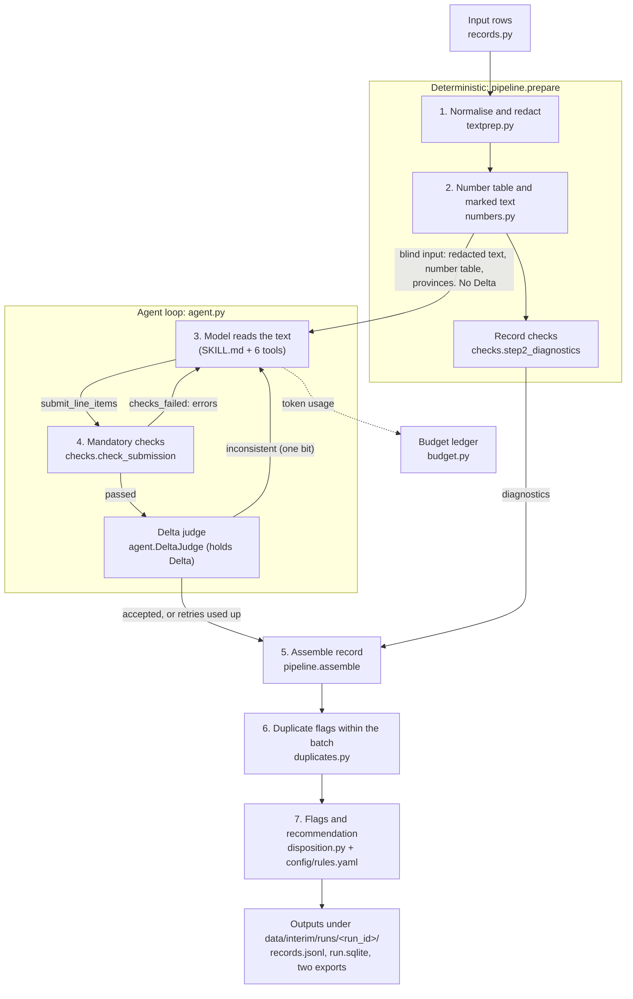

# Architecture

This note describes the code as it is on this branch. File names refer to `src/freight_lineitems/`.

## What the system does

A carrier explains an invoice adjustment in free text. The system turns that text into structured line items,
checks the result against the text itself and against the recorded adjustment (`Delta` = invoice amount −
shipment amount), and attaches flags for a human reviewer.

It does not decide whether a charge should be paid. Every record goes to a reviewer; the system takes no action.

## Pipeline

| step | code | kind | what happens |
|---|---|---|---|
| 0 | `records.py` | deterministic | Reads the dev split (CSV), an Excel export in the same layout, or the public mock (JSONL) into `InputRecord`. The source file is never modified. |
| 1 | `textprep.py` | deterministic | Collapses whitespace; redacts personal data (below); scans for text addressed to a system (patterns in `rules.yaml`). |
| 2 | `numbers.py`, `checks.step2_diagnostics` | deterministic | Finds every date and number, gives each an id (`#1`, `D1`) and objective features (has `$`, joined across a space, unit word after it …). Any digits it cannot parse become an unrecognized region (`?1`) that the model must read. Produces `marked_text`. No judgment about what a number means. |
| 3 | `agent.py`, `skill/…/SKILL.md`, `tools.py` | **model** | The model reads the blind input and calls tools. It classifies every number (kind, status, credit, charge codes), lists line items, and writes the arithmetic relations the text states. It quotes phrases and refers to numbers by id; it never writes an amount. |
| 4 | `checks.check_submission`, `agent.Session.submit` | deterministic | Schema, then mandatory checks: every id judged once, every phrase found in the text, codes exist in the taxonomy, each counted amount has a line item, a `$` amount left out has supporting words, unrecognized regions read digit for digit. Failures go back to the model as errors with allowed fixes. Code recomputes every stated relation and adds up the claim. |
| 4b | `agent.DeltaJudge` | deterministic | Compares the counted sum with Delta (below). |
| 5 | `pipeline.assemble` | deterministic | Builds the output record from the prepared record, the session and the transcript. |
| 6 | `duplicates.py` | deterministic | Within one batch: rows identical except for PK / row number, and the same charge code counted twice within one carrier invoice. Flags only; nothing is merged or removed. |
| 7 | `disposition.py`, `config/rules.yaml` | deterministic | Diagnostics are grouped into flags; flags give the recommendation. This is first computed in `assemble` and computed again for records that receive duplicate flags. |

No record is skipped or rejected before the model: step 1 and 2 findings become diagnostics and the record
continues. If the model call fails, is refused, is cut off or never submits, that is recorded as an explicit
diagnostic and the record still gets an output.

The model's part is narrow on purpose: it interprets text and chooses which tools to call. Parsing numbers,
validating, arithmetic, the Delta comparison, duplicates and the recommendation are all code. The agent's tools
are closed: six tools, no shell, no files, no network (`tools.TOOLS`; details in the
[skill folder README](../skill/freight-dispute-line-items/README.md)).

The system prompt is `SKILL.md` with `{{TAXONOMY}}` and `{{EXAMPLES}}` filled in (`pipeline.system_prompt`).
Model name, token limit, thinking and effort settings come from `config/model.yaml`. The system prompt is sent
with a cache breakpoint; the first record of a batch runs alone so the others can read the cache, then records
run in parallel threads.

## Blind parsing and the Delta judge

The model reads the text without knowing the amount it is "supposed" to reach, so that it cannot fit its reading
to the answer.

- `LLMInput` (`schemas.py`) is the only data the model gets about a record. It has no Delta, no invoice or
  shipment amount, no carrier, no reason code and no dispute status.
- `checks.Ctx`, the context the mandatory checks see, has no Delta either, so no error message can leak it.
- `DeltaJudge` is the only object on the model-facing path that holds Delta. After a submission passes the
  mandatory checks it returns `MATCH`, `MISMATCH` or `NO_ANCHOR` (Delta is 0, nothing to compare). A match is
  also accepted when the text names a tax without an amount and the counted sum plus the table tax equals Delta.
- On a mismatch the model is told only that its reading is "inconsistent" with the adjustment on record, and
  that either side may be wrong. It may resubmit unchanged (`INSISTED`) or corrected (`REVISED`), with a
  reason. It is not told Delta, the difference or the direction. The number of such rounds and of repair rounds
  is set in `rules.yaml` (`agent:`).
- Every attempt is kept, the first included. The final state is one of `MATCH_FIRST`, `MATCH_AFTER_REVISION`,
  `MISMATCH_MODEL_INSISTED`, `MISMATCH_RETRIES_EXHAUSTED`, `NO_ANCHOR`, `NOT_EVALUATED`.
- Explanations of a mismatch (for example "the gap equals one amount in the text") are computed only after the
  session has ended and go to the reviewer, never to the model.

A mismatch is not treated as the model's error: the recorded adjustment can itself be wrong. The reviewer
decides.

## Output: three layers

`pipeline.assemble` writes one JSON object per record with three layers, so that what was read is kept apart
from what the rules concluded and from how the result came about.

| layer | key | content |
|---|---|---|
| facts | `facts` | Source fields as read, derived country and currency (marked as derived), text hash, redacted text, the number table, the final reading with its line items, the claim arithmetic, parse status and Delta consistency. |
| judgment | `judgment` | Flags (code, severity, evidence), the recommendation, the flags that decided it, a return draft when one applies, and all diagnostics. |
| process | `process` | Every attempt with its errors and the feedback given, the full model transcript with token usage per call. |

Each record also carries `versions`: rules, taxonomy and tax table versions, `skill_sha`, `examples_sha`,
`examples_source` (`dev_redacted` or `synthetic`) and `system_prompt_sha`.

`db.py` stores a run in SQLite, with tables generated from `config/schema_v1.yaml`, and writes two exports:

- `export_facts.json`, for downstream use: only disputes whose reading passed the mandatory checks, agrees with
  Delta (`MATCH_FIRST` or `MATCH_AFTER_REVISION`) and has the recommendation `PASSED_CHECKS`.
- `export_review.json`, for reviewers: every dispute with its status, recommendation and flags.

## The three recommendations

| value | meaning |
|---|---|
| `HUMAN_REVIEW` | at least one flag with severity `attention` |
| `RETURN_SUGGESTED` | no `attention` flag, at least one with severity `return`; a draft of what to ask the carrier is attached, and nothing is sent |
| `PASSED_CHECKS` | neither |

`rules.yaml` alone computes this. Code and model produce diagnostics (a code, a path, evidence);
`disposition.flags_from` looks up each code's severity in `rules.yaml` (`attention`, `return` or `info`), applies
the `subsumption` table from the same file, and `disposition.recommend` applies the order above. The model has
no field for a recommendation or a confidence. Its only influence is through facts it reports, such as a doubt
raised with `report_uncertainty`, whose severity is again set in `rules.yaml`. A diagnostic code missing from
`rules.yaml` becomes an `attention` flag marked `unconfigured`, so a forgotten rule is visible.

A recommendation says what the reviewer should look at first. It is not a decision about payment, and every
record reaches a reviewer whatever its recommendation. Thresholds and tolerances also live in `rules.yaml`, not
in code.

## Redaction

Every text is redacted before it is sent to the model (`textprep.redact`, called in `pipeline.prepare`):

- person names: Presidio `PERSON` entities on a dictionary-cased copy of the text, plus two generic English
  context rules (for example "APPROVED BY <name>"); spans made only of charge vocabulary are not treated as
  names;
- email addresses, including spelled-out forms ("name at domain dot com");
- North American phone numbers.

Each is replaced by a placeholder (`[PERSON_1]`, `[EMAIL_1]`, `[PHONE_1]`); the same name gets the same
placeholder. If redaction removed or changed digits, the record is flagged. Known limit: recall on all-capitals
names is incomplete (open item P-08 in `docs/autorun/pending.zh.md`).

## Budget ledger

`budget.py` keeps model spending under a cumulative cap (`CAP_USD`).

- Before a batch, `reserve` checks spent + runs in flight + this batch's estimate against the cap, under a file
  lock shared by all processes. Over the cap, the batch does not start.
- After a batch, `append_entry` adds one line to `docs/autorun/budget_ledger.jsonl` (tracked in git; usage
  counts and dollar figures only, never record text).
- Usage is kept in four separate token classes, with cache writes split by lifetime: input, output, cache write
  5 minutes, cache write 1 hour, cache read. The dollar figure is these counts at API list prices. It is a
  price proxy for comparing runs, not an invoice. A model without a price entry raises an error instead of
  being counted as free.

## Where data lives

| path | content | in git |
|---|---|---|
| `data/` (all of it) | raw client file, dev and test splits, runtime example library, run outputs, SQLite files, results page | **ignored** |
| `data/processed/` | dev split (`dev.csv`) and the test split. The test split is not read during development | ignored |
| `data/interim/skill/examples.json` | worked examples from real dev rows, redacted | ignored |
| `data/interim/runs/<run_id>/` | all row-level output of a run | ignored |
| `data/external/mock_public/` | public mock records and their ground truth | ignored |
| `.env` | `ANTHROPIC_API_KEY` | ignored |
| `*.xlsx` | any Excel file | ignored |
| `config/` | rules, taxonomy, tax table, schema, model settings | tracked |
| `skill/freight-dispute-line-items/` | `SKILL.md`, its README, synthetic examples | tracked |
| `docs/` | reports with aggregates only; the budget ledger | tracked |

Tracked files contain no real rows. Tests build their inputs from synthetic texts; the few tests that need local
data files are skipped when those files are absent.
