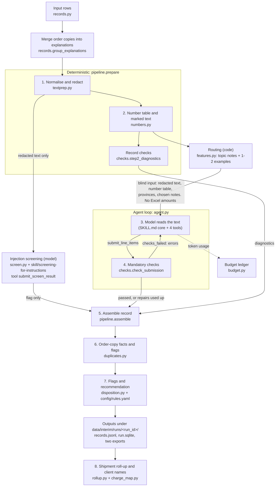

# Architecture

This note describes the code as it is on this branch. File names refer to `src/freight_lineitems/`.

## What the system does

A carrier explains an invoice adjustment in free text. The system turns that text into structured line items,
checks the result against the text itself, rolls the line items up to the shipment (SAP BOL) in the client's table
format, and attaches flags for a human reviewer. The client's spreadsheet columns `Delta`, `Invoice Amount` and
`Invoice Dups Removed` are his own estimates (client answer of 2026-11-13): they are stored only as a baseline for
evaluation and no runtime step compares a reading with them.

It does not decide whether a charge should be paid. Every record goes to a reviewer; the system takes no action.

## Pipeline

| step | code | kind | what happens |
|---|---|---|---|
| 0 | `records.py` | deterministic | Reads the dev split (CSV), an Excel export in the same layout, or the public mock (JSONL) into `InputRecord`. The source file is never modified. Rows with the same shipment, Event Date and normalised text are one explanation (`group_explanations`); its first row is read by the model, the others are order copies. |
| 1 | `textprep.py` | deterministic | Collapses whitespace; redacts personal data (below); scans for text addressed to a system (patterns in `rules.yaml`). |
| 2 | `numbers.py`, `checks.step2_diagnostics` | deterministic | Finds every date and number, gives each an id (`#1`, `D1`) and objective features (has `$`, joined across a space, unit word after it …). Any digits it cannot parse become an unrecognized region (`?1`) that the model must read. Produces `marked_text`. No judgment about what a number means. |
| 1b | `screen.py`, `skill/screening-for-instructions/SKILL.md` | **model** | Task 19. A separate call on the redacted text only asks whether the text speaks to an AI system, a model, a tool or the review process. Its only output is `submit_screen_result`, whose quote must be in the text. A yes adds `REC.TEXT.SCREEN_ADDRESSED_TO_SYSTEM`; it never changes or skips the reading. |
| 2b | `features.py`, `rules.yaml` `features` | deterministic | Task 19. Feature groups (tax, balance/paid/billed, unit rate, rate correction, credit, history) are found by regex; in the `routed` layout the matching topic notes from `skill/freight-dispute-line-items/reference/` and 1-2 worked examples that share a group go into the input. |
| 3 | `agent.py`, `skill/…/SKILL.md`, `tools.py` | **model** | The model reads the blind input and calls tools. It classifies every number (kind, status, credit, charge codes), lists line items, writes the arithmetic relations the text states, and describes two more things: whether the text mentions an earlier claim (`earlier_claim_quote`) and which number it presents as owed now (`stated_amount_due_id`). It quotes phrases and refers to numbers by id, so it cannot put a number that is not in the text into a reading; the sign it gives an amount (`is_credit`) must have support in the text (a credit word between the money-like number before it and the one after it, money-like meaning a `$` or exactly two decimals so that references and quantities do not cut the stretch, parentheses, or a minus sign directly before the number), which `checks.py` verifies (tasks 23, 23b, 23c); a minus sign directly before a counted amount with no credit word or parentheses (separator or credit is unclear) goes to a person whichever way it was read. |
| 4 | `checks.check_submission`, `agent.Session.submit` | deterministic | Schema, then mandatory checks: every id judged once, every phrase found in the text, codes exist in the taxonomy, each counted amount has a line item, a `$` amount left out has supporting words, unrecognized regions read digit for digit. Failures go back to the model as errors with allowed fixes. Code recomputes every stated relation and adds up the claim. |
| 5 | `pipeline.assemble` | deterministic | Builds the output record from the prepared record, the session and the transcript. |
| 6 | `duplicates.py` | deterministic | Attaches each explanation's rows, PKs and order count; a copy without a PK or repeating a PK gets `SHIP.COPY.SAME_OR_NO_PK`. One PK per copy is the normal structure (several orders on one truck) and is not flagged. |
| 7 | `disposition.py`, `config/rules.yaml` | deterministic | Diagnostics are grouped into flags; flags give the recommendation. This is first computed in `assemble` and computed again for explanations that receive a copy flag. |
| 8 | `rollup.py`, `charge_map.py`, `scratch/rollup/replay.py` | deterministic | Rolls each shipment's explanations up into the client's table (below) and adds the client's names and candidate EDI codes. Today it runs as a replay on a stored run and writes files; it is not yet stored in the database (T12-09). |

No record is skipped or rejected before the model: step 1 and 2 findings become diagnostics and the record
continues. If the model call fails, is refused, is cut off or never submits, that is recorded as an explicit
diagnostic and the record still gets an output.

The model's part is narrow on purpose: it interprets text and chooses which tools to call. Parsing numbers,
validating, arithmetic, copies, the shipment roll-up and the recommendation are all code. The tools are closed:
four for the reading agent (`tools.TOOLS`) and one for the screening call (`screen.SCREEN_TOOLS`), no shell, no
files, no network (details in the [skill folder README](../skill/freight-dispute-line-items/README.md)).

The system prompt is generated (`skilltext.py`, task 19): the core `SKILL.md` with every business concept filled
in from `config/rules.yaml` `concepts` (one definition per concept), the taxonomy, the tool table and the fixed
examples. `config/model.yaml` `skill_layout` chooses `routed` (topic notes and similar examples chosen per
explanation by code) or `single` (every topic note in the system prompt, five fixed examples). Model name, token
limit, thinking and effort settings come from `config/model.yaml`. The system prompt is sent with a cache
breakpoint; the first record of a batch runs alone so the others can read the cache, then records run in parallel
threads.

## Who does what (task 19)

Every job the system does, and whether code, a tool or a skill does it. Source: T18 design 4.1-4.2
(`docs/deliverables/T18-architecture/02-design.zh.md`), updated for what task 19 changed. "Skill" = a model call
guided by a skill file; "tool" = a function the model may call; "code" = deterministic, no model.

| # | job | done by | where | task 19 change |
|---|---|---|---|---|
| E1 | read rows into one record shape | code | `records.py` | — |
| E2 | merge order copies into explanations | code | `records.group_explanations`, `duplicates.py` | — |
| E3 | redact names and emails | code | `textprep.redact` | — |
| E4 | spot text addressed to a system | code (two layers) + **skill** `screening-for-instructions` | `textprep.injection_hits`; `screen.py` with tool `submit_screen_result` | new skill and tool; adds one flag only |
| E5 | number table and marked text | code | `numbers.py` | — |
| E6 | text hints code can decide (empty, numbers only, quantity x rate without result, ...) | code | `checks.step2_diagnostics` | — |
| E6b | choose topic notes and similar examples | code | `features.py`, `rules.yaml` `features` | new (replaces `lookup_tax_rule` and `find_similar_examples`) |
| E7 | read the explanation: money or not, asked for now or history, charge, reason, stated arithmetic, earlier-claim mention, stated amount due | **skill** `freight-dispute-line-items` | `SKILL.md` core + `reference/` | core + topic notes; concepts generated from `rules.yaml`; two new output fields |
| E8 | charge name -> code | skill (taxonomy in the core) + **tool** `lookup_charge_code` | `tools.py` | matching by example phrasing, words and spelling; returns the client name |
| E8b | exact arithmetic on the text's figures | **tool** `calculate` | `tools.py` | — |
| E9 | mandatory checks on a submission | code, inside **tool** `submit_line_items` | `checks.check_submission` | the two new fields are checked against the text |
| E10 | reading-level hints (nothing counted, leading-dot amount, earlier claim mentioned, ...) | code | `reading_checks.py`, `checks.py` | `CLAIM.EARLIER_CLAIM_MENTIONED` |
| E11 | model's own doubts | skill + **tool** `report_uncertainty` | `agent.Session.report_uncertainty` | — |
| E12 | relations between explanations of one shipment | code | `rollup.py` | concepts written in `rules.yaml` (definition only; implementation next week); task 20: BALANCE DUE compared wherever it is written (D-95), extension points for cross-batch history and relation suggestions |
| E13 | shipment table, the other-reading totals and the gap columns | code | `pipeline.finish_batch`, `rollup.py`, `charge_map.py`, `shipment_table.py` | task 20: runs inside every batch; output contract `docs/shipment_output_contract.md` |
| E14 | flags -> recommendation | code | `disposition.py`, `rules.yaml` `flags` | — |
| E15 | review screen | code | `review_ui.py` | — |
| E16 | review decisions | person | `review_ui.record_decision` | — |
| E17 | improve the system from reviews | person decides; code and Claude Code propose and verify | `scratch/eval/` | — |
| E18 | evaluation | code (truth from people) | `scratch/eval/` | `t19_eval.py`, `t19_replay.py` |
| E19 | budget, versions, archives | code | `budget.py`, `config.versions` | skill folder and layout versioned |

The line between the reading skill and code: the model says what the text writes; code computes totals, checks
relations, compares explanations of a shipment and decides the colour. Each concept both sides use (counted,
history, total, credit, quantity x rate, exclusion basis, rate correction, other, injection, earlier claim, balance
due, stated amount due) is defined once in `rules.yaml` `concepts`, implemented once in `src/` and generated into the
skill text (`tests/test_concepts.py`, `tests/test_skilltext.py`). The output fields the downstream steps rely on are
described in [`reading_output_contract.md`](reading_output_contract.md).

## Blind parsing

The model reads the text without knowing any amount it is "supposed" to reach, so that it cannot fit its reading
to an answer.

- `LLMInput` (`schemas.py`) is the only data the model gets about a record. It has no Delta, no invoice or
  shipment amount, no carrier, no reason code and no dispute status.
- `checks.Ctx`, the context the mandatory checks see, has none of these either, so no error message can leak them.
- A submission that passes the mandatory checks ends the session. A failed check goes back to the model with the
  errors and allowed fixes; it may resubmit (`REVISED`, or `INSISTED` with a reason), at most
  `agent.max_repair_rounds` times (`rules.yaml`). Every attempt is kept, the first included.
- Until task 14 a passed reading was also compared with Delta and the model was told "inconsistent" once on a
  mismatch. That comparison was withdrawn (task 14, C1): Delta is the client's spreadsheet estimate, and his first
  worked example shows it counting a stated total twice.

Task 19 removed the last mentions of that comparison and of the "inconsistent" result from `SKILL.md` and the
tool texts (they had survived in the v1.2 wording frozen in task 14, pending P-33).

## Shipment roll-up

`rollup.py` turns a shipment's explanations into the client's table: original amount (Shipment Amount), each
charge (tax on its own line), new total and change. It is code only and always gives a default total. Rules, in
order (T12 adjustment plan 4.3): order by Event Date then row; a later explanation of the same charge replaces the
earlier one, comparing the finest internal code (never the client name); tax never takes part and follows its
explanation; different charges add up; the same amount under another code is added and flagged; BALANCE DUE (or
the next explanation's single amount) at 1.03-1.07 times an earlier amount replaces it; undecidable relations are
added and flagged; an explanation without a usable reading is left out and the shipment is marked incomplete.
Every possible duplicate carries the total under the other reading. Thresholds and severities are in `rules.yaml`
(`rollup`, `SHIP.*`). The shipment's recommendation is the worst of its explanations' and its own flags.

Task 20: `pipeline.finish_batch` runs this step inside every batch (order copies, roll-up, client names), and every
evaluation script calls the same function. BALANCE DUE is compared with the explanation's other '$' amounts wherever
it is written (D-95). Each explanation and each single-explanation shipment carries the gap columns: line total,
stated amount due and their difference (information only, D-96). Two extension points: `prior_history` (cross-batch
history; default "not provided") and `relation_suggestions`. Output: `shipments.jsonl`, `shipment_table.csv` / `.json`,
SQLite `shipment_result` / `shipment_line`; fields in [`shipment_output_contract.md`](shipment_output_contract.md).

`charge_map.py` reads `config/charge_map.yaml` (generated from the T13 mapping) and adds, per line, the client's
Addenda B name, every candidate EDI code (none chosen) and, where several client entries fit, the reference names.

## Output: three layers

`pipeline.assemble` writes one JSON object per record with three layers, so that what was read is kept apart
from what the rules concluded and from how the result came about.

| layer | key | content |
|---|---|---|
| facts | `facts` | Source fields as read (the Excel amount columns only as a baseline), derived country, currency (fixed USD), text hash, redacted text, the number table, the final reading with its line items, the claim arithmetic, parse status, and the explanation's source rows and order count. |
| judgment | `judgment` | Flags (code, severity, evidence), the recommendation, the flags that decided it, a return draft when one applies, and all diagnostics. |
| process | `process` | Every attempt with its errors, the full model transcript with token usage per call. |

Each record also carries `versions`: rules, taxonomy and tax table versions, `skill_sha`, `examples_sha`,
`examples_source` (`dev_redacted` or `synthetic`) and `system_prompt_sha`.

`db.py` stores a run in SQLite, with tables generated from `config/schema_v1.yaml`, and writes two exports:

- `export_facts.json`, for downstream use: only disputes whose reading passed the mandatory checks and has the
  recommendation `PASSED_CHECKS`.
- `export_review.json`, for reviewers: every dispute with its status, recommendation and flags.

## The three recommendations

| value | meaning |
|---|---|
| `HUMAN_REVIEW` | at least one flag with severity `attention` |
| `RETURN_SUGGESTED` | no `attention` flag, at least one with severity `return`; a draft of what to ask the carrier is attached, and nothing is sent |
| `PASSED_CHECKS` | neither |

`rules.yaml` alone computes this. Code and model produce diagnostics (a code, a path, evidence);
`disposition.flags_from` looks up each code's severity in `rules.yaml` (`attention`, `return` or `info`), applies
the `subsumption` table from the same file, and `disposition.recommend` applies the order above. The model has
no field for a recommendation or a confidence. Its only influence is through facts it reports, such as a doubt
raised with `report_uncertainty`, whose severity is again set in `rules.yaml`. A diagnostic code missing from
`rules.yaml` becomes an `attention` flag marked `unconfigured`, so a forgotten rule is visible.

A recommendation says what the reviewer should look at first. It is not a decision about payment, and every
record reaches a reviewer whatever its recommendation. Thresholds and tolerances also live in `rules.yaml`, not
in code.

## Redaction

Every text is redacted before it is sent to the model (`textprep.redact`, called in `pipeline.prepare`):

- person names: Presidio `PERSON` entities on a dictionary-cased copy of the text, plus two generic English
  context rules (for example "APPROVED BY <name>"); spans made only of charge vocabulary are not treated as
  names;
- email addresses, including spelled-out forms ("name at domain dot com");
- North American phone numbers.

Each is replaced by a placeholder (`[PERSON_1]`, `[EMAIL_1]`, `[PHONE_1]`); the same name gets the same
placeholder. If redaction removed or changed digits, the record is flagged. Known limit: recall on all-capitals
names is incomplete (open item P-08 in `docs/autorun/pending.zh.md`).

## Budget ledger

`budget.py` keeps model spending under a cumulative cap (`CAP_USD`).

- Before a batch, `reserve` checks spent + runs in flight + this batch's estimate against the cap, under a file
  lock shared by all processes. Over the cap, the batch does not start.
- After a batch, `append_entry` adds one line to `docs/autorun/budget_ledger.jsonl` (tracked in git; usage
  counts and dollar figures only, never record text).
- Usage is kept in four separate token classes, with cache writes split by lifetime: input, output, cache write
  5 minutes, cache write 1 hour, cache read. The dollar figure is these counts at API list prices. It is a
  price proxy for comparing runs, not an invoice. A model without a price entry raises an error instead of
  being counted as free.

## Where data lives

| path | content | in git |
|---|---|---|
| `data/` (all of it) | raw client file, dev and test splits, runtime example library, run outputs, SQLite files, results page | **ignored** |
| `data/processed/` | dev split (`dev.csv`) and the test split. The test split is not read during development | ignored |
| `data/interim/skill/examples.json` | worked examples from real dev rows, redacted | ignored |
| `data/interim/runs/<run_id>/` | all row-level output of a run | ignored |
| `data/external/mock_public/` | public mock records and their ground truth | ignored |
| `.env` | `ANTHROPIC_API_KEY` | ignored |
| `*.xlsx` | any Excel file | ignored |
| `config/` | rules, taxonomy, tax table, schema, model settings | tracked |
| `skill/freight-dispute-line-items/` | `SKILL.md`, its README, synthetic examples | tracked |
| `docs/` | reports with aggregates only; the budget ledger | tracked |

Tracked files contain no real rows. Tests build their inputs from synthetic texts; the few tests that need local
data files are skipped when those files are absent.
