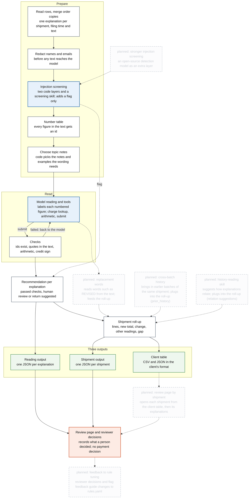

# Pipeline flow (Base v1)

The whole flow of Base v1, from the client's export to the reviewer's decision, and the planned additions that are
already written into the project documents. Base v1 is the internal checkpoint `mvp-v1.4` plus the release documents.

**Legend.** Solid boxes are in Base v1: white is code, blue calls the model, orange is a person, green is an output.
Translucent boxes with a dashed border, labelled "planned", are not built yet; dotted arrows show where each one would
connect.

## What each step does (Base v1)

| step | what it does | where |
|---|---|---|
| Read rows, merge order copies | reads the export without changing it; copies of one note for several orders on a truck become one explanation | `records.py`, `duplicates.py` |
| Redact names and emails | replaces names and emails with placeholders before any model call | `textprep.py` |
| Injection screening | two code layers (patterns and a fuzzy match) and one model call ask whether the text speaks to the system; a hit adds a flag and never changes the reading | `textprep.py`, `screen.py`, `skill/screening-for-instructions/` |
| Number table | finds every number and date and gives it an id; the model can only refer to these ids | `numbers.py` |
| Choose topic notes | adds the topic notes (tax, balances, quantity times rate, rate corrections, credits) and worked examples whose trigger words appear | `features.py`, `config/rules.yaml` |
| Model reading and tools | the model says what each numbered figure is, using `lookup_charge_code`, `calculate` and `submit_line_items` | `agent.py`, `tools.py`, `skill/freight-dispute-line-items/` |
| Checks | the reading is accepted only if every id exists, every quote is in the text, the arithmetic holds and every credit sign has support next to its amount; otherwise it goes back to the model, then to a person | `checks.py` |
| Recommendation per explanation | flags give one of three recommendations by written rules | `disposition.py`, `config/rules.yaml` |
| Shipment roll-up | combines the explanations of one shipment: replaced lines, new total, change, other readings, stated amount due and gap | `rollup.py`, `pipeline.finish_batch` |
| Three outputs | reading output, shipment output and the client's table, each with a written contract | [reading contract](reading_output_contract.md), [shipment contract](shipment_output_contract.md) |
| Review page and reviewer decisions | a local page that shows each shipment's result and records the reviewer's decision; decisions export to CSV | `review_ui.py` |

## Planned additions

Only additions already written into the project documents are drawn. None of them is built.

| planned box | what it would do | where it connects | written in |
|---|---|---|---|
| Cross-batch history | connect earlier export files of the same shipment | `rollup.PriorHistory`, `pipeline.finish_batch(prior_history=...)`; today it reports "not provided" | [shipment contract](shipment_output_contract.md) section 5.1 |
| History-reading skill | suggest how explanations of a shipment relate when the rules leave it undecided | `finish_batch(relation_suggestions=...)` | [shipment contract](shipment_output_contract.md) section 5.2 |
| Replacement words | read words such as "REVISED" that say one explanation replaces another | the shipment roll-up | [project summary](status/2026-11-16_project_summary.md) section 6 |
| Review page by shipment | open the review page by shipment from the client table, then each explanation | the review page | [project summary](status/2026-11-16_project_summary.md) section 8 |
| Feedback to rule tuning | use reviewer decisions and `flag_feedback` to tune rule settings | `review_ui --export-decisions`, `config/rules.yaml` | [shipment contract](shipment_output_contract.md) section 6 |
| Stronger injection screening | an open-source prompt-injection detection model as an extra screening layer | the injection screening step | architecture review of 15 November (internal) |

A Chinese pipeline diagram from the status board is in `docs/status/pipeline_flow.zh.html`.
