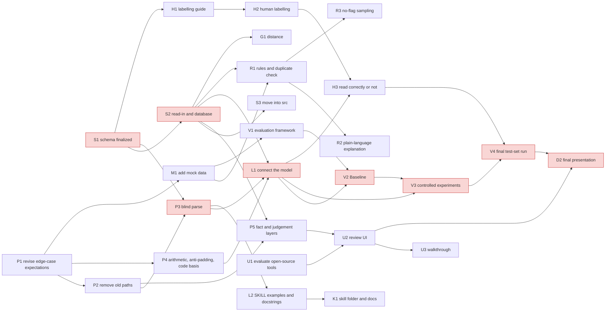
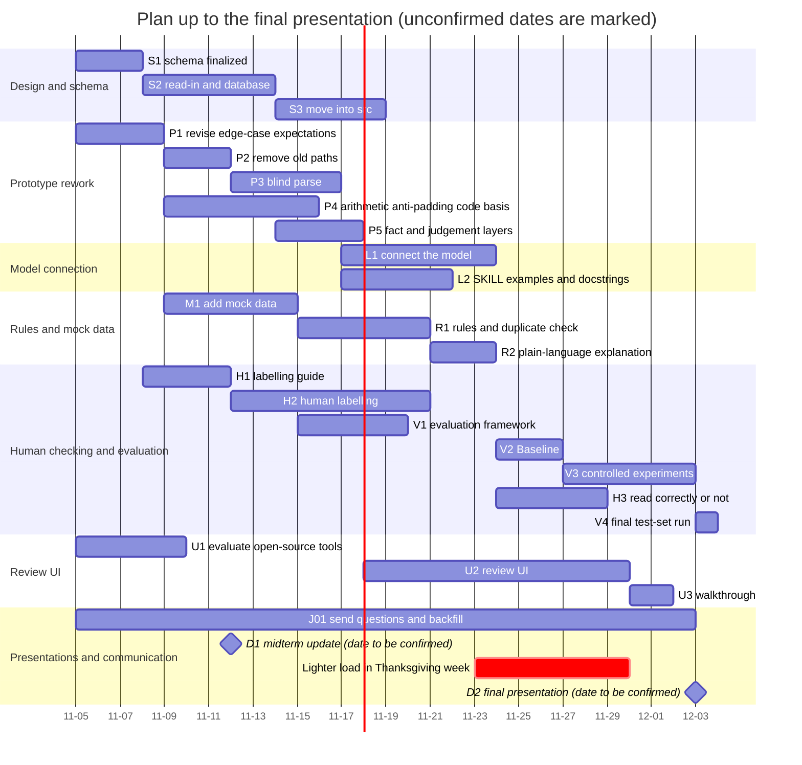

# Project status, pipeline walkthrough and task plan (for the 2026-11-05 team meeting)

Sources: `docs/decisions/2026-11-04_framework_decisions.zh.md` (hereafter the "decision record", cited as "decision 3.2"), the task 06 report `docs/analysis/06_research_schema_report.zh.md` and `06_schema_v0.yaml`, and the board `docs/status/cards.yaml`. Chinese version: `2026-11-05_status_and_plan.zh.md`. For suggested roles, see `2026-11-05_team_roles.en.md`.

## Read this screen first

**What the project is.** A "gear": it turns the free text carriers write in freight invoice adjustments into clean structured data (what each charge is, how much it is, how the text describes it), for PPG reviewers and downstream systems to use (decision 1.1). **Judging whether a charge should be paid is out of scope**; giving reviewers facts that help them decide (for example, how many identical disputes there are under the same shipment) is in scope (decision 1.2).

**Main changes this time (decisions of 2026-11-04).**

1. Every record goes to the model, and the system takes no action; "auto-return before the model" and "auto-notify the carrier" are removed, and every record goes to a reviewer (decisions 2.1, 2.2).
2. Recommendations have only three colours: normal, flagged, suggest return; the colour is computed by rules, not by model self-assessment (decision 2.3).
3. **Blind parse**: the model cannot see Delta. After comparing, the code only tells the model "inconsistent"; the model can stand by its reading or revise it, and every attempt is kept for the reviewer to see (decisions 3.1, 3.2).
4. The code verifies the arithmetic every time; any amount with a `$` that is not counted in the claim must have a basis in the source text; charge codes must be backed by a charge name in the source text (decisions 3.3, 3.5, 3.6).
5. We **store our own parse results** and run multi-level, cross-batch duplicate checks; copies are not merged, and each copy is reviewed independently (decisions 4.1, 5.2, 5.3).
6. Canada is in scope; `US/CAN` is not reliable, so the country is inferred from the province/state and the currency is inferred; until Jake confirms, all tax questions go to a human (decisions 4.3, 4.4).
7. The review UI is a formal deliverable; evaluate open-source tools first, then decide how much to build ourselves (decision 1.8, section 6).

**Where we are now.** The design baseline is set (decision record + schema v0); half of the prototype code has to be changed to follow the new decisions; **the model has never actually been connected** (B04 red). The board has 24 cards: light green 8, yellow 7, red 9, grey 1, dark green 0; Shaped 33%, Verified 0%. Of the 8 light-green cards, 5 have implementations that conflict with the new decisions and are marked "to revise" on the board (section 6). The main line for the next 4 weeks: **schema in place → revise the prototype per the decisions → connect the model → human checking and controlled experiments → final presentation**.

**Overall plan.** Split into 33 tasks (section 3), with total effort estimated at **300 to 466 person-hours**; across five people that is about 60 to 93 hours each, over about 4 weeks to early December. Critical path: schema finalized → data ingest → blind-parse rework → connect the model → controlled experiments → final test-set run → final presentation (section 4).

**Pipeline diagram**: `docs/status/pipeline_flow.en.html` (v5; download it and open it in a browser). The notes for each node in the diagram are in section 2 of this document.

---

## 1. Summary of the current stage

### 1.1 Why it is built this way

Carrier explanations are written in a messy way: the same charge is written a dozen or more different ways, amounts mix paid, unpaid, tax and totals, and a passage sometimes repeats the amount from the previous submission. Today reviewers can only read them one by one. What we want to do is reliably break out "what the text says", and flag the anomalies that can be seen within the rules (arithmetic that doesn't add up, amounts that don't match Delta, the same money claimed twice), so reviewers only look where they need to.

Validation stance (decision 1.4): there is **no ground truth** for this; PPG's handling and the reviewers' judgements are each just their own rules. Our goal is to write the rules down clearly, make sure the system reliably identifies anomalies within the rules, and validate this on mock data. The one exception is "whether the model read the text correctly" (for example, whether a number is the detention amount), which anyone can confirm by looking at the source text; this part is to be tested with real text plus human checking.

### 1.2 How far we have got

| Part | Status | Evidence |
|---|---|---|
| Problem inventory, design proposal, dev/test split | Done (light green, in-sample) | A1, A2, A3 cards and test reports |
| Read-in, number recognition, output, diagnostic catalogue | Code exists and has run on the dev set (light green, in-sample); read-in and output need revising per the new decisions | B01, B02, B10, C1 |
| Submission checks, history checks, aggregated recommendation, rules, code table, SKILL.md, tools | Partly done (yellow); most need revising per the new decisions | B05 to B09, C2, C3 |
| Connect the model | Not started (red) | B04 |
| Labelled set, baseline, controlled experiments, final test-set run | Not started (red) | V1 to V4 |
| schema v0, business research, data relationships | Done this week, pending team discussion | Task 06 report |
| mock data | First round of 360 events generated; expectations were written under the old rules and need revising per the new decisions | `ppg-mock-gen` report outside the repo |

---

## 2. Step-by-step walkthrough (pipeline diagram node notes)

Each step covers four things: **what it does**; **why it is designed this way** (citing the decision record); **status** (board terms: light green = in-sample evidence and deliverable, yellow = partly done, red = not started); **questions for Jake** (numbering and wording from section 8 of the decision record). Whoever owns a step can pick up the questions listed here directly.

### 2.1 Submit dispute (carrier)

- **What it does**: The carrier submits an invoice adjustment and explanatory text in OTM; what we receive is an Excel export from OTM.
- **Why**: Develop only against Excel, don't design an API, and keep the Excel-reading code in one place (decision 1.3).
- **Status**: No corresponding card.
- **Questions for Jake**: None.

### 2.2 0-1 Read-in (card B01)

- **What it does**: Read the Excel file and store every row as-is in the database (with batch and row number); build the relationships among shipment, carrier invoice, PK and dispute per the schema; redact (names, emails); check for injection-style text. Copies are **not merged**.
- **Why**: Keep raw rows separate from "the disputes as we understand them": the former is faithful to the Excel, the latter is our interpretation (task 06 C1); copies are independent of each other (decision 5.3); the country is inferred from the province/state and the currency is inferred (decision 4.3).
- **Status**: Light green (in-sample), but **inconsistent with the decisions, to revise**: it currently merges duplicate rows on five fields and does not store raw rows per the schema. The ID relationships on the dev set have been worked out (task 06 B1, B2).
- **Questions for Jake**:
  - J1. What are PK, `Invoice/Bill ID` and the carrier invoice number, respectively? Why does the same dispute hang under multiple PKs, and why do some PKs carry ID dates later than the time of the dispute?
  - J2. Who does `Invoice Dups Removed`, and by what rule? Is `Invoice Amount` "freight plus this item's Delta"? Where can the real invoice total be seen?
  - J3. Is `Event Date` the time the carrier submitted? Is there a real submission time or version number?
  - J4. Where does the currency come from? What does the `US/CAN` column mean, and why does Calgary to Calgary say `US`?
  - J13. What does each of the four `Dispute Status` values mean?

### 2.3 2 Number recognition (card B02)

- **What it does**: The code finds every number, date and unrecognized numeric region in the text, assigns IDs (`#1`, `D1`, `?1`), and checks that every digit character is covered.
- **Why**: The model only cites IDs and never copies numbers, so amounts are always taken by the code; for unrecognized regions the model must write out each digit (decision 3.8).
- **Status**: Light green (in-sample): the coverage check passes on all 529 distinct texts.
- **Questions for Jake**: None.

### 2.4 Model input (whitelist) (part of card B04)

- **What it does**: Assemble the redacted text, the number table and the origin and destination provinces into the model input; **Delta is not included**, nor are carrier, Reason Code or Dispute Status.
- **Why**: Blind parse, so the model doesn't change its reading to match Delta (decision 3.1).
- **Status**: Red; the prototype's input still contains `delta` and `delta_sign`, **to revise**.
- **Questions for Jake**: None.

### 2.5 3 Blind parse (agent loop) (card B04)

- **What it does**: The model reads the text and gives an interpretation of each number, the total claimed amount, the arithmetic relationships, charge codes and supporting snippets; it submits through `submit_line_items`, which is the only output path.
- **Why**: The model is only responsible for understanding the text and deciding which tools to call; deterministic work goes to code (`CLAUDE.md`); on an inconsistency, it goes back to the model and every attempt is recorded (decision 3.2). The number of retries is `[to be discussed]`, leaning towards 1 to 2.
- **Status**: Red: a real model has never been called; there is only an empty stub and hand-written role-play.
- **Questions for Jake**: None (for questions about what charges mean, see the code table in 2.13).

### 2.6 4-5 Submission checks (card B07)

- **What it does**: The code checks each submission: every number has an interpretation; the arithmetic is verified every time; the total claim is compared with Delta; any amount with a `$` that is not counted in the claim must have a basis in the source text; the supporting snippet for a charge code must be a charge name and be in the alias table (if it isn't, a note says "uncommon mapping"). Consecutive attempts are compared automatically, and numbers whose status changed are listed for the reviewer.
- **Why**: Decisions 3.3 (arithmetic), 3.5 (anti-padding), 3.6 (code basis), 3.9 (submissions that failed are still shown, distinguished by a status field). "Total counted twice" is no longer a gate, only an optional explanation (decision 3.4).
- **Status**: Yellow (in-sample, only 17 synthetic cases). **To revise**: arithmetic references are optional, "total counted twice" is still a gate, anti-padding doesn't cover all statuses, and the model can say "there are no numbers here".
- **Questions for Jake**:
  - J5. Is Canadian tax based on the origin province, the destination province, or some other rule?
  - J2. Is `Invoice Amount` "freight plus this item's Delta"? (This affects what the model's reading is compared against.)

### 2.7 5.5 Multi-level duplicate check (card B08)

- **What it does**: Four levels, lower levels first: the same row re-exported from an earlier batch (suggestion, to be confirmed); row level (everything identical except PK); within an invoice (the same charge appears twice); within a shipment across invoices. The first copy carries a note "N more identical ones follow", and each later copy is marked red and points to the first; across batches, the first copy is the one in the earlier batch.
- **Why**: Decisions 5.1 to 5.3; history is based on the parse results we store (decision 4.1); by default the model is not shown history, and whether to show it is a controlled experiment (decision 4.2).
- **Status**: Yellow (in-sample). **To revise**: currently the batch runner accumulates history in memory, with no database and no levels. On the dev set each shipment has only one carrier invoice, so the "within a shipment across invoices" level can only be validated on mock data (task 06 B1). Whether the "first copy" within a batch is decided by PK or by row number is `[to be discussed]`.
- **Questions for Jake**:
  - J1. Why does the same dispute hang under multiple PKs? (Export duplication, or genuinely multiple change orders?)
  - J6. When a later dispute comes in on the same shipment, does it replace the earlier one, or add to it?
  - J7. For charges billed per day or per occurrence (for example detention), does the carrier submit one total, or submit once for each occurrence?

### 2.8 6a Flags (card B09)

- **What it does**: Turn the diagnostics from each step into flags per `rules.yaml`, with evidence, attached to specific objects (number, line item, dispute, invoice); duplicate flags point to the first copy. Questions the model reports on its own initiative are also turned into flags via the rules.
- **Why**: Rules live in `rules.yaml`, not in `SKILL.md`, so PPG can add or change them later (decision 1.5); the product goal is not to have too many flags (decision 1.6); periodically sample a small share of the records **with no flags** for a human to look at (decision 1.7).
- **Status**: Yellow (in-sample): the code runs end to end on the dev set; thresholds and scores were picked by hand.
- **Questions for Jake**:
  - J11. How many items does a reviewer handle per day, how long does each take, and what are they most worried about missing? When verifying charges such as detention and lumper fees, which documents do they actually look at?

### 2.9 6b Recommendation colour (card B09)

- **What it does**: Compute the colour in order: first check whether there is a problem a human needs to look at, then whether there is a problem that justifies a return; only if there is neither is it normal. All three colours go to the reviewer.
- **Why**: Decision 2.3; records that pass every check also go to the reviewer, just without flags.
- **Status**: Yellow. **To revise**: currently there are three outcomes, `AUTO_REJECT / HUMAN_REVIEW / SPLIT_TRUSTED`, computed from scores.
- **Questions for Jake**: None (J11 also affects this).

### 2.10 6c Return draft (card C1)

- **What it does**: When the recommendation is "suggest return", generate a return draft from the fixed text in the diagnostic catalogue, for the reviewer only; the reviewer can edit it.
- **Why**: The system takes no action; "return" only produces a draft (decision 2.2).
- **Status**: Light green (the catalogue itself). **To revise**: the current draft has an "auto-send" switch.
- **Questions for Jake**:
  - J10. What actions can a reviewer take on a dispute in OTM? Would it be acceptable to make the decision in our interface first and then go back to OTM to carry it out?

### 2.11 7 Parse result store and output (card B10)

- **What it does**: Store the fact layer (parse results) and the judgement layer (diagnostics, flags, recommendations, drafts) separately in the database; the JSON export is also split into two blocks. Downstream only reads facts that passed the checks.
- **Why**: Decisions 3.9, 4.1, 4.5; define the tables first, then the JSON. schema v0 has 18 tables (task 06 C1).
- **Status**: Light green (in-sample). **To revise**: currently failed submissions are also written into the content, there are auto-notify events, and there is no currency and no database.
- **Questions for Jake**:
  - J8. Does the export include the final approved amount?
  - J4. Where does the currency come from?

### 2.12 Review UI (end point)

- **What it does**: When a batch finishes, list the N invoices, each with a colour and triangle icons counted separately by severity; opening one first shows an overview (basic information, distance, reconciliation of the model's reading total against the Delta total, dispute list, flags, context from earlier batches); action buttons are at the dispute level (approve, return to carrier, clear flag, hold), and bulk actions are at the invoice level. The buttons don't change OTM; they only record the reviewer's decision.
- **Why**: Section 6 of the decision record; the review UI is a formal deliverable, and open-source tools such as Label Studio and Argilla are to be evaluated first (decision 1.8). Reviewers' decisions can later serve as reference answers, but they must be screened first (decision 6.5).
- **Status**: No card, not started. Suggest adding a card (section 6).
- **Questions for Jake**:
  - J10. What actions can a reviewer take on a dispute in OTM? Would it be acceptable to make the decision in our interface first and then go back to OTM to carry it out?
  - J11. How many items does a reviewer handle per day, how long does each take, and what are they most worried about missing? When verifying charges such as detention and lumper fees, which documents do they actually look at?
  - J9. Does OTM have the planned mileage for each shipment?

### 2.13 Knowledge assets

| Node | What it does, and why | Status | Questions for Jake |
|---|---|---|---|
| SKILL.md (B05) | Operating procedure and examples for the model to read; duplicate-check and flag rules don't go here (decision 1.5) | Yellow; **to revise**: the input contains Delta, and the tool list contains a trial-calculation tool (decision 3.1) | None |
| Code table (C3) | Charge codes, aliases, source-text names; "other" must store the source-text charge name, which is used to extend the code table (decisions 3.6, 3.7) | Yellow: the external codes are empty for all 37 codes; an alias table needs to be added | J12. Does OTM have an accessorial code table? J14. What exactly does `PURCHASED TRANSPORTATION SURCHARGE` refer to? |
| Tools · tax rate table (B06) | Tools for the model; remove the trial-calculation tool, and a calculator can be provided separately (decision 3.3) | Yellow; **to revise** | J5. Is Canadian tax based on the origin province, the destination province, or some other rule? |
| rules.yaml (C2) | Rules for duplicate checks, flags and recommendations; automatically generates a plain-language explanation for PPG (decision 1.5) | Yellow; multi-level duplicate checks and the recommendation order need to be added | J6, J7 (see 2.7) |
| Diagnostic catalogue (C1) | Fixed explanatory text for each diagnostic | Light green; **to revise**: has text used for auto-notification | None |

### 2.14 Return received (carrier)

- **What it does**: After the reviewer decides to return, it is carried out in OTM; the system does not contact the carrier.
- **Why**: Decisions 2.2, 6.5.
- **Status**: No corresponding card.
- **Questions for Jake**: J10 (see 2.10).

### 2.15 Differences from the v4 pipeline diagram

Removed the "auto-reject pre-check" node and the two lines "match: don't call the model" and "auto-notify"; added a "model input (whitelist)" node, marked as not including Delta; the line from the submission checks back to the model now reads "inconsistent: Delta not revealed, can stand by or revise"; the history check is now "multi-level duplicate check", with history coming from the parse results of earlier batches that we store; all three recommendations flow into the review UI; the output node is now "parse result store", with the fact layer and judgement layer kept separate. Nodes whose current implementation conflicts with the decisions are marked "to revise" in a corner badge, and their colour is unchanged.

---

## 3. Task breakdown (work breakdown)

### 3.1 Colour definitions

Same as the board: **light green** = in-sample evidence and a deliverable; **dark green** = independent-sample or human-review evidence, meeting a threshold written down in advance. The threshold must be written into the card before the check is run. The "completion criteria" in the table below state what is needed for light green; tasks that can reach dark green are noted separately.

### 3.2 Work breakdown table

Person-hours are ranges (low to high). J numbers in the dependency column are questions for Jake; "None" means the task can start right away.

| ID | Task | Workstream | Deliverable and completion criteria | Dependencies | Person-hours | Skills |
|---|---|---|---|---|---|---|
| S1 | Team review of schema v0, finalize as v1 | schema | Settle the schema-related `[to be discussed]` items in the decision record (how to order the first copy, number of retries); upgrade the YAML to v1 | Task 06 | 4–6 | Business analysis |
| S2 | SQLite implementation and Excel read-in | schema | Generate table-creation statements from the YAML; read in the 953 dev-set rows, with ID relationships matching the numbers in task 06 B1; unit tests. Light green | S1 | 16–24 | Coding |
| S3 | Move code into `src/`, batch runner | schema | Cards D1, D2; `uv run pytest` passes | S2 | 10–16 | Coding |
| P1 | Revise the expectations of Codex's 88 edge cases per the decision record | Prototype rework | Each case marked "unchanged / change expectation / delete", with a reason; the revised case set | None | 6–10 | Business analysis |
| P2 | Remove old paths: pre-model return, auto-notify, old recommendation enum | Prototype rework | All records go to the model; recommendation changed to three colours; the relevant parts of the revised P1 cases pass | P1 | 6–10 | Coding |
| P3 | Blind parse: remove Delta from the input, remove the trial-calculation tool; inconsistency feedback and a trace of every attempt | Prototype rework | `SKILL.md` and the input structure contain no Delta; attempts stored per the schema; synthetic cases pass | S1, P2 | 10–16 | Coding |
| P4 | Arithmetic verification, anti-padding, charge-code basis and alias checks, "other" stores the source-text name | Prototype rework | All the checks from decisions 3.3, 3.5 to 3.8 exist; the corresponding P1 cases pass | P1 | 14–20 | Coding |
| P5 | Output split into fact layer and judgement layer, failed submissions distinguished by a status field | Prototype rework | Exported JSON conforms to task 06 C6; the downstream view contains only what passed | S2, P2 | 6–10 | Coding |
| R1 | `rules.yaml`: recommendation order and four-level duplicate rules | Rules | All rules are in the file, no thresholds written in code; on mock data, all positive duplicate cases are flagged and negative cases are not wrongly flagged. Light green | S2, M1; J1, J6, J7 | 12–18 | Business analysis, coding |
| R2 | Generate a plain-language rule explanation from `rules.yaml` | Rules | Chinese and English versions of the explanation; after a rule change, just regenerate | R1 | 4–8 | Coding, writing |
| R3 | Process for "sampling records with no flags" | Rules | Sampling method, proportion and record sheet (decision 1.7) | R1 | 2–4 | Business analysis |
| M1 | Add mock data for the duplicate causes in task 06 B3; revise the expectations of the existing mock data per the new decisions | mock | Each cause has a positive case and a negative case that differs by only one feature; the expectations for the existing 360 events revised per the decisions (for example, "identical export rows" are no longer merged) | P1 | 10–16 | Business analysis, data processing |
| M2 | Usage rules for the holdout batch | mock | Who keeps it, when it is used, used only once, how results are recorded; written into the evaluation plan | None | 2–4 | Project management |
| L1 | Connect the model (agent loop) | Model connection | Official SDK; runs end to end on a dev-set sample, every attempt stored in the database; usage recorded as four separate items. Card B04 light green | P3, P4, S2 | 16–24 | Coding |
| L2 | `SKILL.md` examples, tool docstrings | Model connection | At least 5 tools, each docstring written for the model to read (what it does, when to use it, arguments, return value, failure modes); 3 to 6 examples, taken from the dev set and redacted | P3 | 8–12 | Writing, coding |
| H1 | Labelling guide and sampling for human checking | Human checking | Sampling method for about 200 items (card V1); labelling guide (what each number is, whether it counts toward the claim, charge code) | S1 | 6–10 | Business analysis, writing |
| H2 | Human labelling shared across the five people | Human checking | Each item labelled by at least 1 person, 20% double-labelled; labels stored in a comparable format | H1 | 30–40 | Data labelling |
| H3 | Evaluation of whether the model "read it correctly" | Human checking | The model's readings compared with the human labels number by number; agreement rate on double-labelled items; threshold written into the card in advance. Can reach dark green | H2, L1 | 6–10 | Data analysis |
| V1 | Evaluation framework and metric scripts | Evaluation | Metric definitions, scripts, report template; runs end to end on mock data | M1 | 10–14 | Data analysis, coding |
| V2 | Baseline (card V2) | Evaluation | Direct extraction results without guardrails, as a comparison | L1, V1 | 6–10 | Coding |
| V3 | Controlled experiments: blind parse vs. given Delta, with vs. without history, independent second parse, with vs. without guardrails | Evaluation | Setup, results and conclusions for each experiment group; the with/without guardrails comparison meets the course requirement | L1, V1, V2 | 16–24 | Data analysis, coding |
| V4 | Final test-set run (run only once) | Evaluation | Run once on the held-out test set and report the results as they are | V3, H3 | 4–6 | Data analysis |
| U1 | Evaluate open-source review tools (Label Studio, Argilla, etc.) | Review UI | An evaluation sheet ticked item by item against section 6 of the decision record; recommended scope for what we build ourselves | None | 6–10 | Coding (install and try out), business analysis |
| U2 | Minimum viable review UI | Review UI | Can view by invoice, see colours and flags, buttons record decisions and reasons; reads from our database | U1, P5 | 24–40 | Coding |
| U3 | Review UI walkthrough | Review UI | Team members play reviewers and walk through it, recording issues | U2 | 4–6 | Business analysis |
| G1 | Distance: look at the data, straight-line distance between city centre points | Distance | First confirm which kinds of charges it is useful for; compute locally, without sending addresses to external services (decision 6.6) | S2; J9 | 8–12 | Data processing |
| K1 | skill folder, docs, README | Docs | The skill folder structure required by the course; architecture notes, run instructions | L2 | 6–10 | Writing |
| J01 | Questions for Jake: send, follow up, backfill | Client liaison | 14 questions sent; answers backfilled into the decision record and cards; a status update once a week | None | 6–10 | Client liaison |
| D1 | Midterm progress update (next week, progress only) | Presentation | Slides; each person presents the part they own | None | 8–12 | Writing and presenting |
| D2 | Final presentation and report | Presentation | Slides, demo, written report; each person presents the part they own | V4, U2 | 24–36 | Writing and presenting |
| T1 | After task 05 is done, check the "to be verified" items in task 06 B3 | schema | B3 table updated | Task 05 | 2–4 | Data analysis |
| T2 | Version the tax and currency rules by effective period | Rules | Implemented after J4 and J5 are answered; until they are answered, keep "send to a human" | J4, J5 | 4–8 | Coding |
| T3 | External code mapping (EDI 210 codes, OTM codes) as a column of the code table | Rules | Each external code carries its code system and version (task 06 A4.1) | J12 | 4–6 | Business analysis |

33 items in total, **300 to 466 person-hours**.

### 3.3 Mapping to the course's seven technical requirements

| Course requirement | Corresponding tasks |
|---|---|
| agentic workflow | L1, P3 (agent loop, goes back to the model on an inconsistency) |
| Pretrained model | L1 (Claude, official SDK) |
| At least 5 custom tools, with docstrings written for an LLM to read | L2 (`submit_line_items`, tax rate lookup, similar examples, report a question, calculator) |
| skill folder | L2, K1 |
| Evaluation method | V1, V3, H3, V4 |
| Client data protection or simulated data | M1, M2 (mock data and the holdout batch); redaction in B01; data kept out of version control |
| Comparison with and without safety guardrails | V3 (the with/without guardrails group) |

### 3.4 Scheduling of the task 06 to-do list

| To-do (task 06 part E) | Scheduled in |
|---|---|
| 1 Generate table-creation statements from the YAML | S2 |
| 2 Validate the four-level duplicate check on mock data | M1, R1 |
| 3 `row_fingerprint` field set | S1 (follow the suggestion first), revise after J1 and J3 are answered |
| 4 Ordering of the first copy within a batch | S1 |
| 5 Number of retries | S1 |
| 6 Check B3 after task 05 is done | T1 |
| 7 Pair diagnostic codes with objects and levels | R1 |
| 8 Review UI field mapping | U1 |
| 9 Write "what usually needs verifying" into the code table | U2 (after J11 is answered) |
| 10 Versioning of currency and tax | T2 |
| 11 Metric definitions document | Not scheduled for now (a downstream matter); revisit after J2, J6 and J8 are answered |
| 12 Distance | G1 |
| 13 Mapping redacted positions to source-text positions | U2 |
| 14 JSON version compatibility | Not scheduled for now |
| 15 External code mapping | T3 |

---

## 4. Dependencies and critical path

**Critical path** (red boxes): S1 → S2 → P3 → L1 → V2 → V3 → V4 → D2. About 96 hours at the low end of the person-hour estimates and about 146 hours at the high end, mostly falling on the person who writes the code (see the bottleneck in the role suggestions).

**Can run in parallel**: P1, U1, J01, M2, D1 and H1 can start now and don't depend on any code; P4 and P3 can be split between two people; H2 human labelling doesn't depend on the model and can be finished before the model is connected; R1 and L1 don't depend on each other.

**Must wait**: L1 waits for P3, P4 and S2; V3 waits for L1 and V2; V4 can be run only once, after both V3 and H3 are done; U2 waits for P5 to settle the output format. Until J1, J6 and J7 are answered, the duplicate rules in R1 are built on assumptions (section 6).

---

## 5. Timeline

Today is 2026-11-04. The midterm progress update is next week, with the exact date to be confirmed; the chart uses 2026-11-12 for now. The final presentation is in early December, with the exact date to be confirmed; the chart uses 2026-12-03 for now. The workload is lighter in Thanksgiving week (from 2026-11-23).

By this chart, V3 ends around 2026-12-01 and V4 runs right after it, leaving only a day or two of slack before the final presentation. **If the final presentation is set in the first half of the first week of December, V3 has to be compressed or run fewer experiment groups** (section 6, risk 2).

---

## 6. Risks and responses

| Risk | Impact | Response |
|---|---|---|
| 1. Jake's answers are slow to arrive | J1, J6, J7 block the duplicate rules (R1); J4, J5 block currency and tax (T2); J10, J11 block the buttons and prompts in the review UI (U2) | Proceed on assumptions, written into `rules.yaml` and the decision record and tagged `[pending Jake]`: treat multiple PKs as export duplication for now and only show a note; treat a later dispute as "added" for now; send all tax to a human; infer currency from the country; use the four buttons from decision 6.4 for now. When answers arrive, change the configuration, not the structure |
| 2. The critical path is too long, and the controlled experiments can't be finished before the final | V3 and V4 get compressed | Do two groups of V3 first (blind parse vs. given Delta, and with vs. without guardrails, the latter being a course requirement); with vs. without history and the second parse come later; start V2 as soon as L1 is done |
| 3. Coding capacity is concentrated in one person | S2, P3, P4 and L1 all depend on the same person | Give P2, R2 and V1 to team members who code with AI assistance; split P3 and P4 between two people working in parallel; prefer open-source tools for the review UI to reduce what we build ourselves |
| 4. Review UI scope creep | Eats into the time for evaluation | U1 first establishes "if an open-source tool can do it, we don't build it"; U2 builds only a minimum viable version, with UI details moved to the backlog |
| 5. Model call cost or quota | Limits the number of experiment groups | Use small samples during development; record usage as four separate items (`parse_attempt.usage`); copies reuse the first copy's parse instead of calling the model again |
| 6. The test set gets contaminated | Final test results can't be trusted | Run the test set only once, in V4; nobody opens it during development; the holdout mock batch is likewise used only once (M2) |
| 7. Large gap between mock and real data | Rules that are right on mock data flag too much on real data | Decision 1.6: tune using reviewer feedback; check "read correctly or not" through human checking on real text (H3); sample records with no flags (R3) |
| 8. Progress stalls in Thanksgiving week | The critical path slips | That week, schedule only labelling (H2) and docs (K1), which are off the critical path; push the critical-path tasks forward to the start of L1 before 11-22 |
| 9. Scope drifts into "should it be paid" | Violates the project boundary | Check every field and UI element against the boundary in `CLAUDE.md`; reviewer decisions are only recorded, and the system gives no advice |

---

## 7. Board changes and suggestions

No card colours were changed this time. Cards inconsistent with the 2026-11-04 decisions are marked "to revise" on the board; colour changes are written only as suggestions:

| Card | Now | Where it is inconsistent | Colour suggestion |
|---|---|---|---|
| B01 Read and gate | Light green | Merges duplicate rows; doesn't store raw rows per the schema | `[suggestion, to be confirmed]` change to yellow until redone per the schema |
| B03 Auto-reject pre-check | Light green | The whole step has been removed (decision 2.1) | `[suggestion, to be confirmed]` change to grey and note "removed per the decisions" |
| B05 SKILL.md | Yellow | The input has Delta, and there is a trial-calculation tool | Keep yellow |
| B06 Five tools | Yellow | Has a trial-calculation tool | Keep yellow |
| B07 Submission checks | Yellow | "Total counted twice" is a gate, arithmetic is optional, anti-padding is incomplete | Keep yellow |
| B08 History checks | Yellow | History accumulated in memory, no multi-level duplicate check | Keep yellow |
| B09 Aggregate and disposition | Yellow | Recommendation enum and the score-based algorithm | Keep yellow |
| B10 Outputs | Light green | Failed submissions written into the content, auto-notify events, no currency and no database | `[suggestion, to be confirmed]` change to yellow |
| C1 Diagnostics catalogue | Light green | Has auto-notify text; the handling of `REC.INPUT.EXPORT_DUPLICATE` has changed | `[suggestion, to be confirmed]` keep light green, and rerun the checks after the text is revised |
| C2 rules.yaml | Yellow | Has an auto-return section; recommendations are score-based | Keep yellow |
| A3 Design proposal 02 | Light green | Some conclusions have been superseded by the decision record | Keep light green (an analysis card; it records the proposal as it stood at the time) |

**Suggested new cards** (`[suggestion, to be confirmed]`; revising the board weights is not part of this round, so they were not added directly): schema implementation (S2), mock data (M1), human checking (H1 to H3), review UI (U1 to U3).
