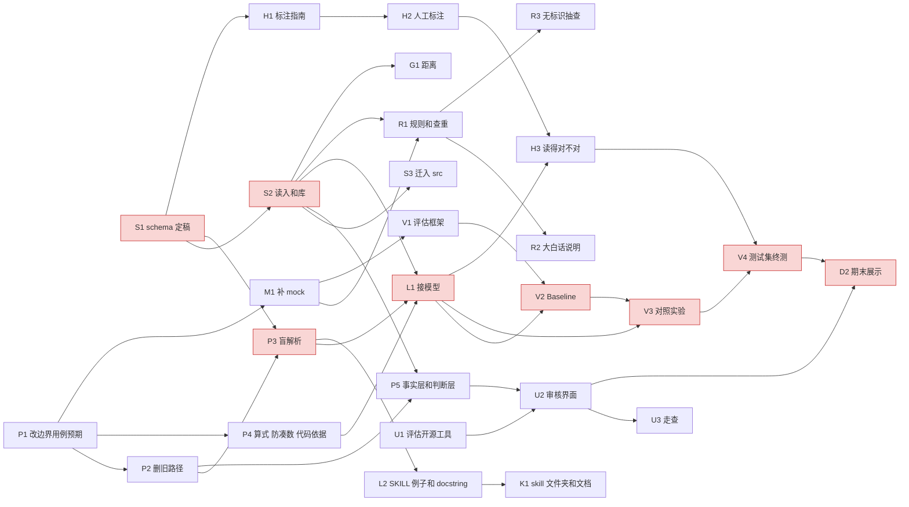
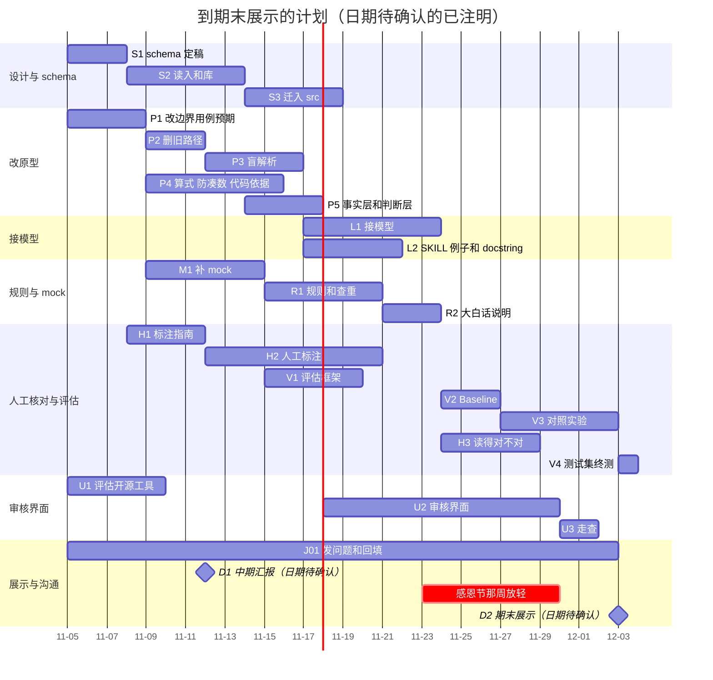

# 项目现状、流程说明与任务计划（2026-11-05 组会用）

依据：`docs/decisions/2026-11-04_framework_decisions.zh.md`（下称"决定记录"，引用写作"决定 3.2"）、任务 06 报告 `docs/analysis/06_research_schema_report.zh.md` 和 `06_schema_v0.yaml`、看板 `docs/status/cards.yaml`。英文版：`2026-11-05_status_and_plan.en.md`。分工建议另见 `2026-11-05_team_roles.zh.md`。

## 先看这一屏

**项目是什么。**一个"齿轮"：把承运商写在运费发票调整里的自由文字，变成干净的结构化数据（每一笔费用是什么、多少钱、文字里怎么说的），交给 PPG 的审核员和下游系统用（决定 1.1）。**判断一笔费用该不该付不在范围内**；给审核员提供帮助其做决定的事实（例如同一票货下有几笔相同的争议）在范围内（决定 1.2）。

**这次的主要变化（2026-11-04 决定）。**

1. 所有记录都进模型，系统不做任何动作；删掉"模型前自动打回"和"自动通知承运商"，所有记录都交给审核员（决定 2.1、2.2）。
2. 推荐只有三种颜色：正常、有标识、建议退回；颜色由规则算，不用模型自评（决定 2.3）。
3. **盲解析**：模型看不到 Delta。代码比对后只告诉模型"不一致"，模型可以坚持或修改，每次尝试都留下来给审核员看（决定 3.1、3.2）。
4. 算式由代码每次验算；带 `$` 却没算进主张的金额必须有原文依据；费用代码要有原文费用名称作依据（决定 3.3、3.5、3.6）。
5. 我们**存自己的解析结果**，做多层面、跨批次的查重；复制品不合并，每份独立审核（决定 4.1、5.2、5.3）。
6. 加拿大在范围内；`US/CAN` 不可信，国家从省州推，币种推算；税的问题在 Jake 确认前一律送人工（决定 4.3、4.4）。
7. 审核界面是正式交付物，先评估开源工具再决定自建范围（决定 1.8、第 6 节）。

**现在处在什么阶段。**设计基线已定（决定记录 + schema v0），原型代码有一半要按新决定改；**模型还没有真正接上过**（B04 红）。看板 24 张卡：浅绿 8、黄 7、红 9、灰 1、深绿 0；成形 33%、验证 0%。浅绿的 8 张里有 5 张的实现和新决定不一致，已在看板上标"待改"（第 6 节）。接下来 4 周的主线是：**schema 落地 → 按决定改原型 → 接模型 → 人工核对和对照实验 → 期末展示**。

**整体计划。**拆成 33 项任务（第 3 节），总人力估计 **300 到 466 人时**，五人平均每人约 60 到 93 小时，到十二月初约 4 周。关键路径：schema 定稿 → 数据读入 → 盲解析改造 → 接模型 → 对照实验 → 测试集终测 → 期末展示（第 4 节）。

**流程图**：`docs/status/pipeline_flow.zh.html`（v5，下载后用浏览器打开）。图上每个节点的说明在本文第 2 节。

---

## 1. 现阶段总结

### 1.1 为什么要做成这样

承运商的说明文字写法很乱：同一种费用十几种写法，金额混着已付、未付、税、合计，一段文字里有时还重复上一次的金额。审核员现在只能逐条读。我们要做的是把"文字说了什么"稳定地拆出来，并把规则内能看出来的异常（算式不对、对不上 Delta、同一笔钱提了两次）标出来，让审核员只看需要看的地方。

验证立场（决定 1.4）：这件事**没有真值**，PPG 的处理和审核员的判断也只是各自的规则。我们的目标是把规则写清楚，确保系统稳定地识别出规则内的异常，并在 mock 数据上验证。唯一的例外是"模型读得对不对"（例如某个数字是不是滞留费的金额），任何人看原文都能确认，这部分要用真实文字加人工核对来测。

### 1.2 做到哪一步了

| 部分 | 状态 | 证据 |
|---|---|---|
| 问题盘点、设计方案、开发/测试集拆分 | 完成（浅绿，样本内） | A1、A2、A3 卡及测试报告 |
| 读入、数字识别、输出、诊断目录 | 代码在，开发集跑过（浅绿，样本内）；读入和输出要按新决定改 | B01、B02、B10、C1 |
| 提交检查、历史检查、汇总推荐、规则、代码表、SKILL.md、工具 | 部分完成（黄）；大多要按新决定改 | B05 到 B09、C2、C3 |
| 接模型 | 未开始（红） | B04 |
| 标注集、baseline、对照实验、测试集终测 | 未开始（红） | V1 到 V4 |
| schema v0、业务调研、数据关系 | 本周完成，待组内讨论 | 任务 06 报告 |
| mock 数据 | 第一轮 360 个事件已生成，预期按旧口径写，要按新决定改 | 仓库外 `ppg-mock-gen` 报告 |

---

## 2. 流程逐环节说明（流程图节点说明）

每个环节写四样：**做什么**；**为什么这样设计**（引用决定记录）；**现状**（按看板口径：浅绿 = 有样本内证据和交付物，黄 = 部分完成，红 = 未开始）；**给 Jake 的问题**（决定记录第 8 节的编号和原文）。负责某个环节的人可以直接接手这里列的问题。

### 2.1 提交争议（承运商）

- **做什么**：承运商在 OTM 里提交发票调整和文字说明；我们拿到的是 OTM 导出的 Excel。
- **为什么**：只按 Excel 开发，不设计 API，读 Excel 的代码集中在一处（决定 1.3）。
- **现状**：不对应卡片。
- **给 Jake 的问题**：无。

### 2.2 0-1 读入（卡片 B01）

- **做什么**：读 Excel，每一行原样存进库（带批次和行号）；按 schema 建立票货、承运商发票、PK、争议的关系；脱敏（人名、邮箱）；检查注入式文字。复制品**不合并**。
- **为什么**：原始行和"我们理解的争议"分开，前者忠实于 Excel，后者是我们的理解（任务 06 C1）；复制品各自独立（决定 5.3）；国家从省州推、币种推算（决定 4.3）。
- **现状**：浅绿（样本内），但**与决定不一致，待改**：现在按五个字段合并重复行，也没有按 schema 存原始行。开发集上的编号关系已经弄清（任务 06 B1、B2）。
- **给 Jake 的问题**：
  - J1. PK、`Invoice/Bill ID`、承运商发票号各是什么？为什么同一笔争议会挂在多个 PK 下，而且有些 PK 的编号日期晚于争议时间？
  - J2. `Invoice Dups Removed` 是谁做的、按什么规则？`Invoice Amount` 是不是"运费加这一笔的 Delta"？真实发票合计在哪里看？
  - J3. `Event Date` 是不是承运商提交的时间？有没有真正的提交时间或版本号？
  - J4. 币种从哪里来？`US/CAN` 这一栏是什么意思，为什么卡尔加里到卡尔加里写的是 `US`？
  - J13. 四种 `Dispute Status` 各代表什么？

### 2.3 2 数字识别（卡片 B02）

- **做什么**：代码找出文字里的每一个数字、日期和认不出的数字区域，编号（`#1`、`D1`、`?1`），检查每个数字字符都被覆盖。
- **为什么**：模型只引用编号、不抄数字，金额永远由代码取值；认不出的区域模型必须逐位写出（决定 3.8）。
- **现状**：浅绿（样本内）：529 种文本覆盖检查全过。
- **给 Jake 的问题**：无。

### 2.4 模型输入（白名单）（卡片 B04 的一部分）

- **做什么**：把脱敏文字、数字表、起讫省份组装成模型输入；**不放 Delta**，也不放承运商、Reason Code、Dispute Status。
- **为什么**：盲解析，避免模型为了凑 Delta 改读法（决定 3.1）。
- **现状**：红；原型的输入里还有 `delta`、`delta_sign`，**待改**。
- **给 Jake 的问题**：无。

### 2.5 3 盲解析（agent 循环）（卡片 B04）

- **做什么**：模型读文字，给出每个数字的解读、整笔主张金额、算式关系、费用代码和依据片段；通过 `submit_line_items` 提交，这是唯一的输出路径。
- **为什么**：模型只负责理解文字和决定调用哪个工具，确定性的事交给代码（`CLAUDE.md`）；不一致时回给模型、记录每次尝试（决定 3.2）。重试次数是 `[待讨论]`，倾向 1 到 2 次。
- **现状**：红：从未调用过真实模型，只有空插口和手写扮演。
- **给 Jake 的问题**：无（费用含义的问题见 2.13 代码表）。

### 2.6 4-5 提交检查（卡片 B07）

- **做什么**：代码检查每次提交：每个数字都有解读；算式每次验算；整笔主张和 Delta 比对；带 `$` 没算进主张的金额要有原文依据；费用代码的依据片段要是费用名称、在别名表里（不在就提示"不常见的对应"）。前后两次尝试自动比较，改了状态的数字列给审核员。
- **为什么**：决定 3.3（算式）、3.5（防凑数）、3.6（代码依据）、3.9（没通过的提交照样显示，用状态字段区分）。"合计被算两次"不再作门槛，只作可选解释（决定 3.4）。
- **现状**：黄（样本内，只有 17 个合成用例）。**待改**：算式引用是可选的、"合计算两次"还是门槛、防凑数没覆盖全部状态、可以说"这里没有数字"。
- **给 Jake 的问题**：
  - J5. 加拿大的税按起点省、终点省，还是别的规则？
  - J2. `Invoice Amount` 是不是"运费加这一笔的 Delta"？（影响拿什么和模型读数比对）

### 2.7 5.5 多层面查重（卡片 B08）

- **做什么**：四层，下层先做：之前批次重新导出的同一行（建议，待确认）；行层面（除 PK 外全部相同）；发票内（同一种费用出现两次）；票货内跨发票。第一份带"后面还有 N 笔相同"的提示，后面每份标红并指向第一份；跨批次时第一份是之前批次里那份。
- **为什么**：决定 5.1 到 5.3；历史以我们存的解析结果为准（决定 4.1）；默认不给模型看历史，给不给作对照实验（决定 4.2）。
- **现状**：黄（样本内）。**待改**：现在是批次运行器在内存里累积历史，没有库，也没有分层。开发集上一票货只有一张承运商发票，"票货内跨发票"这一层只能在 mock 上验证（任务 06 B1）。批次内"第一份"按 PK 还是行号是 `[待讨论]`。
- **给 Jake 的问题**：
  - J1. 为什么同一笔争议会挂在多个 PK 下？（导出复制还是真实的多次 change order）
  - J6. 同一票货后一次的争议，是替换前一次，还是追加？
  - J7. 按天、按次收的费用（例如滞留费），承运商是一次提合计，还是每次提一次？

### 2.8 6a 标识（卡片 B09）

- **做什么**：把各步的诊断按 `rules.yaml` 变成标识，带证据、挂在具体对象上（数字、明细、争议、发票），查重标识指向第一份。模型主动报告的疑问也经规则变成标识。
- **为什么**：规则放 `rules.yaml` 不放 `SKILL.md`，PPG 以后可以增改（决定 1.5）；产品目标是标识不要太多（决定 1.6）；定期从**没有标识**的记录里抽一小部分给人看（决定 1.7）。
- **现状**：黄（样本内）：代码在开发集上跑通，阈值和分数是拍定的。
- **给 Jake 的问题**：
  - J11. 审核员每天处理多少笔、每笔花多久、最担心漏掉什么？核实滞留费、搬卸费这类费用时实际看哪些单据？

### 2.9 6b 推荐颜色（卡片 B09）

- **做什么**：按顺序算颜色：先看有没有需要人看的问题，再看有没有可以退回的问题，都没有才是正常。三种颜色全部交给审核员。
- **为什么**：决定 2.3；全部检查都通过的记录同样交给审核员，只是不加标识。
- **现状**：黄。**待改**：现在是 `AUTO_REJECT / HUMAN_REVIEW / SPLIT_TRUSTED` 三种结局，按分数算。
- **给 Jake 的问题**：无（J11 同时影响这里）。

### 2.10 6c 退回草稿（卡片 C1）

- **做什么**：推荐为"建议退回"时，用诊断目录的固定文字生成一份退回草稿，只给审核员用，审核员可以改。
- **为什么**：系统不做任何动作，"退回"只生成草稿（决定 2.2）。
- **现状**：浅绿（目录本身）。**待改**：现在的草稿有"自动发送"开关。
- **给 Jake 的问题**：
  - J10. 审核员在 OTM 里处理一笔争议有哪几种操作？能否接受先在我们的界面上做决定，再回 OTM 执行？

### 2.11 7 解析结果库与输出（卡片 B10）

- **做什么**：把事实层（解析结果）和判断层（诊断、标识、推荐、草稿）分开存进库；导出 JSON 时也分两块。下游只读通过检查的事实。
- **为什么**：决定 3.9、4.1、4.5；先定表再定 JSON。schema v0 有 18 张表（任务 06 C1）。
- **现状**：浅绿（样本内）。**待改**：现在失败的提交也写进内容、有自动通知事件、没有币种、没有库。
- **给 Jake 的问题**：
  - J8. 导出里有没有最终批准的金额？
  - J4. 币种从哪里来？

### 2.12 审核界面（终点）

- **做什么**：一批跑完列出 N 张发票，每张有颜色和按严重程度分开计数的三角图标；点开先看总览（基本信息、距离、模型读数合计和 Delta 合计的对账、争议列表、标识、之前批次的上下文）；操作按钮在争议一层（批准、退回承运商、清除标识、暂缓），批量操作在发票一层。按钮不改 OTM，只记录审核员的决定。
- **为什么**：决定第 6 节；审核界面是正式交付物，先评估 Label Studio、Argilla 这类开源工具（决定 1.8）。审核员的决定以后可以作为标准答案，但要先筛选（决定 6.5）。
- **现状**：没有卡片，未开始。建议新增一张卡（第 6 节）。
- **给 Jake 的问题**：
  - J10. 审核员在 OTM 里处理一笔争议有哪几种操作？能否接受先在我们的界面上做决定，再回 OTM 执行？
  - J11. 审核员每天处理多少笔、每笔花多久、最担心漏掉什么？核实滞留费、搬卸费这类费用时实际看哪些单据？
  - J9. OTM 里有没有每票货的计划里程？

### 2.13 知识资产

| 节点 | 做什么、为什么 | 现状 | 给 Jake 的问题 |
|---|---|---|---|
| SKILL.md（B05） | 给模型读的操作规程和例子；查重和标识规则不放这里（决定 1.5） | 黄；**待改**：输入里有 Delta，工具表里有试算工具（决定 3.1） | 无 |
| 代码表（C3） | 费用代码、别名、原文名称；"其他"要存原文费用名称，用来扩充代码表（决定 3.6、3.7） | 黄：37 个代码的外部代码都空着；要加别名表 | J12. OTM 有没有 accessorial 代码表？J14. `PURCHASED TRANSPORTATION SURCHARGE` 具体指什么？ |
| 工具 · 税率表（B06） | 给模型的工具；去掉试算工具，可另给计算器（决定 3.3） | 黄；**待改** | J5. 加拿大的税按起点省、终点省，还是别的规则？ |
| rules.yaml（C2） | 查重、标识、推荐的规则；自动生成一份大白话说明给 PPG（决定 1.5） | 黄；要加多层查重和推荐顺序 | J6、J7（见 2.7） |
| 诊断目录（C1） | 每种诊断的固定说明文字 | 浅绿；**待改**：有自动通知用的文字 | 无 |

### 2.14 收到退回（承运商）

- **做什么**：审核员决定退回后，在 OTM 里执行；系统不联系承运商。
- **为什么**：决定 2.2、6.5。
- **现状**：不对应卡片。
- **给 Jake 的问题**：J10（见 2.10）。

### 2.15 和 v4 流程图的差别

删掉"打回预判"节点和"命中：不调用模型""自动通知"两条线；加了"模型输入（白名单）"节点，标明不含 Delta；提交检查回给模型的线改成"不一致：不透露 Delta，可坚持或修改"；历史检查改为"多层面查重"，历史来自我们存的之前批次的解析结果；三种推荐都汇到审核界面；输出节点改为"解析结果库"，事实层和判断层分开。现有实现与决定不一致的节点在角标上标"待改"，颜色不变。

---

## 3. 任务拆分（工作分解）

### 3.1 颜色口径

沿用看板：**浅绿** = 有样本内证据和交付物；**深绿** = 独立样本或人工审核证据，并达到事先写定的门槛。门槛要在跑检验之前写进卡片。下表"完成标准"写的是做到浅绿要什么；能到深绿的另外注明。

### 3.2 工作分解表

人时是区间（低到高）。依赖列里的 J 编号是给 Jake 的问题；"无"表示可以马上开始。

| 编号 | 任务 | 工作线 | 交付物和完成标准 | 依赖 | 人时 | 技能 |
|---|---|---|---|---|---|---|
| S1 | schema v0 组内评审、定稿为 v1 | schema | 决定记录里和 schema 相关的 `[待讨论]` 定下来（第一份怎么排、重试次数）；YAML 升为 v1 | 任务 06 | 4–6 | 业务分析 |
| S2 | SQLite 实现和 Excel 读入 | schema | 由 YAML 生成建表语句；读入开发集 953 行，编号关系与任务 06 B1 数字一致；单元测试。浅绿 | S1 | 16–24 | 写代码 |
| S3 | 代码迁入 `src/`、批量运行器 | schema | 卡片 D1、D2；`uv run pytest` 通过 | S2 | 10–16 | 写代码 |
| P1 | 按决定记录改 Codex 88 个边界用例的预期 | 改原型 | 每个用例标"不变 / 改预期 / 删除"，并写理由；改后的用例集 | 无 | 6–10 | 业务分析 |
| P2 | 删除旧路径：模型前打回、自动通知、旧推荐枚举 | 改原型 | 所有记录进模型；推荐改成三种颜色；改后的 P1 用例相关部分通过 | P1 | 6–10 | 写代码 |
| P3 | 盲解析：输入去掉 Delta、去掉试算工具；不一致反馈和每次尝试留痕 | 改原型 | `SKILL.md` 和输入结构不含 Delta；尝试按 schema 存；合成用例通过 | S1、P2 | 10–16 | 写代码 |
| P4 | 算式验算、防凑数、费用代码依据和别名检查、"其他"存原文名称 | 改原型 | 决定 3.3、3.5 到 3.8 的检查都有，P1 对应用例通过 | P1 | 14–20 | 写代码 |
| P5 | 输出分事实层和判断层，失败提交用状态字段区分 | 改原型 | 导出 JSON 符合任务 06 C6；下游视图只含通过的 | S2、P2 | 6–10 | 写代码 |
| R1 | `rules.yaml`：推荐顺序和四层查重规则 | 规则 | 规则全部在文件里，代码不写阈值；mock 上查重正例全标出、反例不误标。浅绿 | S2、M1；J1、J6、J7 | 12–18 | 业务分析、写代码 |
| R2 | 从 `rules.yaml` 生成大白话规则说明 | 规则 | 中英两版说明；改规则后重新生成即可 | R1 | 4–8 | 写代码、写作 |
| R3 | "无标识记录抽查"流程 | 规则 | 抽样方法、比例和记录表（决定 1.7） | R1 | 2–4 | 业务分析 |
| M1 | 按任务 06 B3 的重复成因补 mock；按新决定改现有 mock 的预期 | mock | 每种成因有正例和只差一个特征的反例；现有 360 个事件的预期按决定改完（例如"完全相同的导出行"不再合并） | P1 | 10–16 | 业务分析、数据处理 |
| M2 | 保留批次的使用规则 | mock | 谁保管、什么时候用、只用一次、结果怎么记；写进评估方案 | 无 | 2–4 | 项目管理 |
| L1 | 接模型（agent 循环） | 接模型 | 官方 SDK；开发集抽样跑通，每次尝试存库；用量四项分开记。卡片 B04 浅绿 | P3、P4、S2 | 16–24 | 写代码 |
| L2 | `SKILL.md` 例子、工具 docstring | 接模型 | 至少 5 个工具，每个 docstring 写给模型读（做什么、何时用、参数、返回、失败）；例子 3 到 6 个，来自开发集并脱敏 | P3 | 8–12 | 写作、写代码 |
| H1 | 人工核对的标注指南和抽样 | 人工核对 | 约 200 条（卡片 V1）的抽样方法；标注指南（每个数字是什么、算不算主张、费用代码） | S1 | 6–10 | 业务分析、写作 |
| H2 | 五人分担人工标注 | 人工核对 | 每条至少 1 人标、20% 双人标；标注存成可比的格式 | H1 | 30–40 | 数据标注 |
| H3 | 模型"读得对不对"的评估 | 人工核对 | 模型读法与人工标注逐数字比对；双人标的一致率；门槛事先写进卡片。可到深绿 | H2、L1 | 6–10 | 数据分析 |
| V1 | 评估框架和指标脚本 | 评估 | 指标定义、脚本、报告模板；mock 上跑通 | M1 | 10–14 | 数据分析、写代码 |
| V2 | Baseline（卡片 V2） | 评估 | 不带护栏的直接抽取结果，作对照 | L1、V1 | 6–10 | 写代码 |
| V3 | 对照实验：盲解析与给 Delta、给不给历史、独立第二次解析、护栏有无 | 评估 | 每组实验的设置、结果和结论；护栏有无对比满足课程要求 | L1、V1、V2 | 16–24 | 数据分析、写代码 |
| V4 | 测试集终测（只跑一次） | 评估 | 在保留的测试集上跑一次，结果原样报告 | V3、H3 | 4–6 | 数据分析 |
| U1 | 评估开源审核工具（Label Studio、Argilla 等） | 审核界面 | 对照决定第 6 节逐条打勾的评估表；推荐自建范围 | 无 | 6–10 | 写代码（安装试用）、业务分析 |
| U2 | 审核界面最小可用版 | 审核界面 | 能按发票看、看到颜色和标识、按钮记录决定和理由；读的是我们的库 | U1、P5 | 24–40 | 写代码 |
| U3 | 审核界面走查 | 审核界面 | 组员扮审核员走一遍，记录问题 | U2 | 4–6 | 业务分析 |
| G1 | 距离：看数据、城市中心点直线距离 | 距离 | 先确认对哪几类费用有用；本地计算，不把地址发给外部服务（决定 6.6） | S2；J9 | 8–12 | 数据处理 |
| K1 | skill 文件夹、文档、README | 文档 | 课程要求的 skill 文件夹结构；架构说明、运行说明 | L2 | 6–10 | 写作 |
| J01 | 给 Jake 的问题：发送、跟进、回填 | 对接客户 | 14 个问题发出；回答回填到决定记录和卡片；每周一次状态 | 无 | 6–10 | 对接客户 |
| D1 | 中期进度汇报（下周，只展示进展） | 展示 | 幻灯片；每人讲自己负责的部分 | 无 | 8–12 | 写作和展示 |
| D2 | 期末展示和报告 | 展示 | 幻灯片、演示、书面报告；每人讲自己负责的部分 | V4、U2 | 24–36 | 写作和展示 |
| T1 | 任务 05 完成后核对任务 06 B3 的"待核实"项 | schema | B3 表更新 | 任务 05 | 2–4 | 数据分析 |
| T2 | 税和币种规则按生效期版本化 | 规则 | J4、J5 回答后实现；未回答前保持"送人工" | J4、J5 | 4–8 | 写代码 |
| T3 | 外部代码映射（EDI 210 代码、OTM 代码）作为代码表的一列 | 规则 | 每个外部代码带代码体系和版本（任务 06 A4.1） | J12 | 4–6 | 业务分析 |

合计 33 项，**300 到 466 人时**。

### 3.3 课程七条技术要求的对应

| 课程要求 | 对应任务 |
|---|---|
| agentic workflow | L1、P3（agent 循环，不一致时回给模型） |
| 预训练模型 | L1（Claude，官方 SDK） |
| 至少 5 个自定义工具，带写给 LLM 读的 docstring | L2（`submit_line_items`、税率查询、相似例子、报告疑问、计算器） |
| skill 文件夹 | L2、K1 |
| 评估方法 | V1、V3、H3、V4 |
| 客户数据保护或模拟数据 | M1、M2（mock 和保留批次）；B01 的脱敏；数据不进版本库 |
| 安全护栏的有无对比 | V3（护栏有无一组） |

### 3.4 任务 06 待办清单的排期

| 待办（任务 06 第 E 部分） | 排进 |
|---|---|
| 1 YAML 生成建表语句 | S2 |
| 2 mock 验证四层查重 | M1、R1 |
| 3 `row_fingerprint` 字段集合 | S1（先按建议做），J1、J3 回答后修 |
| 4 批次内第一份的排序 | S1 |
| 5 重试次数 | S1 |
| 6 任务 05 完成后核对 B3 | T1 |
| 7 诊断代码配对象和层面 | R1 |
| 8 审核界面字段映射 | U1 |
| 9 "通常需要核实什么"写进代码表 | U2（J11 回答后） |
| 10 币种和税版本化 | T2 |
| 11 指标口径文档 | 暂不排（下游的事），J2、J6、J8 回答后再议 |
| 12 距离 | G1 |
| 13 脱敏位置与原文位置对应 | U2 |
| 14 JSON 版本兼容 | 暂不排 |
| 15 外部代码映射 | T3 |

---

## 4. 依赖和关键路径

**关键路径**（红框）：S1 → S2 → P3 → L1 → V2 → V3 → V4 → D2。按人时下限约 96 小时、上限约 146 小时，主要压在写代码的人身上（见分工建议的瓶颈）。

**可以并行的**：P1、U1、J01、M2、D1、H1 现在就能开始，不依赖任何代码；P4 和 P3 可以两个人分头做；H2 人工标注不依赖模型，可以在接模型之前做完；R1 和 L1 互不依赖。

**必须等的**：L1 要等 P3、P4、S2；V3 要等 L1 和 V2；V4 只能在 V3 和 H3 都完成后跑一次；U2 要等 P5 定下输出格式。R1 的查重规则在 J1、J6、J7 回答前先按假设做（第 6 节）。

---

## 5. 时间线

今天是 2026-11-04。中期进度汇报在下周，具体日期待确认，图里暂按 2026-11-12 画；期末展示在十二月初，具体日期待确认，暂按 2026-12-03 画。感恩节那周（2026-11-23 起）任务量放轻。

按这张图，V3 结束大约在 2026-12-01 前后，V4 紧跟着跑，和期末展示之间只有一两天的余量。**如果期末展示定在十二月第一周的前半，V3 要压缩或减少实验组**（第 6 节风险 2）。

---

## 6. 风险和应对

| 风险 | 影响 | 应对 |
|---|---|---|
| 1. Jake 的回答迟迟不来 | J1、J6、J7 卡住查重规则（R1）；J4、J5 卡住币种和税（T2）；J10、J11 卡住审核界面的按钮和提示（U2） | 先按假设往下做，假设写进 `rules.yaml` 和决定记录并标 `[待 Jake]`：多 PK 先当导出复制、只做提示；后一次争议先当"追加"；税一律送人工；币种按国家推算；按钮先用决定 6.4 的四个。回答来了改配置，不改结构 |
| 2. 关键路径太长，期末前做不完对照实验 | V3、V4 被压缩 | V3 先做两组（盲解析与给 Delta、护栏有无，后者是课程要求），给不给历史和第二次解析排在后面；L1 一完成就开始 V2 |
| 3. 写代码的人手集中在一个人身上 | S2、P3、P4、L1 都依赖同一个人 | P2、R2、V1 交给 AI 辅助写代码的组员；P3、P4 拆开两人并行；审核界面优先用开源工具，减少自建 |
| 4. 审核界面范围膨胀 | 吃掉评估的时间 | U1 先定"开源工具能满足的就不自建"；U2 只做最小可用版，界面细节放进待办 |
| 5. 模型调用成本或额度 | 实验组数受限 | 开发时用小样本；用量按四项分开记录（`parse_attempt.usage`）；副本沿用第一份的解析，不重复调用 |
| 6. 测试集被污染 | 终测结果不可信 | 测试集只在 V4 跑一次；开发期间任何人不打开；保留批次的 mock 同样只用一次（M2） |
| 7. mock 和真实数据差距大 | 规则在 mock 上对、在真实数据上标得太多 | 决定 1.6：靠审核员反馈调；"读得对不对"用真实文字人工核对（H3）；无标识记录抽查（R3） |
| 8. 感恩节那周进度停滞 | 关键路径顺延 | 那周只排不在关键路径上的标注（H2）和文档（K1）；关键路径的任务在 11-22 前推进到 L1 开始 |
| 9. 范围漂移到"该不该付" | 违反项目边界 | 所有字段和界面元素按 `CLAUDE.md` 的边界检查；审核员的决定只记录，系统不给建议 |

---

## 7. 看板上的变化和建议

本次没有改任何卡片的颜色。和 2026-11-04 决定不一致的卡片已在看板上注明"待改"，颜色调整只写成建议：

| 卡片 | 现在 | 不一致在哪里 | 颜色建议 |
|---|---|---|---|
| B01 读入与门控 | 浅绿 | 合并重复行；没有按 schema 存原始行 | `[建议，待确认]` 改黄，直到按 schema 重做 |
| B03 打回预判 | 浅绿 | 整个环节被删除（决定 2.1） | `[建议，待确认]` 改灰并注明"已按决定删除" |
| B05 SKILL.md | 黄 | 输入有 Delta、有试算工具 | 保持黄 |
| B06 五个工具 | 黄 | 有试算工具 | 保持黄 |
| B07 提交检查 | 黄 | 合计算两次是门槛、算式可选、防凑数不全 | 保持黄 |
| B08 历史检查 | 黄 | 内存里累积历史，没有分层查重 | 保持黄 |
| B09 汇总与处置 | 黄 | 推荐枚举和按分数的算法 | 保持黄 |
| B10 输出 | 浅绿 | 失败提交写进内容、自动通知事件、没有币种和库 | `[建议，待确认]` 改黄 |
| C1 诊断目录 | 浅绿 | 有自动通知文字，`REC.INPUT.EXPORT_DUPLICATE` 的处理变了 | `[建议，待确认]` 保持浅绿，改完文字后重跑检查 |
| C2 rules.yaml | 黄 | 有自动打回段，推荐按分数 | 保持黄 |
| A3 设计方案 02 | 浅绿 | 部分结论被决定记录取代 | 保持浅绿（分析类，记录的是当时的方案） |

**建议新增的卡片**（`[建议，待确认]`；看板权重的修订不在本轮，所以没有直接加）：schema 实现（S2）、mock 数据（M1）、人工核对（H1 到 H3）、审核界面（U1 到 U3）。
