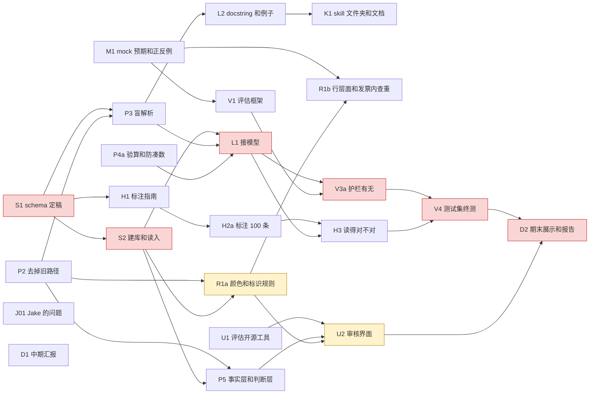
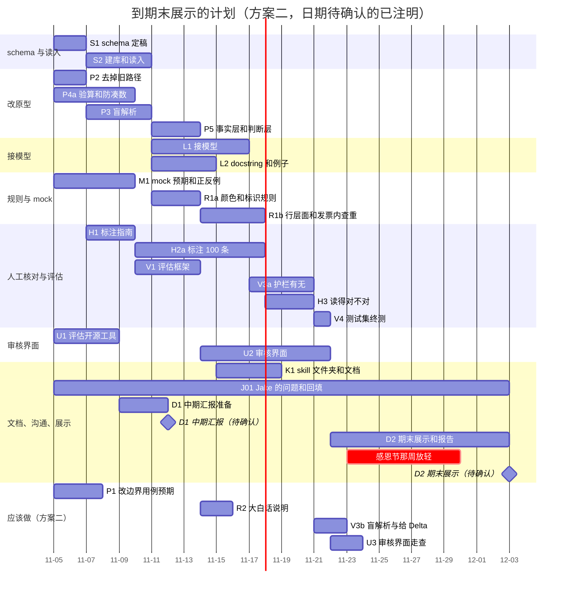

# 工作量重排 v2：按人力预算分层（2026-11-05，任务 08）

依据：`docs/decisions/2026-11-04_framework_decisions.zh.md`（下称"决定记录"，引用写作"决定 3.2"，优先级最高）、任务 07 计划 `2026-11-05_status_and_plan.zh.md`（下称"07 计划"）、任务 06 报告 `docs/analysis/06_research_schema_report.zh.md` 和 `06_schema_v0.yaml`。精炼报告：`2026-11-05_debrief.zh.md`。本轮只有中文版。

**本文件取代的部分**：
- 07 计划第 3 节（任务拆分）、第 4 节（依赖和关键路径）、第 5 节（时间线）、第 6 节（风险和应对），以及"先看这一屏"里"整体计划"一段（300 到 466 人时、五人平均）。
- `2026-11-05_team_roles.zh.md` 和 `.en.md` 全部作废（文件开头已注明）。
- 07 计划第 1 节（现阶段总结）、第 2 节（流程逐环节说明）、第 7 节（看板建议）**仍然有效**。

**所有数字由 `scratch/plan/workload_v2.py` 算出**（任务数据只在这个脚本里维护；`--check` 核对本文第 3 节的表和脚本是否一致）。

---

## 1. 估算前提和口径

**1.1 写代码的方式。**本项目的代码用 Claude Code 辅助写。写代码任务的人时 = 写清需求和验收条件、读 Claude Code 的改动、跑测试、对照决定记录核对、修问题的时间，不是手敲代码的时间。参照：现有原型共约 2,230 行 Python（`scratch/prototype/`），新代码量与之相当。接真实模型（L1）和对照实验（V3a）要反复调试，区间上限按调试多轮估。

**1.2 按人工估的工作。**人工标注、和 Jake 沟通、组内评审、展示和彩排、标注指南、开源工具试用，不能交给 Claude Code，按人工估。人工标注按每条 5 到 7 分钟估（编号后的数字表由代码预先给出，标注员只判断每个数字是什么、算不算主张、费用代码）。展示的彩排按所有参与者的人时合计。

**1.3 固定开销（不分层）。**组会、看板维护、收尾检查：五人、四周、每周 30 到 60 分钟，计 **10 到 20 人时**。07 计划没有计入这一项。

**1.4 分层口径。**
- **必须做**：缺了它，课程七条技术要求或 Jake 批准的范围就不满足；或者它在必须做的任务的依赖链上。Jake 批准的范围按 `CLAUDE.md` 的项目范围（解析文字、费用归类到代码表、和 Delta 做数值核对、一致性标识）加上已定的交付物审核界面（决定 1.8）理解。
- **应该做**：明显提升质量，但缺了也能交付。
- **可以不做**：本轮放弃也不影响交付。

**1.5 难度口径。**
- **低**：不需要写代码，或照现成模板就能做。
- **中**：要写代码，但改动局限在一处，不需要理解整个架构。
- **高**：在关键路径上，或者要理解整个架构才能做（在关键路径上的人工任务也算高）。

**1.6 预算口径。**组员预算固定为 **80 人时**（4 人 × 约 20 小时），含组员自己参加组会的时间。用户本人的小时数 = 方案总人时（含固定开销）− 80。

---

## 2. 和旧文档的差异

**2.1 任务的合并、拆分和新增**（07 的 33 项 → 37 项）：

| 改动 | 内容 | 理由 |
|---|---|---|
| 合并 S3 | 不再单独"迁入 `src/`"：各写代码任务直接写进 `src/` 并带 pytest；批量运行器并入 L1 | 先在原型里改、再整体迁移是两遍工作 |
| 合并 M2 | 保留批次的使用规则并入 V1（评估方案） | 它本来就是评估方案的一节 |
| 合并 V2 | Baseline 并入 V3a：护栏关闭那一组就是"不带护栏的直接抽取" | 07 的 V2 和 V3 的"护栏有无"是同一个对比 |
| 拆 P4 | P4a 算式验算、防凑数（必须做，是护栏）；P4b 费用代码依据和别名表、"其他"存原文名称（应该做） | 两者的层不同 |
| 拆 R1 | R1a 推荐颜色和标识规则；R1b 行层面、发票内查重（必须做）；R1c 票货内跨发票、跨批次查重（应该做） | 开发集上一票货只有一张承运商发票（任务 06 B1），后两层只能在 mock 上验证 |
| 拆 H2 | H2a 标 100 条（必须做）；H2b 再标 100 条到 200 条（应该做） | 100 条足够给出"读得对不对"的结论，200 条让区间更窄 |
| 拆 V3 | V3a 护栏有无（必须做，课程要求）；V3b 盲解析与给 Delta（应该做）；V3c 给不给历史、独立第二次解析（可以不做） | 只有护栏有无是课程要求 |
| 新增 U4 | 审核界面最小可用版之外的部分（批量清除、之前批次上下文、距离、草稿编辑、核实提示），可以不做 | 07 的 U2 把这些写成"放进待办"，没有估人时 |
| 去掉依赖 | P2、P4a、M1 不再依赖 P1（改 88 个边界用例的预期）；P1 降为应该做 | 这些任务的测试直接按决定记录写，不必等旧用例改完 |
| 去掉人名 | 07 的 D1、D2 的完成标准里"每人讲自己负责的部分"删去；风险 3"写代码的人手集中在一个人身上"改写为技能匹配风险（第 9 节） | 用户不分配任务，由组员认领 |

**2.2 按决定 5.3 改正的一处。**07 计划第 6 节风险 1 写的是"多 PK 先当导出复制、只做提示"；任务 06 报告"先看这一屏"最后一段也说 J1 的回答"决定行层面查重的标识是'提示'还是'标红'更合适"。这两处和决定 5.3 冲突。**本计划按决定 5.3**：同一内容的每份复制品是独立记录，第一份带"后面还有 N 笔相同"的提示，**后面每一份都标红、指向第一份，由审核员判断，不因 J1 的回答改变**。J1 的回答只影响标识的说明文字、成因的归类和 mock 的造法。任务 06 报告里的那句话不改，以决定记录为准（决定记录开头的优先级规定）。任务 06 报告第 C 部分的行层面规则表（"后面每份：`flag` 标红"）本来就和决定 5.3 一致。

**2.3 人时的变化。**07 的 33 项 300 到 466 人时；本文 37 项 161 到 255 人时（不含固定开销），下降约 46%。主要原因：
- 写代码为主的任务（07 中 186 到 292 人时）按 Claude Code 辅助重估为 86 到 140 人时，占下降量的大部分。
- 人工为主的任务从 114 到 174 降为 67 到 103：人工标注按每条分钟数重估（200 条从 30 到 40 降为 20 到 28）；展示和报告的初稿交给 Claude Code，人只改和彩排。
- 新增 U4（8 到 12）和固定开销（10 到 20）是 07 没有的。

---

## 3. 任务清单

每项一行。依赖列先写任务，分号后写 Jake 的问题（决定记录第 8 节的编号）；"无"表示可以马上开始。必须做的任务在最后一列写它满足的要求，其他层写理由。人时是区间（低到高）。

### 3.1 schema 与读入

| 编号 | 做什么 | 层 | 人时 | 难度 | 技能 | 依赖 | 完成标准 | 满足的要求或理由 |
|---|---|---|---|---|---|---|---|---|
| **S1** | schema v0 组内评审，定稿为 v1 | 必须做 | 3–5 | 高 | 业务分析 | 无；J1、J3 回答后修 `row_fingerprint` | 和 schema 相关的 `[待讨论]` 定下（批次内第一份按 PK 还是行号、重试次数）；YAML 升为 v1 | 依赖链：S2、P3、H1 都用定稿的表结构 |
| **S2** | 由 YAML 建 SQLite 表，读入 Excel；脱敏、注入检查、国家和币种推算迁入 `src/` | 必须做 | 6–10 | 高 | 写代码、数据处理 | S1；J1、J2、J3、J4、J13（先按假设） | 开发集 953 行读入，编号关系与任务 06 B1 一致；复制品不合并；pytest 通过 | 客户数据保护（脱敏在读入时做）；依赖链：L1、P5、R1a |

### 3.2 按决定改原型

| 编号 | 做什么 | 层 | 人时 | 难度 | 技能 | 依赖 | 完成标准 | 满足的要求或理由 |
|---|---|---|---|---|---|---|---|---|
| **P1** | 按决定记录改 Codex 88 个边界用例的预期 | 应该做 | 4–6 | 低 | 业务分析 | 无 | 每个用例标"不变 / 改预期 / 删除"并写理由 | 多一套回归用例，缺了也能交付 |
| **P2** | 写进 `src/` 时去掉旧路径：模型前打回、自动通知、草稿自动发送、旧推荐枚举 | 必须做 | 2–4 | 中 | 写代码 | 无 | 所有记录都进模型；`src/` 里没有这些路径和相关诊断文字；pytest 通过 | 范围：系统不做任何动作（决定 2.1、2.2）；依赖链：P3、P5 |
| **P3** | 盲解析：输入去掉 Delta、去掉试算工具；不一致时只回"不一致"；每次尝试按 schema 存 | 必须做 | 4–8 | 高 | 写代码 | S1、P2；无 | 模型输入和 `SKILL.md` 不含 Delta；第一次读法可查；合成用例通过 | agentic workflow（不一致时回给模型，模型可坚持或修改，决定 3.2） |
| **P4a** | 提交检查：每个数字有解读、算式每次验算、带 `$` 未计入的金额要有原文依据、前后尝试比较、不许"这里没有数字" | 必须做 | 5–8 | 中 | 写代码 | 无 | 决定 3.3、3.5、3.8 的检查都有，每条有单元测试 | 安全护栏（`submit_line_items` 拒收原文没有的金额）；范围：数值核对 |
| **P4b** | 费用代码依据和别名表；"其他"存原文费用名称 | 应该做 | 4–6 | 中 | 写代码、业务分析 | P3；J12、J14 | 别名表从开发集原文费用名称整理；依据不在别名里打"不常见的对应"（决定 3.6、3.7） | 提升归类质量；缺了仍能按代码表归类 |
| **P5** | 输出分事实层和判断层；失败提交用状态字段区分 | 必须做 | 3–5 | 中 | 写代码 | S2、P2；J8 | 导出 JSON 符合任务 06 C6；下游视图只含通过的（决定 3.9） | 范围：给下游的结构化数据；依赖链：U2 |

### 3.3 规则与查重

| 编号 | 做什么 | 层 | 人时 | 难度 | 技能 | 依赖 | 完成标准 | 满足的要求或理由 |
|---|---|---|---|---|---|---|---|---|
| **R1a** | `rules.yaml` 与代码：标识规则，推荐颜色按"需人看 → 可退回 → 正常"算 | 必须做 | 4–6 | 中 | 写代码、业务分析 | S2、P2；J5、J11 | 阈值全在 `rules.yaml`；税的问题一律送人工；模型主动报告的疑问变成标识（决定 2.3、4.4） | 范围：一致性标识；依赖链：U2 |
| **R1b** | 行层面、发票内两层查重 | 必须做 | 4–7 | 中 | 写代码、业务分析 | R1a、M1；J1、J6、J7（不影响标红规则） | 第一份提示"后面还有 N 笔相同"，后面每份标红并指向第一份；mock 上正例全标出、反例不误标 | 范围：一致性标识（决定 5.2 前两层、5.3） |
| **R1c** | 票货内跨发票、跨批次两层查重 | 应该做 | 3–5 | 中 | 写代码 | R1b；J6 | 跨批次的第一份是之前批次那份；mock 上验证 | 开发集上这两层没有实例，只能在 mock 上验证 |
| **R2** | 从 `rules.yaml` 生成大白话规则说明 | 应该做 | 2–3 | 中 | 写代码、写作 | R1a；无 | 改规则后重新生成即可（决定 1.5） | 给 PPG 看规则；缺了不影响运行 |
| **R3** | "无标识记录抽查"流程 | 可以不做 | 1–2 | 低 | 业务分析 | R1a；无 | 抽样方法、比例、记录表（决定 1.7） | 投入使用之后才用得上 |

### 3.4 mock 数据

| 编号 | 做什么 | 层 | 人时 | 难度 | 技能 | 依赖 | 完成标准 | 满足的要求或理由 |
|---|---|---|---|---|---|---|---|---|
| **M1** | 按新决定改现有 mock 的预期；补 R1b 两层的正例和反例 | 必须做 | 5–8 | 中 | 写代码、业务分析 | 无；J1、J6、J7（成因先按假设） | 360 个事件的预期按决定改完；每种成因有正例和只差一个特征的反例 | 模拟数据（课程要求）；依赖链：R1b、V1 |

### 3.5 接模型

| 编号 | 做什么 | 层 | 人时 | 难度 | 技能 | 依赖 | 完成标准 | 满足的要求或理由 |
|---|---|---|---|---|---|---|---|---|
| **L1** | 官方 SDK 的 agent 循环和批量运行器 | 必须做 | 8–12 | 高 | 写代码 | S2、P3、P4a；无 | 开发集抽样跑通；每次尝试存库；用量四类分开记；卡片 B04 浅绿 | agentic workflow、预训练模型 |
| **L2** | 工具 docstring 和 `SKILL.md` 例子 | 必须做 | 4–6 | 中 | 写作、写代码 | P3；无 | 至少 5 个工具，docstring 写给模型读（做什么、何时用、参数、返回、失败）；3 到 6 个开发集例子，已脱敏 | 至少 5 个自定义工具；skill 文件夹 |

### 3.6 人工核对

| 编号 | 做什么 | 层 | 人时 | 难度 | 技能 | 依赖 | 完成标准 | 满足的要求或理由 |
|---|---|---|---|---|---|---|---|---|
| **H1** | 标注指南和抽样方法 | 必须做 | 3–5 | 低 | 业务分析、写作 | S1；无 | 只从开发集抽；指南写明每个数字是什么、算不算主张、费用代码 | 评估方法："读得对不对"只能靠真实文字加人工核对（决定 1.4） |
| **H2a** | 人工标注 100 条，其中 20 条双人标 | 必须做 | 10–14 | 低 | 数据标注 | H1；无 | 存成可与模型输出逐数字比对的格式 | 评估方法（同上） |
| **H2b** | 再标 100 条，到 200 条 | 应该做 | 10–14 | 低 | 数据标注 | H2a；无 | 双人标比例不变 | 让 H3 的区间更窄 |
| **H3** | 模型"读得对不对"的评估 | 必须做 | 3–5 | 中 | 数据分析、写代码 | H2a、L1；无 | 逐数字比对；双人标一致率；门槛事先写进卡片。可到深绿 | 评估方法 |

### 3.7 评估

| 编号 | 做什么 | 层 | 人时 | 难度 | 技能 | 依赖 | 完成标准 | 满足的要求或理由 |
|---|---|---|---|---|---|---|---|---|
| **V1** | 评估框架、指标脚本；保留批次的使用规则（原 M2） | 必须做 | 4–6 | 中 | 数据分析、写代码 | M1；无 | 指标定义、脚本、报告模板在 mock 上跑通；保留批次只用一次 | 评估方法；测试数据保护 |
| **V3a** | 护栏有无对比（护栏关闭一组即原 V2 的 baseline） | 必须做 | 4–6 | 高 | 数据分析、写代码 | L1、V1；无 | 同一批开发集样本两组结果和结论；门槛事先写进卡片 | 安全护栏的有无对比（课程要求） |
| **V3b** | 盲解析与给模型 Delta 的对比 | 应该做 | 2–4 | 中 | 数据分析 | V3a；无 | 两组结果和结论 | 检验决定 3.1 的核心设计；缺了也能交付 |
| **V3c** | 给不给历史、独立第二次解析 | 可以不做 | 3–5 | 中 | 数据分析 | V3a、R1c；无 | 两组结果和结论 | 决定 4.2、3.5 都把它列为实验，不是交付条件 |
| **V4** | 测试集终测，只跑一次 | 必须做 | 2–3 | 高 | 数据分析 | V3a、H3；无 | 在测试集上跑一次，结果原样报告 | 评估方法 |

### 3.8 审核界面

| 编号 | 做什么 | 层 | 人时 | 难度 | 技能 | 依赖 | 完成标准 | 满足的要求或理由 |
|---|---|---|---|---|---|---|---|---|
| **U1** | 评估开源审核工具（Label Studio、Argilla 等） | 必须做 | 3–5 | 低 | 业务分析（安装试用） | 无；J10 | 对照决定第 6 节逐条打勾；结论：用哪个工具或自建（第 4 节三个版本） | 审核界面交付物（决定 1.8：先看开源工具） |
| **U2** | 审核界面最小可用版（三个版本的人时见第 4 节） | 必须做 | 10–16 | 高 | 写代码 | U1、P5、R1a；J10、J11 | 按发票列出颜色和按严重程度计数的标识，可按"有没有提醒"筛选；点开看到争议、模型说明、标识；争议一层四个按钮记录决定和理由；读我们的库 | 审核界面交付物（决定 1.8） |
| **U3** | 审核界面走查 | 应该做 | 2–3 | 低 | 业务分析 | U2；J11 | 组员扮审核员走一遍，问题记成清单 | 提升可用性 |
| **U4** | 最小可用版之外：批量清除、之前批次上下文、距离、草稿编辑、核实提示 | 可以不做 | 8–12 | 中 | 写代码 | U2、R1c；J9、J10、J11 | 决定 6.1 到 6.4 其余各条 | 最小可用版已能演示和记录决定 |

### 3.9 文档、对接客户、展示

| 编号 | 做什么 | 层 | 人时 | 难度 | 技能 | 依赖 | 完成标准 | 满足的要求或理由 |
|---|---|---|---|---|---|---|---|---|
| **K1** | skill 文件夹、架构说明、README | 必须做 | 3–5 | 低 | 写作 | L2；无 | 课程要求的 skill 文件夹结构；运行说明能照做 | skill 文件夹（课程要求） |
| **J01** | 给 Jake 的 14 个问题：发送、跟进、回填 | 必须做 | 4–6 | 低 | 对接客户 | 无；J1 到 J14 | 问题—回答—回填位置的跟踪表；回答回填到决定记录和卡片 | Jake 批准的范围：`[待 Jake]` 的假设要客户确认 |
| **D1** | 中期进度汇报（只展示进展） | 必须做 | 5–8 | 低 | 写作、展示 | 无；无 | 幻灯片和彩排 | 课程里程碑 |
| **D2** | 期末展示、演示和书面报告 | 必须做 | 14–22 | 高 | 写作、展示 | V4、U2；无 | 幻灯片、演示、报告；终测数字来自 V4。初稿可在 V4 之前写 | 课程里程碑 |

### 3.10 距离与其他

| 编号 | 做什么 | 层 | 人时 | 难度 | 技能 | 依赖 | 完成标准 | 满足的要求或理由 |
|---|---|---|---|---|---|---|---|---|
| **T1** | 任务 05 完成后核对任务 06 B3 的"待核实"项 | 应该做 | 1–2 | 低 | 数据分析 | 任务 05；无 | B3 表更新 | M1 的成因更可靠 |
| **G1** | 距离：先看数据，城市中心点直线距离本地计算 | 可以不做 | 4–6 | 中 | 数据处理、写代码 | S2；J9 | 先确认对哪几类费用有用；地址不发外部服务（决定 6.6） | 决定 6.6 本身要求先确认有没有用 |
| **T2** | 税和币种规则按生效期版本化 | 可以不做 | 2–4 | 中 | 写代码 | 无；J4、J5 | 回答前保持"送人工"（R1a 已覆盖） | 回答前没有可实现的规则 |
| **T3** | 外部代码映射（EDI 210、OTM）作为代码表的一列 | 可以不做 | 2–3 | 低 | 业务分析 | 无；J12 | 每个外部代码带代码体系和版本（任务 06 A4.1） | 依赖 J12，下游才用得上 |

---

## 4. 审核界面的三个版本

U2 放在必须做（决定 1.8）。必须做的合计按最小可用版计；选哪个版本由 U1 的结论和会上决定。

| 版本 | 做法 | 人时 | 能做到 | 做不到 |
|---|---|---|---|---|
| 最小可用版（自建） | 读我们的库的本地网页（例如 Streamlit 一类的轻量工具） | 10–16 | 第 3.8 节 U2 的完成标准全部 | U4 的各项 |
| 替代 A：开源工具配置 | Label Studio 或 Argilla，一笔争议一个任务，标识写在说明里，四个按钮配成选项加理由框 | 5–8 | 逐笔看争议和标识、记录决定和理由 | 按发票看总览、按严重程度计数和排序、发票一层的批量操作 |
| 替代 B：静态页面加表格 | 由库生成只读 HTML 报告；审核员的决定填在 Excel 模板里，再读回库 | 3–5 | 按发票看颜色和标识 | 界面里的按钮；决定要人工导回，容易出错 |

换成替代 A，各方案总人时减 5–8；换成替代 B，减 7–11。替代 B 是否算"审核界面"交付物，要在会上确认。

---

## 5. 汇总

**5.1 按层**

| 层 | 项数 | 人时 | 难度（低 / 中 / 高） | 其中 Claude Code 写代码 | 其中人工 |
|---|---|---|---|---|---|
| 必须做 | 23 | 113–180 | 6 / 9 / 8 | 14 项，66–107 | 9 项，47–73 |
| 应该做 | 8 | 28–43 | 4 / 4 / 0 | 4 项，11–18 | 4 项，17–25 |
| 可以不做 | 6 | 20–32 | 2 / 4 / 0 | 4 项，17–27 | 2 项，3–5 |
| 合计 | 37 | 161–255 | 12 / 17 / 8 | 22 项，94–152 | 15 项，67–103 |
| 固定开销 | — | 10–20 | — | — | — |

**5.2 按工作线**（项数，人时）

| 工作线 | 必须做 | 应该做 | 可以不做 |
|---|---|---|---|
| schema 与读入 | 2 项，9–15 | — | — |
| 按决定改原型 | 4 项，14–25 | 2 项，8–12 | — |
| 规则与查重 | 2 项，8–13 | 2 项，5–8 | 1 项，1–2 |
| mock 数据 | 1 项，5–8 | — | — |
| 接模型 | 2 项，12–18 | — | — |
| 人工核对 | 3 项，16–24 | 1 项，10–14 | — |
| 评估 | 3 项，10–15 | 1 项，2–4 | 1 项，3–5 |
| 审核界面 | 2 项，13–21 | 1 项，2–3 | 1 项，8–12 |
| 文档、对接客户、展示 | 4 项，26–41 | — | — |
| 距离与其他 | — | 1 项，1–2 | 3 项，8–13 |

---

## 6. 和预算对比、方案（建议，待确认）

组员预算 80 人时。下表的总人时含固定开销 10–20；用户本人 = 总人时 − 80；"每周"按 2026-11-05 到 2026-12-03 四周平均。

| 方案 | 做哪些 | 总人时 | 用户本人 | 用户本人每周 | 放弃了什么 | 风险 |
|---|---|---|---|---|---|---|
| 一（建议，待确认） | 只做必须做 | 123–200 | 43–120（中点约 82） | 11–30 | 应该做 8 项、可以不做 6 项 | 没有 88 个边界用例回归；只标 100 条；没有"盲解析与给 Delta"的证据；跨发票、跨批次查重只在设计里 |
| 二（建议，待确认） | 必须做，加 P1、V3b、U3、R2 | 133–216 | 53–136（中点约 94） | 13–34 | H2b、P4b、R1c、T1 和可以不做 6 项 | 别名核对缺失，"不常见的对应"提示没有；跨发票、跨批次查重只在设计里 |
| 三（建议，待确认） | 必须做加全部应该做 | 151–243 | 71–163（中点约 117） | 18–41 | 可以不做 6 项 | 用户本人负荷最高；上限超过每周 40 小时 |

**推导要点**：
- 必须做 113–180 + 固定开销 10–20 = 123–200；减去 80 得 43–120。方案二加 P1（4–6）、V3b（2–4）、U3（2–3）、R2（2–3），共 10–16。方案三加全部应该做 28–43。
- 这四项入选方案二的理由：P1 让改原型有回归用例；V3b 是盲解析这一核心设计唯一的证据；U3 是交付物在演示前唯一的检查；R2 让 PPG 能读规则（决定 1.5）。
- 审核界面换替代 A：方案一的用户本人降为 38–112；换替代 B：36–109。
- **技能匹配决定实际分担。**必须做里的人工任务只有 47–73 人时；组员 80 人时里扣掉自己参加组会的时间（约 8–16），还剩 64–72。如果组员只认领人工任务，必须做里 Claude Code 写代码的 66–107 人时几乎全部落在用户本人身上，方案一的用户本人数字取上半区间。组员认领的写代码任务越多，用户本人越接近下限。

---

## 7. 依赖和关键路径

图里只画必须做的 23 项。**两条关键路径几乎一样长**（按单项人时首尾相接，不考虑人手）：
- 红框：S1 → S2 → L1 → V3a → V4 → D2，37–58 人时。
- 黄框所在：S1 → S2 → R1a → U2 → D2，37–59 人时。

两条都经过 S1 → S2，所以 **S1、S2 一拖，两条一起拖**。V4 前面另一条支线 H1 → H2a → H3 只要标注按时做完就不卡（H3 最早完成在 20–32 人时，V3a 在 21–33）。

**可以马上开始、不依赖代码的**：S1、P2、P4a、M1、U1、J01、D1；S1 定稿后马上能开始 H1。

---

## 8. 时间线

中期汇报暂按 2026-11-12（**待确认**），期末暂按 2026-12-03（**待确认**）。感恩节那周（2026-11-23 起）放轻。下图按方案二画；应该做的四项单独一段。

按这张图，V4 在 2026-11-21 前后跑完，U2 同日完成，期末前有一周多余量（含感恩节）。**这张图按日历排，没有按人手排。**如果写代码的任务大多由一个人做，必须做里的 66–107 人时要在 11-05 到 11-21 这两周半里完成，每周 26 到 43 小时；做不到时 V4 和 U2 会推到感恩节那周或之后（第 9 节风险 2）。

---

## 9. 风险和应对

| 风险 | 影响 | 应对 |
|---|---|---|
| 1. Jake 的回答迟迟不来 | J1、J6、J7 影响查重的说明文字和 mock；J4、J5 影响币种和税；J10、J11 影响审核界面 | 先按假设做，假设写进 `rules.yaml` 和决定记录并标 `[待 Jake]`：**后面每一份复制品都标红，由审核员判断，不随 J1 的回答改变（决定 5.3）**；J1 只改说明文字和成因归类；后一次争议先当"追加"；税一律送人工；币种按国家推算；按钮先用决定 6.4 的四个 |
| 2. 用户本人承担的小时数过高 | 方案一 43–120，上限每周 30 小时；关键路径的写代码任务排队 | 会上先确认组员能认领多少写代码任务；审核界面考虑替代 A；方案一不再往上加 |
| 3. 技能匹配：组员只认领人工任务 | 必须做里写代码的 66–107 人时都落在用户本人身上 | 难度为"中"的写代码任务（P2、P4a、P5、R1a、R1b、M1、L2、H3、V1）改动局限在一处，适合不熟悉整体架构的人用 Claude Code 认领；每项的完成标准已写成可验收的形式 |
| 4. 两条关键路径一样长 | S1、S2 拖期时，接模型和审核界面同时延后 | S1 本周内定稿；U1 马上开始，尽早确定审核界面走哪个版本 |
| 5. Claude Code 前提下的估计偏乐观 | 接真实模型（L1）和实验（V3a）要多轮调试 | 这两项按区间上限排；L1 一跑通就开始 V3a 和 H3 |
| 6. 模型调用成本或额度 | 实验组数受限 | 开发用小样本；用量按四类分开记录（`parse_attempt.usage`）；复制品沿用第一份的解析，不重复调用 |
| 7. 测试集被污染 | 终测结果不可信 | 测试集只在 V4 跑一次；开发期间任何人不打开；保留批次同样只用一次（V1） |
| 8. mock 和真实数据差距大 | 规则在 mock 上对、在真实数据上标得太多 | 决定 1.6：靠审核员反馈调；"读得对不对"用真实文字人工核对（H3）；无标识记录抽查（R3）本轮不做，写进待办 |
| 9. 感恩节那周进度停滞 | D2 的准备时间被压缩 | 计划让 V4 在感恩节前跑完；那周只写 D2 的初稿 |
| 10. 范围漂移到"该不该付" | 违反项目边界 | 所有字段和界面元素按 `CLAUDE.md` 的边界检查；审核员的决定只记录，系统不给建议 |

---

## 10. 课程七条技术要求的对应

| 课程要求 | 对应的必须做任务 |
|---|---|
| agentic workflow | P3、L1 |
| 预训练模型 | L1（Claude，官方 SDK） |
| 至少 5 个自定义工具，带写给 LLM 读的 docstring | L2 |
| skill 文件夹 | L2、K1 |
| 评估方法 | H1、H2a、H3、V1、V4 |
| 客户数据保护或模拟数据 | S2（脱敏）、M1（mock）、V1（保留批次只用一次）；数据不进版本库 |
| 安全护栏的有无对比 | P4a（护栏本身）、V3a（有无对比） |
